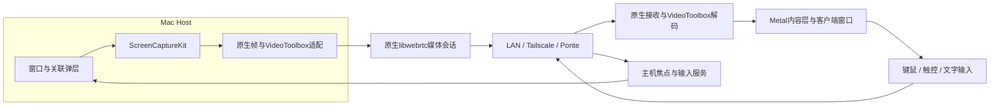

# KKRemote

面向 Mac、iPad 和 iPhone 的原生远程工作空间：把远端 Mac 的应用窗口独立串流到客户端，优先做好清晰度、低延迟和窗口交互，再扩展到整屏远程与多主机窗口工作区。

**当前进入 M0 传输验证阶段。** 仓库包含可构建的 **KKRemote Lab**（Mac 测试源与接收端、iPad / iPhone 接收端），用于验证 H.264 SDR 视频、配对连接和控制消息往返。已打通两台 Mac 经过 Ponte LAN 通道的 1080p60 合成视频；2026-11-13 用户确认 TestFlight 构建 3 经异地 Ponte 能在 iPhone 持续显示动态测试图，实际接收性能待报告量化。已减少高码率下的媒体分片并显著缩短 WebRTC 发送排队；新增 socket 接收路径在五分钟 Ponte LAN 测试中达到零 RTP 丢包与零 NACK，但平均 57.93 fps、仍有冻结，尚未达到稳定 60 fps 的低延迟验收目标。真实窗口捕获、远程输入、HEVC/HDR 与远程 iPad 尚未验证。产品架构版本仍为 v0.3，2026-11-12。

最新手机结果见 [iPhone 构建 5 压力测试](docs/testing/iPhone构建5压力测试.md)：异地 Ponte 1440p 视频已通；45 Mbps 噪声源约三分钟观察中，编码平均 18.94 fps、视频样本均值 30.41 Mbps，仍有卡顿，尚未达到 60 fps。五分钟双 Mac 对照见 [Ponte 接收调度优化](docs/testing/Ponte接收调度优化.md)；上一轮实现与 LAN / Ponte 高码率复测见 [高码率排队优化](docs/testing/高码率排队优化.md)；v1 历史记录见 [Ponte 固定 UDP 实验](docs/testing/Ponte固定UDP实验.md)。TestFlight 已调整为内部测试，流程与构建记录见 [TestFlight 与传输实验](docs/testing/TestFlight与传输实验.md)；构建 2 不含 Ponte 适配器。

## 项目方向

- **窗口优先**：从应用窗口开始，处理菜单、弹层、尺寸变化、焦点和输入映射。
- **原生画质**：保留真实 Retina 像素，规划硬件编解码与完整 HDR 色彩链路。
- **高码率、低延迟**：以实际画质、输入到显示的延迟和有界排队共同评价性能。
- **Apple 客户端**：Mac 作为被控端，支持 Mac、iPad、iPhone 查看与操作。
- **覆盖网连接**：优先适配 Tailscale 与 Surge Ponte，自建公网连接基础设施不在首版范围。
- **逐步扩展**：后续加入传统整屏远程，并探索将多台主机的窗口汇聚到一个客户端工作区。

以上均为产品目标，不代表已经实现。移动端边框、留白、导航与手势的专项体验设计将在整体架构确认后细化。

## 当前架构选择

保留 Apple 原生采集、编解码与呈现；**优先验证原生 libwebrtc，自定义 QUIC 媒体协议作为有条件备选**。最终选型取决于 HEVC/HDR 接入、Ponte 实际媒体连通性及高码率下的延迟表现。

| 层次 | 设计方向 |
|---|---|
| 窗口与捕获 | ScreenCaptureKit、窗口身份与关联弹层管理、公开辅助功能接口 |
| 编解码 | VideoToolbox 硬件编码/解码；HEVC 主选，H.264 兼容路径；Main10/HDR 待验证 |
| 实时媒体 | 原生 libwebrtc，通过自定义工厂接入 VideoToolbox；QUIC 留作必要时对照 |
| 会话与输入 | 主机配对、窗口订阅、几何版本、控制租约、独立光标、键鼠与文字输入 |
| 客户端呈现 | AppKit / UIKit / SwiftUI 外壳，Metal 内容层，能力允许时使用 EDR |
| 网络接入 | LAN、Tailscale、Surge Ponte；主机提供认证信令入口 |



媒体轨道、窗口身份与布局版本需要明确绑定；窗口控制消息与视频帧不能假定天然同步。多主机工作区将采用每台主机独立会话、客户端合成窗口的结构。

详细决策见 [QUIC / WebRTC 传输路线复核](docs/design/传输路线复核.md) 和 [窗口优先架构](docs/design/窗口优先架构.md)。

## 路线图

| 阶段 | 目标 | 状态 |
|---|---|---|
| 研究与设计 | Casement / Jump 机制研究、窗口架构、传输复核、验收计划 | 已形成文档，持续评审 |
| M0：技术关口 | 窗口映射、原生像素、HEVC/HDR、WebRTC 与两种覆盖网验证 | Ponte 双 Mac LAN 媒体已通；高负载延迟、iPad 真机与 Tailscale 待验收 |
| M1：Mac 单窗口 | Mac → Mac 的捕获、传输、显示、输入和重连闭环 | 已规划 |
| M2：窗口系统与性能 | 关联弹层、多窗口、高码率、资源预算、恢复与音频 | 已规划 |
| M3：移动客户端 | iPad / iPhone 的视口、触控、IME 与生命周期 | 已规划 |
| M4：能力与稳定性 | HDR、设备/网络矩阵、画质、延迟和热状态验证 | 已规划 |
| M5：移动体验 | 边框、留白、窗口导航、手势与动画优化 | 后续细化 |
| M6：整屏远程 | 传统桌面远程模式 | 后续阶段 |
| M7：多主机工作区 | 将主机 A、B 等来源的窗口汇聚到客户端画布 | 仅架构预留 |

M0–M4 的窗口功能版不依赖整屏模式或多主机功能。阶段范围、依赖和验收出口见 [分阶段实施计划](docs/design/分阶段实施计划.md)。

## 文档导航

建议依次阅读架构、传输复核和实施计划，再查看具体协议与研究依据。

| 文档 | 内容 |
|---|---|
| [iPhone 构建 5 压力测试](docs/testing/iPhone构建5压力测试.md) | 1440p 异地 Ponte 连通性、45 Mbps 噪声源的降帧、重传与延迟基线 |
| [Ponte 接收调度优化](docs/testing/Ponte接收调度优化.md) | UDP socket、丢包分类、五分钟 LAN/Ponte 对照与剩余降帧问题 |
| [高码率排队优化](docs/testing/高码率排队优化.md) | v2 封装、pacing、编码突发观测、LAN / Ponte 对照与限制 |
| [Ponte 固定 UDP 实验](docs/testing/Ponte固定UDP实验.md) | v1 历史实验、H.264 修正与初始双 Mac 媒体测试 |
| [TestFlight 与传输实验](docs/testing/TestFlight与传输实验.md) | 当前实验工具、构建与签名、远程设备测试流程、已知限制 |
| [窗口优先架构](docs/design/窗口优先架构.md) | 模块边界、窗口捕获、像素、HDR、输入与生命周期 |
| [传输路线复核](docs/design/传输路线复核.md) | QUIC / WebRTC 比较、调整理由与选型门槛 |
| [网络与媒体传输](docs/design/网络与媒体传输.md) | Tailscale、Ponte、信令、媒体恢复和连接诊断 |
| [分阶段实施计划](docs/design/分阶段实施计划.md) | M0–M7 的范围、依赖、投入假设和阶段出口 |
| [协议与坐标契约](docs/design/contracts.md) | 窗口身份、几何、输入、像素与能力协商 |
| [验证与验收计划](docs/design/验证计划.md) | 对照条件、性能指标、设备矩阵和诊断字段 |
| [多主机工作区](docs/design/多主机工作区.md) | 客户端合成、跨主机焦点、资源预算与故障隔离 |
| [Casement 机制研究](docs/research/casement.md) | 窗口、捕获、编码、传输与输入的静态分析 |
| [Jump 机制研究](docs/research/jump.md) | 原生媒体、JRTC/WebRTC、编码与反馈的静态分析 |
| [研究边界与证据等级](docs/research/研究边界.md) | 样本版本、证据类型、工具限制和未解决问题 |
| [早期方案评审](docs/方案评审.md) | 历史比较；现行建议以 v0.3 传输复核为准 |

## 性能与验证状态

架构文档中的码率、延迟和工期为目标预算；本轮观测另见上述实验记录。20–120 Mbps 是计划测试区间；同网 RTT ≤ 10 ms、约 1440p60 时输入到显示 P95 ≤ 80 ms 是起始目标，**不是已达到的性能**。

研究报告来自指定版本的本地静态分析与公开文档。Lab 已通过 Mac 本机真实 WebRTC 回环、双 Mac Ponte LAN 媒体测试，以及早期构建在 iPad 模拟器的视频播放与报告导出检查。当前结果不能证明远程 iPad、公网 Ponte、Tailscale 或长期高码率的低延迟表现。静态调用路径不证明某次会话执行了该路径；支持 10 位编码也不自动证明完整 HDR。

## 仓库结构与使用

```text
kkremote/
├── README.md
├── Apps/TransportLab/          # 共用的 Mac / iOS 实验工具源码与资源
├── Config/                     # 签名示例；真实账号配置由 Git 忽略
├── KKRemote.xcodeproj/          # 可直接打开的 Xcode 工程
├── project.yml                 # XcodeGen 工程定义
├── scripts/                    # 构建、归档、TestFlight 上传
├── docs/
│   ├── design/                 # 当前架构、协议与实施计划
│   ├── research/               # 整理后的研究报告
│   ├── testing/                # 实验与分发流程
│   └── 方案评审.md              # 历史方案
└── research/
    ├── README.md               # 研究资料的版本控制范围
    └── platform/
        └── transport-review-sources.json
```

```bash
git clone git@github.com:cabinw/kkremote.git
cd kkremote
```

安装 Xcode 和 XcodeGen 后，可以构建不需要开发者账号的 Mac 本地测试版：

```bash
brew install xcodegen
scripts/build-lab.sh mac
open .build/DerivedData/Build/Products/Debug/KKRemoteLabMac.app
```

实验依赖固定为社区分发的 `stasel/WebRTC 157.0.0`，包含原生 H.264 VideoToolbox 路径。生产版本仍需评估自建 libwebrtc、可审计依赖与 HEVC/HDR 接入；本实验包不代表最终传输协议已定型。

仓库保存整理后的报告及公开上游来源记录。原始应用交付物、反汇编、符号表、工具诊断和本机运行产物留在本地，由 `.gitignore` 排除。报告保留本地证据文件名、样本哈希和证据标识；这些本地材料不会随克隆提供，详见 [研究资料说明](research/README.md)。
