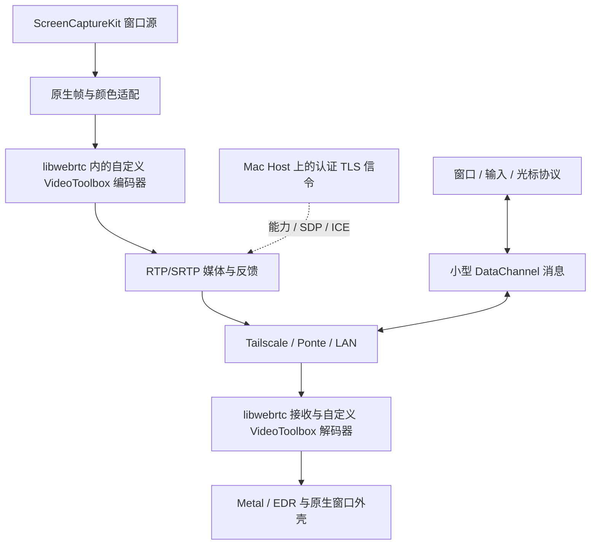

# QUIC 与原生 WebRTC：传输路线复核

设计 v0.3，2026-11-12。**仅分析与方案调整，没有产品代码、构建、抓包或运行性能试验。** 本文替代 v0.2 中“QUIC 首选”的建议；是否冻结为正式实现路线，要经过未来 M0 验证。

## 1. 结论与前次判断的修正

建议保留已选择的 A：Apple 原生采集、硬件编解码、Metal 呈现、窗口优先、Mac → Mac/iPad/iPhone、Tailscale/Ponte。将媒体底座改为 **优先验证原生 libwebrtc，QUIC 自定义媒体作为有条件备选**。不增加云账号、公网信令服务或自建 TURN。

之前偏向 QUIC 的合理原因是：固定服务端点容易解释、任意编码帧及颜色描述容易承载、与 Apple Network.framework 配合紧密。但判断低估了补齐实时媒体系统的成本，也把“Apple 原生”与“WebRTC”错误地放在了互斥位置。WebRTC 的价值不仅是公网穿透，还包括媒体反馈、发送调度与接收恢复；这些在 Wi-Fi、Tailscale 和 Ponte 上仍然重要。

本次调整的是优先验证顺序，不是已经证实 WebRTC 比 QUIC 快。QUIC 有成功实现高性能远程桌面的空间；原生 libwebrtc 也有版本维护、Apple 格式接入和 Ponte 地址适配的成本。两者当前都没有 KKRemote 的实测结果。

## 2. Jump 给了哪些证据，没给哪些

本机 Jump 10.15 系列的实际调用中观察到 JRTC PeerConnection、SDP/ICE、VideoTrackSource、编码完成回调、RtpSender 编码器选择与 DataChannel。结合 VideoToolbox、速率/丢包/RTT回调，可以判断存在 **WebRTC/JRTC + 自定义媒体适配** 的路径。证据与样本哈希见 [Jump 本地研究](../research/jump.md)。

不能据此宣称 Fluid 等于标准 WebRTC、用户当前会话一定走某条分支，或直接使用默认 SDK 就能获得相同体验。没有恢复 Jump 的完整私有协议、所有调参或当前会话的画质/网络状态。

清晰度还取决于像素、色度、编码模式及显示。Jump 官方区分 4:2:0/4:4:4 和 8/10 位，并指出 Mac 的 Hardware 档不提供 4:4:4；因此若对照的 Jump 使用软件 4:4:4，KKRemote 的 HEVC 4:2:0 即使码率很高，彩色文字也未必相当。这与 QUIC/WebRTC 的选择是两个问题。[Jump 编码与色彩档位](https://docs.jumpdesktop.com/viewer/performance/codecs/)

## 3. 公平比较的对象

| 层次 | 原生 libwebrtc 路线 | QUIC 路线 |
|---|---|---|
| 采集 | ScreenCaptureKit，保留原生像素与颜色 | 相同 |
| 编解码 | 自定义原生帧适配、VideoToolbox encoder/decoder factory | 直接管理 VideoToolbox |
| 实时媒体 | RTP/SRTP、RTCP、拥塞估计、pacer、重传/关键帧反馈、接收缓冲 | QUIC DATAGRAM + 需实现的媒体分包、反馈、恢复、帧期限及调度 |
| 控制 | 小型 DataChannel 消息；启动时另有主机信令入口 | QUIC 可靠 streams |
| 可达性 | 约束 ICE 候选到指定覆盖网，主机提供信令 | 连接指定 hostname/IP + UDP 端口 |
| 显示/窗口/触控 | AppKit/UIKit/Metal 与 KKRemote 自有协议 | 相同 |

WebRTC 媒体使用 SRTP；DTLS 用于协商密钥，DataChannel 使用 SCTP/DTLS。不能把所有视频塞入可靠 DataChannel，再认为自动获得 RTP 媒体管线的全部能力。[媒体规范](https://www.rfc-editor.org/rfc/rfc8834.html)、[数据通道规范](https://www.rfc-editor.org/rfc/rfc8831.html)

两条路线都以 UDP 媒体为性能验证对象。不能拿未经调优的浏览器视频会议，和高度定制的原生 QUIC 引擎比较；也不能拿有完整恢复能力的 libwebrtc，和只会发送编码帧的 QUIC 演示比较。

## 4. 高码率：协议名称不是上限

20–120 Mbps 是我们的试验区间，不是某个协议的保证。WebRTC 不是天然只能运行在几 Mbps；当前原生接口有码率上下限、帧率、缩放等参数。但目标上限、拥塞估计、编码器实际输出、分配给各流的预算是不同量；只设置 max bitrate 不能证明达到目标。[libwebrtc RTP 参数](https://webrtc.googlesource.com/src/+/refs/heads/main/api/rtp_parameters.h)

QUIC 同样受拥塞控制。Network.framework 提供的是系统实现，不意味着我们能任意修改内部控制器或得到所有内部统计；应用层也必须随队列和可用带宽减载。

高码率对突发和恢复要求更高。80 Mbps、60 fps 的平均帧约 167 KB；按每个媒体包 1000 字节估算，需要约 167 包。若每包独立丢失概率 0.1%，一帧至少缺一包的概率约为 `1 - 0.999^167 ≈ 15.4%`。这是数学示例，不能当实测损坏帧比例；它说明小丢包也不能忽视。两种路线面对的是同一个问题。

libwebrtc 已有按估计带宽发送的 pacer，平滑关键帧突发，并在媒体流之间调度。我们仍需检查其速率爬升、实际排队及多窗口分配，避免默认策略不适合桌面。QUIC 已有网络拥塞控制，却不代办帧级恢复与质量分配；这些仍需我们设计。[WebRTC pacer 设计](https://webrtc.googlesource.com/src/+/refs/heads/main/modules/pacing/g3doc/index.md)、[QUIC DATAGRAM](https://www.rfc-editor.org/rfc/rfc9221.html)

初始策略：活动窗口保留真实像素和 60 fps 目标，后台先降帧、隐藏先暂停；总视频预算服从链路持续能力并留余量。静态画面无需填满码率。不通过抬高最低码率或关闭拥塞控制强行保持“80 Mbps”。

## 5. 低延迟：比较整条管线及其尾部

从输入到显示，包含输入上行、主机事件处理、应用绘制、捕获、编码、发送排队、传输、接收恢复、解码及显示刷新。协议只占其中几段。QUIC 的握手优势也不能直接换算为持续交互优势。

WebRTC 的接收缓冲和 pacer 确实可能增加延迟；需要选择适合交互的缓冲目标，限制原始帧、编码及发送积压，测量 P95/P99。它没有协议规定的统一“固定增加 100/200 ms”。QUIC 若要处理乱序和丢包，也必须做等待、补发或放弃的取舍，并不会因为没有现成 jitter buffer 就免费得到同等稳定性。

QUIC datagram 不重传，避免因可靠交付等待旧媒体；WebRTC 的 RTP 媒体本身也不是可靠有序字节流。两者都可能因为缺失参考帧而暂时无法解码，可靠控制通道也都可能产生自身的顺序等待。不能简单说“QUIC 无队头阻塞，所以比 WebRTC 快”。

网络物理上限同样存在：1 MB 的关键帧通过 100 Mbps 有效出口，单是发送就约需 80 ms。扩大突发可以减少本地等待，却可能把队列推到 Wi-Fi 或隧道里。应控制关键帧大小/频率、安排发送节奏，并记录最终 frame age。

WebRTC 的默认策略不一定合适，但先调成熟管线，通常比从零补齐恢复和时序更有把握；这是工程风险判断，不是性能测量结论。

## 6. 窗口串流：两者都能做，窗口体验主要在上层

建议每个 host 一条 PeerSession。WebRTC 后端在一个 PeerConnection 中使用多条 video track，共享传输与预算；QUIC 后端将多个 surface 逻辑复用到数据报。**不默认每个窗口都新建一条独立网络连接**，避免多套拥塞估计同时抢占同一链路。

WebRTC 的新增/关闭 track 可能触发协商，连续窗口操作要串行处理；可以验证少量 transceiver 复用方案，但不预分配无限轨道。QUIC 的自定义订阅更直接，不过编码器创建、尺寸变化、参考帧刷新，两条路线都要处理。

窗口控制仍由 KKRemote 实现：窗口身份、菜单/sheet、resize、AX 焦点、输入坐标、客户端边框、safe area、软键盘和本地缩放。换协议不自动修复 Casement 的留白/边缘，也不自动把 Mac 控件排成移动 UI。

媒体轨道与 `surfaceID + generation + streamEpoch + layoutRevision` 必须明确绑定。DataChannel 消息与 RTP 帧没有天然的跨通道有序关系；收到新布局不能立即套在旧帧上。需验证时间戳/帧元数据映射与新 epoch 首帧屏障，原子切换图像与输入坐标。不要假定默认 ObjC API 已暴露全部所需字段。

独立光标与绝对指针状态可走可覆盖、无序的短消息；按下/释放、IME、窗口动作可靠有序，限制单消息尺寸并与大文件传输分开。DataChannel 与 RTP 即便共用端口，也不代表输入自动获得硬优先级；M0 必须测媒体满载时的输入尾延迟。

未来多主机工作区仍是客户端合成：A/B 各一条 PeerSession，各窗口各纹理，全局协调焦点与解码预算。任何一种传输都支持这种结构，无需将不同主机画面重新编码成一个桌面。[多主机设计](多主机工作区.md)

## 7. HEVC、HDR 与 Retina：QUIC 的真正优势在哪里

QUIC 对载荷格式不设媒体语义，发送 HEVC Main10 和私有色彩描述比较直接。代价是我们负责其余媒体机制。libwebrtc 有自定义编码器工厂，能接入 VideoToolbox；不能因此认定默认 Apple SDK 已提供完整能力。[编码器接口](https://webrtc.googlesource.com/src/+/refs/heads/main/api/video_codecs/video_encoder_factory.h)

本次查阅上游源码发现 H.265 packetizer/depacketizer 已存在，但默认 ObjC encoder/decoder factory 未列入 HEVC。这个有限范围的观察既不能推出“WebRTC 不支持 H.265”，也不能推出“Apple HEVC HDR 开箱即用”。[H.265 分包器](https://webrtc.googlesource.com/src/+/refs/heads/main/modules/rtp_rtcp/source/rtp_packetizer_h265.cc)、[默认 Apple 编码器工厂](https://webrtc.googlesource.com/src/+/refs/heads/main/sdk/objc/components/video_codec/RTCDefaultVideoEncoderFactory.mm)

因此 M0 要验证：

1. 原生 CVPixelBuffer/IOSurface 接入，避免隐式转换到 8 位 I420 或 CPU 读回。
2. VideoToolbox HEVC/Main10 编解码工厂、SDP profile/格式协商、RTP 分包与参考链恢复；检查实际level/tier、设备和编码器的像素/码率上限与属性返回，不能靠目标码率设置证明支持120 Mbps。
3. 色域、传递函数、矩阵、range 与必要元数据从采集经码流/控制描述到解码和 Metal/EDR 均一致；10 位本身不等于 HDR。
4. Retina 实际源像素保留，不被默认 source adaptation、编码缩放或客户端二次缩放悄悄降低。
5. resize、SDR/HDR 切换及丢包后能恢复正确配置，适配补丁能局限在可维护边界。

只证明 H.264 SDR 出图不满足路线冻结条件。如果 HEVC/HDR 接入必须长期大幅修改 libwebrtc 内核，QUIC 的可控性就可能胜过其额外媒体工程成本。

## 8. Tailscale：WebRTC 不需要配套公网服务

设计为客户端通过 tailnet hostname/IP 访问 Mac 上的认证 TLS 信令入口，交换能力、SDP 和候选；视频走同一覆盖网。对于可达的 host 候选，可以不配置外部 STUN/TURN 服务。**不设 STUN 服务器不等于去掉 ICE 的 STUN 连通性检查**。[ICE 标准](https://www.rfc-editor.org/rfc/rfc8445.html)

要验证 libwebrtc 在 Mac/iOS 的实际网络枚举与 socket 路由，约束候选到所选覆盖网，避免悄悄选中物理网卡或公网路径。原生 PortAllocator 有端口范围和候选收集相关接口，但配置存在不等于已验证适配 Tailscale。[PortAllocator](https://webrtc.googlesource.com/src/+/refs/heads/main/p2p/base/port_allocator.h)

QUIC 连接明确 tailnet 端点更简单；这主要减少连接配置工作，不构成稳定传输速度的证据。两者都依赖 Tailscale 实际外层路径。走 DERP 时会增加时延并受到吞吐限制；WebRTC candidate 显示 host/UDP，也不能证明 Tailscale 底层直连。高码率资格依据实际路径和持续负载。[Tailscale 性能说明](https://tailscale.com/docs/reference/troubleshooting/poor-performance-tailnet)

## 9. Surge Ponte：选型最大的网络不确定项

Ponte 由 Surge 处理 `.sgponte` 名称，Mac 提供服务端能力，具体通道自动选择。它的名称/DEVICE 访问机制不能直接当成与 Tailscale 相同的双向网卡地址空间。[Ponte 官方说明](https://manual.nssurge.com/features/ponte.html)

QUIC 可连接一个明确的 `.sgponte:UDP端口`，拓扑较直接。WebRTC 的信令入口即使可达，ICE 交换出来的远端 LAN IP 和动态 UDP 端口也未必自动映射到该 hostname。**信令成功不代表媒体成功**；原生 socket 接管、候选地址、反向检查、peer-reflexive 候选和多会话端口使用需要实际验证。

建议验证从受限端口范围和覆盖网候选策略开始；必要时评估原生网络/socket 适配器，使外部端点与内部候选正确映射。不能仅全局替换 SDP 内的 IP 就宣称完成，也不先引入公网 TURN 来掩盖问题。如果需要广泛修改 ICE 核心或新增常驻媒体代理才能稳定连通，重新比较 QUIC。

另一方面，Surge 有版本相关的 `block-quic` 策略，QUIC 并非天然更容易穿过所有配置；WebRTC 流量也必须受真实 UDP 接管/转发能力约束。普通代理对 UDP 的处理不能未经验证套用到所有 Ponte 通道。[Surge QUIC 策略](https://manual.nssurge.com/policies/parameters.html)

必须分别验证 Mac、iPad、iPhone；系统 HTTP 代理成功不证明原生 UDP 被接管。测试时记录 Surge 版本、模式和可观测通道，不修改用户全局配置，不假定两个 VPN 可同时运行。

## 10. 方案调整后的模块与连接结构

原来的 `KKTransport = sendDatagram(bytes)` 抽象不足以承接完整 WebRTC。应将媒体会话边界提高：原生 source/sink、轨道订阅、编码能力、质量预算、输入/控制、统计及生命周期。libwebrtc 适配器封装其对象和队列；VideoToolbox 通过 factory 接入，不在外部再编码一次。

KKSessionCore 保持独立的身份/窗口/几何协议；KKMediaCore 保持原生像素、颜色和能力契约。QUIC 候选将来实现同级媒体后端，内部才是 MediaFragment/RepairRequest，不能要求 RTP 再套一层相同分片协议。详细现行接口见 [窗口架构](窗口优先架构.md) 与 [网络设计](网络与媒体传输.md)。

首版只维护最终选定的一套主媒体后端。当前保留替换边界，不同时交付“双栈智能切换”，也不默认让视频走 WebRTC、控制再走 QUIC，避免增加路由、身份和时序组合。

## 11. 冻结路线的门槛与退出条件

| 关口 | 未来验证 | 通过后/失败后 |
|---|---|---|
| 格式 | Apple 原生缓冲、HEVC SDR/Main10 HDR、Mac与一台HDR移动设备闭环 | 可维护适配通过；需大改内核则比较 QUIC |
| Ponte | 三类客户端，实际 ICE/DTLS/SRTP/DataChannel 和双向交互 | 地址/端口可稳定映射则继续；仅HTTP成功不通过 |
| 高码率 | 同源同codec，20–120 Mbps，关键帧/连续resize、多窗口 | 不能靠降低像素或关闭拥塞控制达标 |
| 延迟与恢复 | LAN基线、0.1/1%丢包、带宽阶跃、媒体满载下输入 | 队列有界、恢复可解释；以P95及画质一起判定 |
| 维护 | 固定上游revision、可重复构建、接口与补丁清单 | 将成本集中在适配层；频繁深度fork是风险出口 |

未来 M0 先做 libwebrtc 的最小垂直验证，预计 2–3 周的探索预算，需设备条件与结果校准。如出现上述阻碍，再安排约 1–2 周、相同采集与编解码条件下的 QUIC 对照；它是调查预算，不是完整自研引擎工期承诺。未实现基本分包、恢复与pacing的QUIC演示不算等价样本。

比较记录首帧时间、码率爬升、实际像素、输入到显示P50/P95/P99、帧龄、冻结、修复开销、CPU/GPU/功耗和30分钟热状态。既测编码后数据的网络段，也测完整窗口交互；不拿 RTT 代替输入到显示。

默认选择：满足全部门槛且适配可维护，就用原生 libwebrtc；只有 QUIC 对已确认的瓶颈带来有意义且可重复的改善，或 WebRTC 的 Ponte/HDR 适配成本过大，才转向 QUIC。若两者都在某条实际隧道上不达标，先解决外层路径/带宽问题，不能宣称换协议必然有效。

## 12. 本轮证据与限制

来源是既有本机静态研究、协议规范、产品官方文档，以及本轮只读查看的 libwebrtc 上游文件。上游查阅时主分支 revision 为 `4cb6c02c9fc8da01de821964e67594e863d41574`；来源清单见 [复核来源记录](../../research/platform/transport-review-sources.json)。它是研究快照，不是已选定的生产依赖版本。

上述工期、码率和延迟均为设计预算；未测量用户现有 Jump 会话、Tailscale/Ponte 配置或任何 KKRemote 实现。移动窗口外壳专项设计、整屏模式和多主机实际功能仍按原范围延后。
