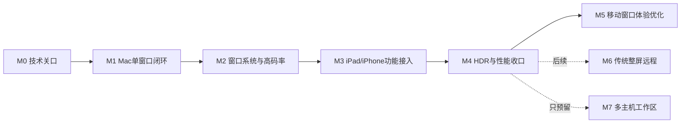

# 窗口优先分阶段实施计划

当前执行调整（2026-11-13）：[窗口产品首版推进](窗口产品首版推进.md)与[任务看板](../board/index.html)为执行入口。现有媒体基础允许直接推进窗口会话、远端选窗与输入；完整传输压力验收不再是开始功能开发的前置条件。下文保留早期设计与工期假设，不代表当前完成状态。

设计 v0.3，2026-11-12。**本轮停留在方案层；下面是未来工作顺序，没有开始写代码或运行这些实验。** 传输建议改为原生libwebrtc优先、QUIC有条件备选，见[复核与门槛](传输路线复核.md)。

## 1. 交付目标与依赖

首个功能版是：Mac Host把用户选择的窗口高质量串流到Mac、iPad或iPhone，经Tailscale/Ponte连接；支持窗口操作、基础输入、正确像素密度、独立光标、明确的HDR/SDR能力及可解释的性能状态。

首版不以整屏模式、自建公网服务、多主机工作区、主机私有虚拟屏或文字精细层为完成条件。移动端基本可用性纳入功能版；边框/留白/导航/动画的专项设计在架构和功能闭环后单独优化。

HDR和Ponte不是等最后才发现的依赖：M0先证明关键链路可行，M1/M2持续覆盖；M4是矩阵与稳定性收口。图中M5表示实机优化顺序；其视觉/交互方案可以在本轮整体架构评审后先讨论，无需等代码完成。

## 2. M0：冻结可实施边界

**输入**：本轮架构、已有REA证据；固定至少一组Mac→Mac及一台移动设备。执行时再记录设备型号、OS、Surge/Tailscale版本与接管模式。

| 工作包 | 将来产出 | 通过标准/不通过出口 |
|---|---|---|
| 公开窗口映射 | SCWindow/AX匹配规则及支持列表 | 同进程同名多窗可区分；歧义禁操作，不偷换成私有桥接 |
| 捕获语义 | 普通窗、菜单、sheet、popover、遮挡/最小化/跨屏结果表 | 明确IndependentWindow可覆盖范围与关联surface策略 |
| 高密度与HDR | 原生buffer、自定义VT工厂、HEVC/Main10协商、1×/2×与HDR闭环 | Mac及一台HDR移动设备的实际像素/附件/显示相符；只出H.264 SDR首帧不足以冻结路线 |
| 原生libwebrtc可用性 | 固定revision、可重复构建、帧元数据映射、pacer/接收队列/修复与满载输入测量 | 大关键帧、小量丢包可恢复；无隐式降采样；适配局限于可维护边界 |
| Tailscale/Ponte | 主机TLS信令、指定覆盖网候选、端口映射、ICE/DTLS/SRTP/DataChannel | 三类客户端真实媒体与双向输入通过；只验证HTTP不算通过 |
| 条件性QUIC对照 | 仅在HDR/Ponte/性能等出现实质阻碍时验证同源同codec的QUIC媒体 | 有基本分包/恢复/pacing后公平比较；不是默认并行开发完整双栈 |
| 协议冻结 | identity、surface/epoch、geometry、input、feedback与上限说明 | 字段能同时支持窗口、未来display及host命名空间 |

M0的原型属于未来技术验证，本轮不创建。原生libwebrtc关口预计2–3个日历周探索预算；若触发QUIC对照，另预留约1–2周调查，仍不等于完整自研媒体引擎工期。Ponte失败先明确候选、端口、接管或底层路径原因，不能删除用户要求或直接加公网TURN替代。HDR/Ponte可维护适配且性能通过则冻结libwebrtc；失败或需要深度fork时依据对照重选。

## 3. M1：Mac → Mac单窗口最小闭环

**范围**：一个host、一个活动主窗口、SDR、原生像素，首先证明基本流畅和交互。HEVC硬编主选，H.264兼容回退。

工作顺序：Host权限/认证信令与配对 → 窗口目录与订阅 → 原生source/VideoToolbox工厂 → 媒体轨道/恢复 → 客户端解码/呈现 → 独立光标 → 键鼠与文字提交 → 断连释放/重连。后端以M0选定结果为准。

交付物：可重复测试的一条窗口链路、连接卡片、必要统计和问题日志。Tailscale/Ponte两类地址均参与，不把它们留到产品完成后才接入。

验收：真实1×/2×无隐式放大；启流即有首帧；点击/拖拽/键盘不串窗；关闭本地查看不关闭远端应用；断连无粘键。对约1440p60负载开始记录P50/P95，性能未达标需拆段定位，不能靠降低到明显模糊的像素通过。

预计2–3个日历周。此阶段可以暂不含音频、复杂弹层与精细客户端外壳，但已定义对应接口。

## 4. M2：窗口系统与高码率低延迟

**范围**：同一host多个窗口、关联弹层、尺寸事务、窗口生命周期与资源预算。

工作包：

1. 主窗口/关联弹层的捕获、层级与输入；resize返回实际尺寸，新epoch首帧后原子提交。
2. 源pixel、编码pixel与客户端drawable全程诊断；高码率档按编码像素预算。
3. 最新原始帧槽、有界编码/发送/接收队列；优先配置和验证libwebrtc的NACK/参考链恢复/pacing，不重复实现第二套。若选QUIC，这些转为自建工作并重估工期。
4. 活动窗口/后台窗口分配预算、遮挡暂停；音频以host/app去重。
5. 网络恢复、VPN暂停/切换端点、Mac睡眠唤醒、窗口关闭重建。

验收：稳定路径支持25/45/80 Mbps等设计档的逐项负载试验；实际吞吐随内容变化，不强制填满。高码率下控制消息不长期积压、关键帧不造成秒级卡顿。1%与3%人为丢包场景要求恢复与有界降级，不要求同时维持最高码率。

在同网RTT≤10ms、60fps、约2560×1440负载下，以P95≤80ms input-to-photon为起始目标；连通性与性能验收分开。预计2–3个日历周。

## 5. M3：iPad / iPhone功能接入

**范围**：复用媒体/协议核心，加入移动平台的生命周期和输入适配，暂不进行最终视觉打磨。

| 工作 | 验收 |
|---|---|
| Metal视口及原生像素管理 | 同样像素负载不因设备类型被固定降到1.5×；能力不足有理由 |
| 窗口切换与来源信息 | 清楚知道当前应用/主机；切窗后旧输入不能投递 |
| 直接触控/触控板 | 点击、拖拽、滚动、本地缩放互不冲突，直接触控默认无远程箭头 |
| 软键盘与IME | 中文组合/提交/删除不重复；键盘显示改变viewport不连续触发远端resize |
| 旋转/safe area/分屏 | 内容矩形和逆映射正确，无上下留白误点和边缘错位 |
| 后台/前台与网络切换 | 及时释放控制，恢复重新核对epoch和资源；不假定后台可持续解码 |
| 外接键盘/指针 | iPad及Mac快捷键归属明确，修饰键无粘住 |

先在iPad上跑通，再覆盖iPhone小视口约束。iOS/iPadOS拟从18+验证，依据实际设备能力协商；最低系统版本待M0核定，不把所有老设备承诺为HDR/高帧率。预计2–3个日历周。

## 6. M4：HDR、覆盖网与性能收口

把M0已通过的HDR路径纳入正式会话协商、格式切换和回退；用同一内容对比SDR、10位SDR与HDR，验证颜色、元数据和实际呈现。高码率不会替代色彩正确性验收。

完整矩阵：Mac、iPad、iPhone × Tailscale/Ponte × 正常路径/受限路径 × 窗口类型。无需穷举所有机型，但必须明确已测范围。高码率资格基于实际净载荷、队列、RTT与温度；中继路径只承诺按预算退化，不把连接成功写成高性能通过。

至少30分钟交互与切窗稳定性、关键帧恢复、窗口尺寸连续改变、多个可见窗口、后台暂停及设备热降档。分离encoder受限、decoder受限、网络受限和source无有效帧四类原因。

交付物：格式/设备支持矩阵、推荐参数与回退策略、性能报告、可复现测试内容、已知应用限制、两类覆盖网的接入与诊断说明。预计2–3个日历周。

**M4完成后得到窗口功能版；不因传统整屏和多主机工作区尚未做而阻塞。**

## 7. M5：移动窗口体验专项，稍后再细化

用户确认整体方案后，可以先开展这一轮视觉/交互设计；本轮先不展开。实机优化再以M3/M4已能真实操作的客户端为依据，重点验证手机/平板上边框、顶部工具栏、底部safe area、键盘、横竖屏和窗口切换的体验。

候选方向：本地轻量外壳、去除重复标题区、可信内容裁切、远端窗口最小尺寸策略、精准操作辅助、窗口组导航。先原型评审，再选择样式；不提前写死“统一裁掉顶部高度”等会破坏远端控件的方案。

验收关注能否完成真实任务、内容面积、误触率与操作步数，而非仅截图好看。此阶段投入在下一轮设计后估算，当前不执行。

## 8. 后续功能位

**M6传统整屏远程**：实现DisplayCaptureAdapter与display枚举、显示器坐标、多屏切换，复用媒体/认证/输入核心。与窗口模式共享会话，但明确控制权；工作量单独估算，首版不实现。

**M7多主机工作区**：先两主机各一窗口，再扩展本地画布、全局资源调度、焦点路由和断线隔离。只依赖成熟的窗口surface与PeerSession，不依赖M6完成。设计约束见[多主机工作区](多主机工作区.md)，本轮不执行。

**主机虚拟画布与文字精细层C**：分别独立决策；前者处理远端显示环境，后者提高静态细节。二者都不应被隐藏计入基础窗口版工期。

## 9. 投入与组织假设

按两名熟悉Apple图形/音视频、能维护原生libwebrtc适配的工程师估算，更新后M0–M4约10–15个日历周、20–30工程周量级。这是阶段探索与排期范围，不能作为交付承诺；不能因为复用WebRTC就预扣未经验证的工期。条件性QUIC调查与最终若转自研后的媒体工程另计，M0结束必须重估。HEVC/HDR适配、窗口弹层与Ponte路径可能成为主导变量。

职责建议：一名侧重Host窗口/采集/编码/传输，一名侧重客户端呈现/输入/生命周期；协议与性能由双方共同评审。这里是未来项目组织建议，不表示当前派出实施人员或开始开发。

旧方案评审中的16–24工程周、v0.2的9–14日历周均为历史粗估；当前范围纳入明确的传输关口。不含M5–M7、商用账号/计费、Windows、浏览器或自建公网基础设施。

## 10. 本轮文档完成标准

架构模块、窗口/视口边界、网络接入、媒体恢复、性能预算、阶段依赖和多主机预留已能逐项评审。剩余不确定项进入M0，不用未验证的性能或“应该没问题”替代验收。用户下一次决定进入某阶段时，再按该阶段范围开始实现。
