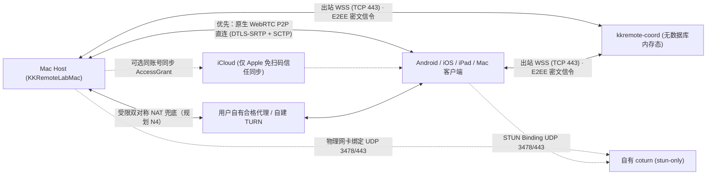

# KKRemote 跨平台原生连接、零知识协调与自有 STUN 实施交接

日期：2026-11-17。文档状态：**第一阶段（跨平台零知识协调 + 自有 STUN + Mac/Android 5G 实机直连投流）已实施并验证；CloudKit 信任同步、应用内用户代理与原生 Android Main10 客户端待分阶段推进**。

源码基线：`1f353da`（`codex/native-connectivity-plan` 初始设计基线）之上实施跨平台协调与原生直连闭环。所有节点地址、域名、密钥与实机标识在本文中均已脱敏（以 `coord.example.com`、`203.0.113.10` 等占位符表示）。

---

## 1. 执行摘要与跨平台架构演进

原始方案以“Apple 同生态 CloudKit 目录与信令”为唯一默认协商入口；在此基础上，新增**原生支持 Android 设备（如折叠屏手机、Android 平板）跨网远控 Mac 独立窗口**的核心诉求后，信令与发现层统一升级为**跨平台零知识协调服务（`kkremote-coord`）+ 自有 `coturn`（`stun-only`）**：

1. **统一跨平台主干，消除双栈割裂**：
   - CloudKit 在 Android 端缺乏原生后台推送与对称系统凭据能力；若 Apple 走 CloudKit 信令、Android 走另一套信令，会导致状态机、安全审计与排障分裂。
   - 现采用统一的 **`HTTPS/WSS`（`TCP 443`）出站长连接零知识协调节点 + `UDP 3478 / 443` 自有 STUN 节点**，macOS、iOS/iPadOS、Android/Web 共用同一套 `P-256` 设备身份、端到端加密（E2EE）握手与原生 WebRTC ICE 打洞状态机。
   - **iCloud 退居可选信任同步层**：Apple 同账号设备未来仅需用 `NSUbiquitousKeyValueStore` / `CloudKit` 私有库同步已签发的 `AccessGrant`（约 300 字节），实现“Apple 同账号免扫码、Android 首次扫码一次永久信任”，底层连接与打洞完全同构。
2. **零媒体中继、零明文秘密保留不变**：
   - 自有节点严格运行 `coturn (stun-only)` 与无数据库内存态 `kkremote-coord`，**绝不转发任何视频、音频、窗口图像或键鼠输入（媒体中继流量恒为 `0 bps`）**；1 Mbps 轻量云主机即可稳定承载。
   - 协调节点只验证 `ECDSA-P256` 公钥所有权并按 `DeviceID` 转发 `AES-256-GCM` 密文，看不到明文配对码、SDP、ICE 候选或窗口标题；首次配对令牌仅置于配对链接 `#fragment` 中，浏览器与客户端不会将其发送至服务端 HTTP 请求行或访问日志。
3. **保留全部既有边界与安全红线**：
   - 保留现有 Surge Ponte / Tailscale / LAN 直连入口与实验配对配置不变。
   - 严格使用 macOS 物理窗口捕获（`enablesWindowLayout = false`），**禁止自动移动或缩放源窗口，禁止恢复虚拟显示器**。

---

## 2. 架构与端到端连接状态机

### 2.1 标准原生连接闭环（已实装验证）

1. **身份初始化**：
   - Mac Host 与客户端各自在本地生成长期 `P-256` 签名密钥对（`ECDSA`）与密钥协商密钥对（`ECDH`），`DeviceID = hex(SHA256(SPKI_sign)[0..15])`（128-bit）。
   - Mac Host 生成一次性配对链接 `https://coord.example.com/#host=<id>&pub=<spki>&kex=<spki>&pair=<token>&name=<label>`；`#fragment` 仅在本地传递。
2. **协调注册与在线感知**：
   - Host 建立出站 `WSS /v1/ws` 发送带时间戳与随机挑战签名的 `hostHello`；协调节点验签后登记内存态在线表，并在 `welcome` 中下发**纯数字 IP STUN 列表**（规避客户端 Fake-IP DNS 污染）。
   - 客户端发送验签的 `clientHello(targetHostID)`，立即获知目标 Host 在线状态与公钥，并在 Host 上下线时收到实时 `hostPresence` 推送。
3. **零知识 E2EE 会话认证与授权签发**：
   - 客户端生成每会话随机 `sessionID`，基于双方 `ECDH` 共享秘密经 `HKDF-SHA256(salt=sessionID, info="kkremote-coord-e2ee-v1")` 派生会话 `AES-256-GCM` 密钥，加密并签名发送 `connectRequest`（携带首次 `pairToken` 或持久 `AccessGrant`）。
   - Host 解密核验通过后，首次连接自动签发绑定客户端 `DeviceID` 的 `ECDSA` 签名凭证 `AccessGrant`；后续重连无需再次扫码或刷新短码。
4. **物理网卡 STUN 探测、DTLS 指纹绑定与双向打洞**：
   - Host 与客户端收集本地及自有 STUN `srflx` 候选，经 E2EE `offer / answer / candidate` 交换，并强制校验加密层声明的 `dtlsFingerprint` 与 SDP 内 `a=fingerprint` 完全一致（阻断中间人替换媒体证书）。
5. **持久 PeerConnection 与带内窗口热切换**：
   - `PeerConnection` 默认以 `deferInitialCapture = true` 建立，无需预先截屏整个桌面；`RTCDataChannel` 打开后，客户端在带内请求窗口目录（`list -> catalog`）、选择目标窗口（`select -> selected`）。
   - **关键改进**：窗口切换直接在现有 `RTCVideoSource` 上热替换 `WindowCaptureSource`（`switchWindowCapture`），**全程不断开 `PeerConnection`、不重做公网 ICE 打洞**；若 Host 未授予 macOS 辅助功能（Accessibility）权限，自动安全降级为只读观看并明确提示。

---

## 3. 已落地代码模块清单

| 模块路径 | 职责与实现要点 | 验证状态 |
|---|---|---|
| [Server/Coord/main.go](../../Server/Coord/main.go)、[ws.go](../../Server/Coord/ws.go) | Go 标准库零外部依赖协调服务端：`hostHello`/`clientHello` 验签、防重放缓存、在线状态订阅、限速 E2EE 密文 `relay`、`/v1/healthz` 探针 | `go test -v ./...` 通过；云端 `systemd` 常驻验证通过 |
| [Server/Coord/web/index.html](../../Server/Coord/web/index.html) | 内嵌零 CDN 移动端 Web/PWA 客户端：`WebCrypto` P-256 E2EE、串行信令队列、H.264 High Profile 优先协商、带内窗口目录、触控点击/右键/双指滚轮/中英文输入栏、5G 端口跳变单次自动重协商 | OPPO 折叠屏（Android 17 / Chrome）5G 实机通过 |
| [DeviceIdentity.swift](../../Apps/TransportLab/Sources/DeviceIdentity.swift) | macOS/iOS 通用 `P-256` 长期身份、沙盒安全默认存储、`AccessGrant` 签发与校验、`#fragment` 配对链接生成、E2EE `AES-256-GCM` 封装与 SDP DTLS 指纹提取 | [test-coord-identity.sh](../../scripts/test-coord-identity.sh) 通过 |
| [CoordSignaling.swift](../../Apps/TransportLab/Sources/CoordSignaling.swift) | 跨平台共享出站 `URLSessionWebSocketTask` 协调信令客户端/服务端角色握手、E2EE 收发、DTLS 指纹强校验 | 单测与跨网实机联调通过 |
| [PhysicalDirectBridge.swift](../../Apps/TransportLab/Sources/PhysicalDirectBridge.swift) | macOS 物理网卡直连桥：通过 `setsockopt(IPPROTO_IP, IP_BOUND_IF)` 绑定真实物理接口（如 `en0`），绕过 Surge Enhanced Mode / Clash `utun` 劫持；排除 STUN 自身 IP 干扰；以 `64 pps` 节拍对运营商 5G CGNAT 顺序端口（`+1..+16, -2..-1`）做温和邻近探测 | 家庭宽带（开启 Surge 增强模式）↔ 电信 5G 实机打洞通过 |
| [RouterPortMapper.swift](../../Apps/TransportLab/Sources/RouterPortMapper.swift) | 轻量级本地网关 NAT-PMP（RFC 6886）与 UPnP IGD 临时 UDP 端口映射尝试，会话结束自动 `unmap` 清理，不报错阻塞主流程 | 已集成于 `PhysicalDirectBridge` |
| [LabH264Factory.swift](../../Apps/TransportLab/Sources/LabH264Factory.swift) | 在保留 `640c33`（Constrained High 5.1）基础上补充 `640033`（High 5.1）与 `42e033`（Constrained Baseline 5.1），避免 Android 解码器回退到 `42e01f`（Level 3.1，上限 720p30）导致 Retina 窗口无视频包 | Retina 窗口 `2334×1578@60fps` 实测通过 |
| [PeerEngine.swift](../../Apps/TransportLab/Sources/PeerEngine.swift)、[LabModel.swift](../../Apps/TransportLab/Sources/LabModel.swift)、[LabCLI.swift](../../Apps/TransportLab/Sources/LabCLI.swift)、[LabApp.swift](../../Apps/TransportLab/Sources/LabApp.swift) | 支持 `sessionOverride`、`iceServers`、`deferInitialCapture`、带内 `RTCDataChannel` 窗口控制、不断连热切换窗口捕获、GUI 跨平台 Host 面板与 CLI `--coord-url` / `--pairing-url-fd` | [test-signaling.sh](../../scripts/test-signaling.sh)、本机 `--self-test` 与 5G 真机通过 |

---

## 4. 实机联调关键发现与排障记录（高价值工程经验）

在“**macOS 家庭宽带 Wi-Fi（运行 Surge Enhanced Mode）↔ Android 折叠屏真机（中国电信 5G 蜂窝网络 + Clash TUN 分流）**”跨网实测中，定位并解决了四个真实生产环境必遇陷阱：

1. **macOS Surge Enhanced Mode / TUN + Fake-IP 双重劫持**：
   - **现象**：开启 Surge 增强模式后，系统 DNS 将 STUN 域名解析为 `198.18.0.0/15` Fake-IP；即便 `libwebrtc` 开启 `ignoreVPNNetworkAdapter = true` 并绑定局域网地址，macOS 路由表仍将发往公网的 UDP 包送入 `utun`，导致 Host 的 `srflx` 候选变成海外代理出口 IP，国内 5G 直连彻底绕远甚至不通。
   - **根治**：① `kkremote-coord` 在 `welcome` 中直接下发数字 IP 形式的 STUN 端点，绕过 Fake-IP DNS；② `PhysicalDirectBridge` 使用 `IP_BOUND_IF` 将媒体与 STUN 探测套接字硬绑定在物理 `en0` 接口上，直接暴露家庭路由器真实公网映射（实测为保留端口的 Endpoint-Independent Mapping `NAT3`）。
2. **运营商 5G CGNAT 端口分配特征与路由器防洪阈值**：
   - **现象**：实测中国电信 5G CGNAT 对外呈 Address-Dependent Mapping 且按连接顺序递增分配端口（两次 STUN 探测呈现 `p, p+1` 特征）；若单次对 50+ 邻近端口无节流并发喷射（`> 1,100 pps`），会触发家用路由器（如华硕系网关）UDP Flood 保护导致出站探测包被静默丢弃。
   - **根治**：将主候选检查与邻近端口扫描解耦，邻近端口限制在 `+1..+16, -2..-1` 并限速至每 `250ms` 一轮（约 `64 pps`），同时严格过滤 STUN 服务器自身迟到响应包，实测 `< 3.5s` 稳定建立 `prflx ↔ srflx` 直连。
3. **Android H.264 Profile-Level 协商陷阱（RFC 6184）**：
   - **现象**：Android Chrome 硬件解码能力表同时包含 `42e01f`（Baseline Level 3.1）与 `6400xx`（High Profile），但不匹配 `640c33`（Constrained High flags），且默认把 `42e01f` 排在首位；一旦协商落入 Level 3.1，macOS VideoToolbox 编码器对超过 `1280×720` 的 Retina 窗口拒绝输出码流（`packetsSent = 0`）。
   - **根治**：Host Offer 同时提供 `640c33`、`640033`、`42e033`，客户端 `setCodecPreferences` 显式将 `6400/640c` 置于首位，成功协商 `profile-level-id=640034`，顺利跑满 `2334×1578 @ 60fps`。
4. **窗口选择必须与 ICE 生命周期解耦**：
   - 旧局域网/Ponte 模式下切换窗口会重建 `PeerEngine`；在公网 CGNAT 环境下，关闭套接字重开会令已打通的 NAT 映射立即失效。改为带内 `RTCDataChannel` 事务 + `RTCVideoSource` 原位热切换捕获源后，切换窗口 `sessionID` 不变、零断流。

---

## 5. 自有 STUN 与协调节点部署规范（1 Mbps 轻量云安全基线）

单台轻量 Linux 云主机即可同时托管 `coturn` 与 `kkremote-coord`（仅信令与地址反射，无媒体转发）：

1. **端口与防火墙规则**：
   - `TCP 443`：Nginx TLS 1.2/1.3 反向代理 `kkremote-coord`（`/` 静态控制页、`/v1/healthz` 健康检查、`/v1/ws` WebSocket 信令），不接管同机其他虚拟主机域名。
   - `UDP 3478` 与 `UDP 443`：`coturn` 监听 `3478`，并通过持久化 `iptables -t nat PREROUTING` 将 `UDP 443` 重定向至 `3478`（提升严苛企业/校园 Wi-Fi 下 UDP 443 可达率）。
2. **`coturn` 强制安全基线（`/etc/turnserver.conf`）**：
   - 必须启用 `stun-only`（实测 `TURN Allocate 0x0003` 请求被直接丢弃，绝无成为开放中继或耗尽 1 Mbps 带宽的风险）。
   - 云主机位于 VPC 弹性公网 IP 后时，配置 `listening-ip=<vpc-ip>` 与 `external-ip=<public-ip>/<vpc-ip>`。
   - 关闭 `no-tcp`、`no-tls`、`no-dtls`、`no-cli`，并在 `systemd` 配置 `MemoryMax=128M`、`Restart=always`。
3. **`kkremote-coord` 强制安全基线**：
   - 仅绑定 `127.0.0.1:18480`，由前置 Nginx 终结 TLS；通过 `/etc/kkremote-coord.env`（权限 `0600`）注入数字 IP STUN 地址。
   - 单 WebSocket 帧上限 `64 KiB`、单连接令牌桶限速 `40 msg/s`、时间戳防重放窗口 `±300s`、不落盘任何客户端连接记录。

---

## 6. 当前验证证据与分阶段剩余路线图

### 6.1 已完成验证项

| 验证项 | 方法与环境 | 结果 |
|---|---|---|
| 协调服务端验签与防伪造 | `cd Server/Coord && go test -v ./...` | **通过**：伪造公钥拒止、在线通知、E2EE 密文透传正常 |
| 长期身份、授权与 DTLS 绑定 | `./scripts/test-coord-identity.sh` | **通过**：`P-256` 签名、配对令牌、`AccessGrant` 跨设备防冒用、E2EE 篡改拒止 |
| 既有 TLS 信令与窗口控制兼容 | `./scripts/test-signaling.sh` | **通过**：`SIGNAL_TESTS_PASSED`，未破坏既有 Ponte / LAN 模式 |
| 本机 `direct-ice` 窗口串流自检 | `KKRemoteLabMac --self-test --route direct-ice` | **通过**：`2560×1440 @ 60fps` 原生解码通过 |
| 自有 STUN 节点线上核验 | 物理网卡直发 RFC 5389 Binding 与 TURN Allocate 测试 | **通过**：`UDP 3478` / `UDP 443` 均正常返回反射地址（约 `12–17ms`），`TURN Allocate` 不响应 |
| **Android 5G 跨网实机联调** | Mac（家庭 Wi-Fi + Surge 增强模式）↔ Android 折叠屏真机（电信 5G 蜂窝网络，关闭 Wi-Fi） | **通过**：首次配对签发 `AccessGrant`、`< 3.5s` 建立 P2P 直连（`prflx ↔ srflx`，RTT 约 `33ms`），`HN Reader` `2334×1578 @ 60fps` 实时解码，带内热切换至 `TextEdit` `1312×844 @ 54–60fps` 不断连，服务端中继流量 `0 bps` |

### 6.2 已知限制与后续阶段（N4–N8）

1. **受限双对称 NAT（随机端口分配 `NAT4 ↔ NAT4`）边界**：
   - 当前家庭宽带端为 `NAT3`（Endpoint-Independent Mapping）时，可与 5G 顺序端口 CGNAT 直接打通；若两端均为**完全随机端口分配的严格对称 NAT 且网关禁用 UPnP/NAT-PMP**，纯 STUN 物理上无法直接穿透，需推进 **N4 应用内用户自有代理适配器（如 `SOCKS5 UDP ASSOCIATE` / `Shadowsocks` 资格探针 + 桥接）** 或用户自建 TURN。
2. **macOS 辅助功能（Accessibility）权限说明**：
   - 远端触控点击、滚轮与键盘注入依赖宿主进程获得系统 `隐私与安全性 -> 辅助功能` 授权；未授权时已验证会自动降级为只读观看并在客户端底部清晰提示，不会导致崩溃或黑屏。
3. **Apple 同账号 iCloud 免扫码信任同步（可选体验增强）**：
   - 底层协调与打洞已在 `CoordSignaling.swift` 就绪；iOS / macOS 客户端可按需把本地 `DeviceIdentity` 签发的 `AccessGrant` 同步到同账号 iCloud KVS / CloudKit 私有库，省去同账号 Apple 设备首次复制配对链接步骤。
4. **原生 Android Kotlin 客户端（第二阶段 `Apps/AndroidClient`）**：
   - 当前 Web/PWA 客户端已覆盖跨网发现、E2EE 配对、60fps H.264 Retina 窗口观看与键鼠触控；若需在 Android 端开启 **10-bit HEVC Main10 PQ HDR 硬解渲染**、系统级返回手势拦截与内嵌用户代理客户端，可在下一阶段基于同一 `kkremote-coord` 协议构建原生 Kotlin 客户端。
5. **长稳与多区域 STUN 冗余**：
   - 当前已完成单台亚洲节点上线与 5G 实机闭环；30 分钟长稳对照（Native P2P vs Ponte vs 用户代理）、Wi-Fi↔5G 实时切网恢复以及第 2/3 台异地备用 STUN 节点按排期独立验收。
