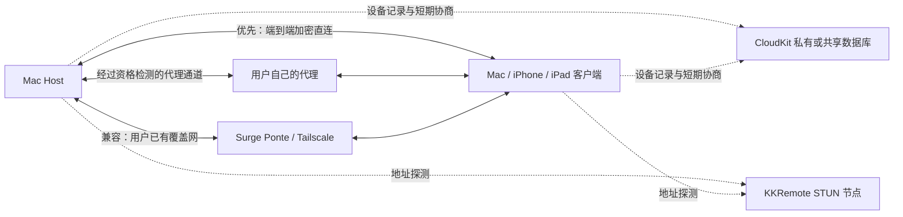

# KKRemote 原生连接、自有 STUN 与用户代理实施交接

日期：2026-11-17。文档状态：**交接设计，尚未实施或部署**。

源码核对基线：`38da1fb`（共享开发分支创建隔离工作区时的提交）。本文不证明当前后台进程、手机构建或服务器运行状态；历史真机结果与当前代码能力分开列出。

## 1. 执行摘要与已经确定的产品边界

目标是：Mac、iPhone、iPad 安装 KKRemote 后，通过 iCloud 找到自己的设备，点击即可连接远端应用窗口；不用为了基本功能另外安装网络软件。

用户已经确定：

1. 默认原生直连：优先局域网、可达 IPv6、IPv4 NAT 穿透。
2. 使用 iCloud 同步设备与协商信息，借鉴 Surge Ponte 的产品方式；推荐用 CloudKit 实现，不声称已还原 Surge 内部 API 或私有协议。
3. KKRemote 可以运营自有 **STUN 地址探测服务**。用户已有十余台分布于不同地区的 VPS，可供选定测试；4 vCPU / 8GB 是可用规格示例。实际服务器清单、SSH 访问方式和部署端口尚未交接。
4. **不提供官方媒体中继，不设计官方中继套餐、配额或收费流量。** 自有 STUN 不转发视频、音频、控制或文件。
5. 直连不成功时，允许使用用户自己的、经检测合格的代理。配置在 App 内导入并持久保存，之后自动使用。
6. 已有 Surge Ponte / Tailscale 网络的用户可以继续使用这些入口；首版复用现有网络，不内嵌它们的 VPN 客户端，也不要求提交第三方账户密码。
7. 媒体复用现有 libwebrtc + VideoToolbox + HEVC Main10 / HDR。当前测试预算为 1440p 面积（3,686,400 像素）、60fps、20Mbps。预算不是所有网络或内容下的性能保证。
8. 产品以窗口串流为主，支持未来 Mac 本地独立窗口与多主机；本任务不实现整屏、客户端布局、虚拟屏或系统级通用 VPN。
9. 保留当前实验入口及配对配置。禁止自动移动或调整源窗口、修改显示器、恢复已停用的虚拟工作区。

**推荐路线：CloudKit 设备目录与启动协商 + 原生 WebRTC ICE 直连 + 自有 STUN + 应用内用户代理适配器。** 用户自建 TURN 可作补充，不能用“要求用户再搭 TURN”代替已有代理支持。

本决策更新了早期“只使用覆盖网、不做公网穿透”的范围；不推翻现有媒体管线与已验证的 Ponte 兼容路径。

## 2. 当前工程：哪些能复用，哪些尚不存在

| 模块 | 当前证据 | 实施影响 |
|---|---|---|
| 媒体引擎 | [PeerEngine.swift](../../Apps/TransportLab/Sources/PeerEngine.swift) 使用 RTCPeerConnection、自定义 VT 编解码工厂；存在原生 ICE 与固定 UDP 两类入口 | 保留媒体编码、RTP/RTCP、拥塞控制和恢复，扩展连接引导 |
| 原生 ICE 配置 | `iceServers = []`、`tcpCandidatePolicy = .disabled`、`continualGatheringPolicy = .gatherOnce` | 有 ICE 基础，但未接入公网 STUN/TURN；切网策略也未完成 |
| 现有信令 | [SignalTransport.swift](../../Apps/TransportLab/Sources/SignalTransport.swift)：直接访问 Host 的 TCP/TLS-PSK；携带 SDP、候选、窗口与桥接协商 | 需要 Host 地址与端口已经可达，不能直接解决双 NAT 下的首次协商 |
| 当前身份 | 实验配对密钥；兼容六位短码，本地哈希不增加短码熵 | 没有完整的设备公钥目录、共享授权、轮换和撤销体系；正式公网身份不能只靠固定短码 |
| Ponte 适配 | [DatagramBridge.swift](../../Apps/TransportLab/Sources/DatagramBridge.swift)：WebRTC loopback UDP ↔ 认证固定端点 UDP | 可作为代理通道的实验接入点；它本身不是 NAT 穿透引擎 |
| 外层封装 | [MediaDatagram.swift](../../Apps/TransportLab/Sources/MediaDatagram.swift)：v2 AES-GCM、每会话派生密钥、序号/重放窗口、有界重组 | 复用安全边界，勿把封装名字当成完整新媒体协议 |
| UDP socket | [UDPSocket.swift](../../Apps/TransportLab/Sources/UDPSocket.swift) 的 socket 实验路径仅 IPv4；Network.framework 基线保留 IPv6 能力 | 新 IPv6 直连优先交给原生 ICE；代理路径不能据此宣称 IPv6-only 已通过 |
| 窗口与输入 | [WindowSession.swift](../../Apps/TransportLab/Sources/WindowSession.swift)、[WindowControl.swift](../../Apps/TransportLab/Sources/WindowControl.swift)；控制消息目前走认证信令 | 要把业务消息与具体信令载体解耦，保留窗口代次、控制租约与去重语义 |
| 云端目录与代理 | 在本次核对的 Apps、scripts、Config、project.yml 中，未发现已接通的 CloudKit、原生 STUN 节点配置或普通代理客户端实现 | 按新增模块实施，不能标作只改 UI 或填一个服务器地址 |
| 并发模型 | 当前 Lab 一个 Host 信令会话主要服务一个观看者、一个窗口媒体代次 | 原生连接先保持此范围，接口预留 host/session/window 身份；不同时扩展无限多窗口 |

历史证据入口：[通信方案 v1](通信方案-v1.md)、[HDR 验证](../testing/HEVC-Main10-HDR验证.md)、[真实体验交接](iOS真实体验接入交接.md)、[精确像素历史报告](../testing/精确像素与窗口恢复验证.md)。Main10、真实窗口、Ponte 与 iPhone 已有实测；原生公网打洞、CloudKit 建连、用户代理与完整 Tailscale 矩阵尚未验收。偶发冻结与长期稳定性仍有遗留问题，不能因新入口连通就宣布修复。

源端原生采集与自动布局曾绑定，是独立画质改进项；本任务不得借机开启自动布局或改窗口大小。

## 3. 架构与连接顺序



普通原生连接流程：

1. Host 运行，客户端在前台；从本地缓存与 CloudKit 读取设备记录。目录存在仅表示“已登记”，不等于此刻在线。
2. 完成设备信任检查；建立本次连接请求、随机挑战、有效期和双方会话身份。
3. 通过 CloudKit 交换启动协商。ICE 收集本地与 STUN 反射候选，分批交换并进行双向连通性检查。
4. 核验对端身份与本次 DTLS 指纹绑定，建立 PeerConnection 和可靠控制通道。此时不要求旧 TCP 信令端口在公网可达。
5. 在认证后的实时控制通道上请求窗口目录、选择窗口、协商 Main10/HDR，然后启用媒体。先建立数据通道、后挂接视频的具体 transceiver 流程必须验证。
6. 直连失败且用户允许使用已配置代理时，走合格代理路径；没有可用路径则给出可解释结果，不静默调用官方 TURN。
7. 连接稳定后，输入、窗口事务和媒体不经过 CloudKit。网络变化触发有限的重新探测、ICE restart 或会话重建。

已配对且端点可达的 LAN / Ponte / Tailscale 会话继续支持现有直达信令。**不要让所有入口都强依赖 iCloud 可用**；其缓存、身份和授权有效性仍要独立检查。

## 4. 可选技术路线与取舍

| 路线 | 收益 | 成本或限制 | 决定 |
|---|---|---|---|
| A：CloudKit + 原生 ICE/STUN | 复用当前媒体栈；直连不再额外经过 loopback 桥接 | 要补齐信令抽象、身份、网络变化和平台验证 | **默认主线** |
| B：用户代理 + 应用内 UDP 适配器 + 现有 WebRTC | 接入用户已有代理；可用桥接做最小实验 | 代理协议、映射稳定性、额外封装、复制与队列均需验证 | **A 的必要补充，独立能力开关** |
| C：用户自建 TURN | libwebrtc 标准接入，便于建立代理性能对照 | 用户需要提供 TURN，普通代理不能直接当 TURN | 可选高级入口，不替代 B |
| D：嵌入 WireGuard / tsnet 等完整网络栈 | 可获得通用覆盖网能力 | 增加运行时、平台集成、授权/许可与运维评估；远超仅窗口串流需求 | 首版不采用；已有 Tailscale 用外部网络入口 |
| E：QUIC DATAGRAM + 自研媒体传输 | 固定端点与应用调度可控 | 必须重新承担媒体分包、反馈、恢复等工作；QUIC 不自动解决发现与打洞 | 不因本任务启动，保留有条件研究 |

路径 A 与 B 共享同一身份、会话和窗口协议，不是两套产品。原生直连尽量绕过现有固定端点桥接；代理兼容初期可复用桥接，测出实际开销后再决定是否深入修改 libwebrtc socket/port allocator。

信令另有两项备选，需要与默认 CloudKit 邮箱方案分开评估：

- **CloudKit 目录 + 可达端点直接握手**：适用于已通 LAN、IPv6 或覆盖网，冷启动少一次云端往返；不能替代受限 NAT 双方的协商。
- **用户自建 WebSocket 协调服务**：仅在 CloudKit 时延不达标、且用户另行选择这种部署模式时评估。不得为了通过测试悄悄增加 KKRemote 官方常驻信令后台。

## 5. CloudKit 目录、协商与信任

### 5.1 推荐数据职责

以下是接口草案，不是已经发布的线协议。实现时统一版本并记录兼容策略。

| 记录 | 内容 | 生命周期 |
|---|---|---|
| DeviceRecord | 稳定 DeviceID、公钥及版本、名称、平台、协议能力、可选端点提示、最近声明时间 | 设备登记到撤销；地址变化不改变设备身份 |
| AccessGrant | Host 与 Viewer 的授权关系、控制/只读权限、版本和撤销状态 | 授权有效期；邀请接受不绕过 Host 的授权策略 |
| ConnectRequest / Answer | SessionID、双方 DeviceID、随机挑战、协议版本、SDP/指纹绑定、过期信息 | 短期；终结后清理，不积累永久连接日志 |
| CandidateBatch | 会话与 ICE generation、批次序号、候选集合、完成标志 | 仅当前协商代次；晚到旧批次丢弃 |

同系统 iCloud 账号使用私有数据库；不同账号通过 CKShare 和共享数据库。这里的账号是设备系统 iCloud，不是 TestFlight 登录邮箱。CKShare 的权限、双方写入位置、通知与记录区域需通过最小样例验证，不假定所有人可随意写同一条记录。[CloudKit 容器](https://developer.apple.com/documentation/cloudkit/ckcontainer)、[共享记录](https://developer.apple.com/documentation/cloudkit/shared-records)

### 5.2 推送、缓存与启动时延

- 通知仅作“数据发生变化”的提示；主动读取当前会话记录，处理通知合并、丢失、乱序和重复。
- 客户端前台连接时允许有时限的刷新重试；Host 使用适合后台常驻的订阅、低频兜底与退避。禁止以永久高频轮询补偿推送不可靠。
- 私有与共享数据库的 subscription 支持范围不同，要选择实际支持的数据库/区域订阅及增量拉取方式，不机械复用 CKQuerySubscription。
- 候选分批提交，避免每个候选一次云写入；批处理窗口和超时通过测量决定。
- 应用自己处理会话过期和垃圾清理，不把记录中的 expiresAt 当作 CloudKit 自动 TTL。
- Host 睡眠、未运行、权限缺失要可解释。CloudKit 推送不是远程唤醒或 iOS 常驻后台的保证。
- Development / Production 容器环境和 schema 必须一致；USB 与 TestFlight 混测前先核对，不能把环境隔离误诊为网络故障。
- 连接建立后不靠 CloudKit 存活维持媒体；云服务临时不可用时保留已认证会话。新连接与撤销状态过期的处理需明确失败策略。

Apple 明确提示通知可能合并，不能依赖通知逐条送达。因此 CloudKit 协商必须先做独立可行性关口，不先承诺秒开。[通知语义](https://developer.apple.com/documentation/cloudkit/ckquerynotification)

### 5.3 身份与凭据

- 每台设备生成本地长期密钥，私钥保存在 Keychain；CloudKit 同步公钥和授权记录，不同步普通明文私钥。
- 首次信任可采用同账号设备确认或二维码指纹确认；跨账号必须明确邀请授权。实施 agent 需写清首次信任的信任根，而非仅验证一份自签名。
- 认证应绑定双方 DeviceID、SessionID、随机挑战、协议版本及本次 SDP/DTLS 指纹；不能只给云端目录验签，却允许会话指纹被替换。
- 敏感协商负载采用经审查的标准加密方案按接收方保护。CloudKit 私有数据库访问控制不等于所有字段天然具备我们声明的端到端加密保证。
- 代理凭据默认本机 Keychain；若提供跨设备同步，单独定义加密与共享范围。普通被邀请观看者不应获得 Host 的代理密码。
- 不把实验固定短码升级成正式公网认证。旧模式保留在明确的实验/兼容边界；无用户指令不得更换现有测试码。
- 设备撤销、账户切换和密钥轮换使旧授权/代次失效；输入不因连接恢复而自动重放。标准 WebRTC 加密仍要有正确的身份绑定。[WebRTC 安全架构](https://www.rfc-editor.org/rfc/rfc8827.html)

## 6. 原生直连与用户代理：必须验证的实现关口

### 6.1 原生 ICE

1. 对 native 路线注入自有 STUN 列表，保持覆盖网固定路线不被新公网候选意外替换。
2. STUN 探测与媒体必须由实际相关 socket/ICE transport 完成。另开一个临时 socket 测得地址再填入 SDP，不证明媒体 socket 可达。
3. 完成候选交换、双向检查、优先级、超时、ICE generation 和 restart；不只交换“公网 IP”。IPv6 同样需要验证防火墙与回包。
4. 不用 A/B/C/D NAT 标签直接决定成功或失败。不同目的地的映射可能不同，以真实 candidate pair 检查为准。
5. 网络变化后候选与映射会失效；如当前 ObjC SDK 无法可靠原位恢复，则使用受控 PeerConnection 重建。需核对实际 M157 依赖能力。
6. 部分工厂网络选项及 field trials 是创建期/进程级配置，不允许为新入口改全局配置导致已有 Ponte 会话被破坏。

ICE 使用 STUN/TURN 机制建立连接，但增加 STUN 地址本身不等于完成上述状态机。[ICE 标准](https://www.rfc-editor.org/rfc/rfc8445.html)

### 6.2 用户代理路径

最小可行方向：Host 在 KKRemote 内建立用户代理的 UDP 通道，通过**同一代理关联/出口**探测映射，向授权 Viewer 发布短期端点。Viewer 向该端点发送认证探测，建立双向通路，再承载原有 WebRTC 会话。

```text
Host WebRTC ↔ 本地代理适配器 ↔ 用户代理 UDP 出口 ↔ Viewer
                                     ↑
                       STUN 只用于探测这个实际出口
```

若 Viewer 网络也需要代理，再单独验证 Viewer 侧代理模式。Host 使用代理不自动意味着必须把其代理凭据发给 Viewer。

**代理资格检测**至少覆盖：

- 协议是否真的支持 UDP，而非仅 HTTP CONNECT / 普通 TCP。
- 代理 UDP 出口是否可从独立远端地址回包；只“访问 STUN 成功”不算通过。
- 映射在 STUN 目的地和实际 Viewer 目的地之间是否保持可用；源地址过滤、出口端口漂移与有效期如何。
- 双向小包及接近实际媒体包大小的认证探测；随后验证持续吞吐、抖动和队列。
- 代理 TCP 控制关联关闭、代理重启、认证过期、蜂窝切换后的恢复。
- 支持的地址族、代理额外头部、是否内部把 UDP 包放进可靠字节流。后者即便可用，也需单列延迟等级。

首个实验协议可以选有公开规范的 SOCKS5 UDP ASSOCIATE；面向用户的协议优先级须结合现有节点配置再定，可评估 Shadowsocks 的具体公开版本与库。普通 SOCKS5 不提供代理凭据的传输加密保证，不作为未经保护的公网敏感凭据方案。Snell 等不默认已兼容；先核对公开实现、使用条件和实际互通。[SOCKS5 标准](https://www.rfc-editor.org/rfc/rfc1928.html)

“支持 UDP”不等于“可做 Ponte 式 Full Cone 代理穿透”。Surge 对代理出口有明确条件；我们需要可复现的准入测试，不宣传支持任意代理。[Ponte 代理条件](https://manual.nssurge.com/features/ponte.html)

普通代理不能填入 `RTCIceServer` 冒充 TURN。短期桥接可复用 KKU2 的认证/重放保护，但 native 路线不必额外套此封装；在没有完成等价安全验证前，不为减少开销删除认证。深入接入 libwebrtc socket factory 属于后续优化选项，需要基准数据支持。

### 6.3 包大小与排队

现有 v2 的 1280 字节是**外层 UDP payload**，不等于整个 IP 包 1280；IPv6、代理封装和覆盖网还会增加头部。沿用旧常数不能宣称满足所有路径 MTU。

新适配器须明确每层字节预算、探测实际可用载荷、处理过大报文，避免依赖 IP 分片。保留有界队列、发送节拍、丢包恢复和逐帧记录；不得将全部视频改走可靠 DataChannel/TCP 来掩盖 UDP 失败。

## 7. Surge 与 Tailscale 兼容策略

| 接入 | 第一阶段实现 | 必须保持的语义 |
|---|---|---|
| Surge Ponte | 使用系统解析的 `<host>.sgponte` 和已配置端口，复用固定 UDP v2 兼容模式 | 不读取其他 App 的私有 iCloud 容器；不修改 Surge 全局规则；不以能解析名称证明媒体可达 |
| Tailscale | 使用已连通 tailnet 的 IP / MagicDNS 名称；候选、路由与权限单独测试 | 仅有账户不等于网络已启用；不要求新账号登录 KKRemote；不悄悄改走公网直连 |
| LAN / 手动端点 | 保留直接认证入口；以后可补 Bonjour 便利发现 | 发现不替代身份验证；不登录 iCloud 时仍可使用已授权可达端点 |

一个 Host 的多个地址归属于同一可信身份，客户端不生成重复设备。用户固定选择某路线时应遵守；自动模式只在用户允许的路线集合中切换，不能自动启停 VPN 或改系统 DNS。

状态必须分开：`requestedRoute`、`effectiveTransport`、`outerPathObservation`、`evidenceSource`。内层 `host/UDP` 或 loopback candidate 不证明外层直连。Tailscale 自己可能使用 DERP；这是用户选择的外部网络服务，不是 KKRemote 官方中继，也不能标成 direct。缺乏可用诊断时显示“覆盖网内部路径未知”。[Tailscale 连接类型](https://tailscale.com/docs/reference/connection-types)

## 8. 自有 STUN 服务部署设计

### 8.1 节点与运行职责

先从用户现有 VPS 中选择 3 台：靠近主要用户的亚洲节点、不同线路的亚洲备用节点、欧美测试节点。无需一次部署全部服务器。

- 每台 4 vCPU / 8GB 可作为有余量的测试起点，**未完成压测，不承诺具体容量**。
- 稳定公网 IPv4，尽量同时提供 IPv6；确认 UDP 可达、带宽/包率限制和已有业务占用。
- 使用固定版本 coturn，启用 `stun-only`；拒绝 TURN Allocation，不开放媒体 relay 端口段，不需要 GPU 或业务数据库。
- 固定版本、配置校验、健康检查、限速、采样日志、指标与回滚方式一起交付。限速需考虑大量合法用户共用运营商 NAT，不能简单按一个 IP 对应一个人处理。
- 默认只做地址反射。若另做 RFC 5780 NAT 行为诊断，需要相应多地址/端口与服务端配置；两台普通 STUN 并不自动等价于完整 RFC 5780 实现。
- 节点选择优先近期成功记录与少量备用，有限探测后扩展；带抖动退避，避免同时唤醒所有节点。
- 节点清单可内置并通过可验证的版本化配置更新；不可把普通云记录篡改成任意代理地址后继续信任。

coturn 官方提供 STUN-only 配置，并说明 NAT 行为诊断的额外条件。[官方配置](https://github.com/coturn/coturn/blob/master/examples/etc/turnserver.conf)

Surge 官方说明 Ponte 2.0 使用其自建 STUN。正确借鉴是“不运营媒体中继、使用轻量基础服务”，而非宣称没有任何官方服务器。[Surge 发布说明](https://kb.nssurge.com/surge-knowledge-base/release-notes/surge-mac-6-release-note)

### 8.2 容量估算，不是实测

规划假设：一次 Binding 请求和响应合计 400 字节；30 秒一次探测、一个节点；不含重试及建连集中突发。请求/秒 = 活跃设备数 × 每轮节点数 ÷ 探测间隔。

| 场景 | 请求/秒 | 收发合计带宽 |
|---|---:|---:|
| 1 万注册用户，10% 同时使用，每人两台设备 | 约 67 | 约 0.21Mbps |
| 1 万台活跃设备 | 约 333 | 约 1.07Mbps |
| 1 万人同时使用，每人两台设备 | 约 667 | 约 2.13Mbps |
| 两万台设备，每 15 秒探测两个节点 | 两节点合计约 2,667 | 两节点合计约 8.53Mbps |

400 字节不是协议常量，实际消息、地址族、重试、多网卡和多候选会改变结果。每 30 秒也不是产品必须永久轮询的频率。常规 ICE 对端连通性/同意维护不应全部计入公共 STUN 负载。[STUN](https://www.rfc-editor.org/rfc/rfc8489.html)、[对端同意维护](https://www.rfc-editor.org/rfc/rfc7675.html)

首轮以每节点 5,000–10,000 请求/秒作为压测目标，记录 CPU、内存、收发 PPS、内核丢包、成功响应率和服务处理延迟。分别测持续负载、集中重连、限速与节点故障。目标不是已知机器能力，失败应先定位 VPS 限制与实现瓶颈。

STUN 不承载 20Mbps 视频。更多全球 STUN 节点可以改善地址探测可达性与建连体验，但不会自动降低设备间媒体的稳态 RTT。

### 8.3 部署前需要交接的私有信息

节点地区、OS/架构、SSH 别名、可用公网地址、IPv6、UDP/带宽限制、端口冲突、允许部署的目录和服务用户，以及测试域名的管理方式。均通过本机忽略配置或既有凭据管理交接，不写进本文或公开仓库。不能仅凭“有十余台 VPS”推断具体服务器访问权与现有业务拓扑。

## 9. 建议模块边界与兼容迁移

下列名字为模块草案，可按工程结构调整：

| 模块 | 责任 | 不负责 |
|---|---|---|
| DeviceDirectory | CloudKit/缓存、同一设备多地址、共享状态 | 编解码、按地址认人 |
| DeviceIdentity / TrustStore | 本地密钥、授权、会话身份与指纹绑定 | 自创密码算法 |
| BootstrapSignaling | CloudKit 请求/应答/候选；兼容直接 TLS 信令 | 高频输入和媒体转发 |
| ConnectionCoordinator | 路线策略、超时、代次、切网、有限恢复 | 系统 VPN/DNS/显示配置 |
| NativeICEConnection | 使用原生 ICE 建立认证媒体与控制路径 | 全局网卡接管 |
| UserProxyTransport | 代理导入、资格测试、UDP 关联和桥接 | 通用代理软件的全部功能 |
| SessionControlChannel | 将窗口/控制事务与 TLS/DataChannel 载体解耦 | 绕过控制租约或重放旧操作 |
| RouteTelemetry | 候选与外层证据、失败阶段、质量与开销 | 从网络标签猜测实际路径 |

状态机建议：发现 → 信任检查 → 启动协商 → 探测 → 对端身份核验 → 控制已就绪 → 媒体中 → 恢复中 / 结束。每个状态有终止条件、可取消性和结构化错误。

重要迁移事项：

1. **先改信令抽象，再接 CloudKit。** 不能仍在 `SignalTransport.connect(host:)` 成功后才允许 ICE 开始；那会保留公网启动死锁。
2. 新模式先验证 data-only PeerConnection 再订阅视频；是否复用 transceiver、何时协商轨道需写入契约。不要为取窗口目录先捕获整个桌面。
3. 桥接密钥和远端 DTLS 指纹要通过新认证启动通道安全交付；不能照搬旧 TLS 安全前提却直接把秘密明文放入普通云记录。
4. 稳定 HostID 与会话内 WindowID 分离；保持 SessionID、media epoch、ICE generation、requestID 与控制租约。丢弃旧会话候选、帧和输入。
5. route 切换不能产生两个控制者或双重发送。对可能已经执行的文字/点击不自动重发；释放旧控制状态后再授予新租约。
6. 原生、代理和覆盖网能力通过版本化 capability 协商。旧客户端继续使用旧入口，未识别新能力时明确回退，不能换含义复用旧枚举值。
7. 将清晰度、移动布局与此任务隔离。新入口首先验证相同源、相同编解码和相同显示设置，避免网络对照被源端变化污染。

## 10. 分阶段任务与退出标准

以下均为 **待执行**，不能把本文件提交算作功能完成。N1 与 N2 是可独立推进的工作；最终合流仍按依赖验收。

| 阶段 | 工作与交付 | 完成条件 |
|---|---|---|
| N0 基线与接口 | 在隔离分支记录依赖 revision、现有测试入口；冻结身份/启动信令/控制通道接口草案 | 现有 Ponte 配置不变；有明确回退点；与 iOS/Mac 客户端负责人对齐能力字段 |
| N1 CloudKit 可行性 | 同账号设备目录、最小可信配对与短期请求/应答；再验证 CKShare | 前后台、推送遗漏、重复/过期、账号切换、开发/生产环境均有结果；记录冷/热连接 P50/P95；未达启动目标时先提交取舍，不暗加官方 WebSocket |
| N2 STUN 测试网络 | 选定 3 个节点，配置 STUN-only、健康检查、压测与回滚 | 公网 IPv4/IPv6 实测；TURN 请求不能建立 relay；单节点故障可回退；日志与配置脱敏 |
| N3 原生直连闭环 | CloudKit 协商 + ICE + 认证 data-only 控制 + 窗口媒体 | 关闭 Surge/Tailscale 后，在具备直连条件的异地网络完成目录、选窗、HDR、控制；旧 TCP 信令端口不要求公网开放；不可直连场景给出正确失败 |
| N4 用户代理实验 | 一个明确协议版本的 App 内适配器、资格探针与网络报告 | 用户提供的合格代理可双向认证并传媒体；不合格代理可解释拒绝；验证客户端需/不需代理两种情况；无需安装第三方 App |
| N5 兼容与路线策略 | LAN、Ponte、Tailscale、多端点同身份、用户固定路线 | 同一设备不重复；不改全局网络配置；路由真实来源可解释；覆盖网不能被静默绕过 |
| N6 生命周期与安全 | Wi-Fi/蜂窝切换、睡眠唤醒、App 前后台、代理失效、授权撤销 | 无无限重连、无粘键/重复文字、无旧代次污染；角色/身份错误拒绝；云中断不无故断开已认证媒体 |
| N7 性能与开销 | 相同真实窗口对照 native / 用户代理 / Ponte；Mac 与 iPhone 实测 | 1440p 面积、Main10 HDR、60fps / 20Mbps 预算下，报告分阶段时延、帧率、队列、CPU/内存/耗电与外层字节；明确未达项 |
| N8 发布交接 | 部署说明、客户端能力说明、测试报告、已知限制、版本与回滚 | 每阶段已验证改动均提交并推送；远端 SHA 核对；安装包与原始报告不代替 Git 提交 |

建议 N1 开始前在执行计划中写明启动时延目标；第一轮可暂以受控网络下热连接 P95 3 秒、冷连接 P95 8 秒作为评估目标，先测不少于 30 次/场景。两项均为候选目标，不是当前能力，也不代表 CloudKit SLA；记录从点击到认证控制就绪及到首帧的两种时长，不能混用。不达标时要区分云协商、打洞、编码首帧，避免通过降低测试标准隐藏问题。

N7 先 5 分钟冒烟，再对有代表性的合格线路做 30 分钟对照；无必要不扩大长测。帧率以真实源供帧为前提，23.976fps 视频不能要求 60 个不同内容帧；静态窗口不靠填充达到 20Mbps。既有偶发冻结问题单独列出，不扩大本任务去重做显示系统。

## 11. 验收矩阵与需要留下的证据

| 维度 | 必测场景 | 证据 |
|---|---|---|
| CloudKit | 同账号、跨账号、未登录、配额/限流、通知延迟、旧记录、离线缓存 | 会话阶段时间线、读写计数与错误类别；不上传明文 SDP/凭据 |
| 直连 | 同 LAN、跨宽带、蜂窝→家庭宽带、IPv6、受限 NAT、UDP 不通 | 实际 candidate pair 与认证结果；成功率必须写明样本分母 |
| 用户代理 | 合格 Full Cone UDP、仅 TCP、受限回包、端口漂移、代理重启 | 独立远端回包证据、映射与包大小测试、失败原因 |
| 覆盖网 | Ponte 与 Tailscale 分别启用、外层状态未知、断开覆盖网 | 所选路线与实际可见证据；不把端点字符串当外层路径证明 |
| 安全 | 错设备、过期/重放协商、篡改指纹、撤销后新连接、旧 epoch 输入 | 确认拒绝点及无误执行；不要把完整私钥或测试码写报告 |
| 媒体 | 桌面滚动、视频、HDR 灰阶、静态文字、正常与受控弱网 | 源/编码/接收/解码/显示计数；RTP/桥接队列、帧龄、实际码率 |
| 资源 | 待机、连接中、媒体中、切网、断开后 | CPU、RSS、网络字节、手机热状态；退到空闲后的资源释放 |
| STUN | 持续/突发请求、单节点停机、丢包、限速 | PPS、成功率、服务处理延迟与客户端 RTT 分开；无媒体 relay |

全球 VPS 适合负载发生器和可控网络试验，不能代替真实家庭 NAT、运营商蜂窝与受限网络。STUN 节点选得更近不等于视频直连 RTT 一定更低。

建议报告字段：build/revision、平台、协议能力、requestedRoute、effectiveTransport、outerPathObservation/evidenceSource、session/epoch（脱敏）、CloudKit/STUN/ICE/身份/首帧耗时、候选类型、探测次数、实际字节、故障与回退原因。没有时钟同步依据时不要把跨设备时间戳相减声称单向时延。

已有回归入口包括 `scripts/test-signaling.sh`、`scripts/test-media.sh`、`scripts/test-transport-policy.sh`、`scripts/test-main10.sh`，构建入口为 `scripts/build-lab.sh`。它们验证原有实现，不等于新 CloudKit/代理能力已通过。新增测试应覆盖身份与状态机失效边界、映射和代理实际行为；文档阶段不用启动媒体或安装手机包。

## 12. 未决问题与禁止偷换的实现假设

| 未决项 | 需要谁/什么证据 | 当前处理 |
|---|---|---|
| 实际 STUN 节点与域名 | 用户交接节点访问清单；执行 agent 做资源盘点 | 不采购、不猜测公网 IP、不占用已有服务端口 |
| CloudKit 冷启动是否满足体验 | N1 真机与后台 Host 数据 | 先设关口；不承诺即时推送或无限免费请求 |
| 首个生产代理协议与库 | 用户已有节点类型、公开协议、许可及互通结果 | SOCKS5 可做实验；生产选择待证据，不承诺兼容所有代理 |
| SDK 的 restart / 双栈 / socket 接入 | 当前二进制 API 与真实网络验证 | 支持受控重建回退；不以网上版本能力替代本项目能力 |
| 独立原生桌面窗口、多主机 | Mac 客户端会话与 UI 开发 | 预留身份与资源预算；不在隧道任务重写客户端 |
| 真实窗口像素与偶发冻结 | 原通信/画质任务证据 | 不把历史虚拟屏数据迁移为当前保证，不开启虚拟屏 |

持续遵守仓库 [AGENTS.md](../../AGENTS.md)：共享工作区隔离提交，显式暂存路径，排除 overlay-test/ 与 ui-gemini/；按验证阶段提交并推送，核对远端 SHA；不提交密钥、用户节点/账号/设备标识、构建产物或原始抓包。不重写公开历史或合入 main。iOS 会话负责客户端交互，新执行 agent 负责连接层并协调共享接口。

## 13. 可直接交给执行 agent 的任务说明

> 阅读本文与 AGENTS.md，以 N0→N8 分阶段实现 KKRemote 原生连接。默认 CloudKit 设备同步和协商、原生 ICE 直连、自有 STUN；直连失败使用用户提供的合格代理；保留现有 Surge Ponte/Tailscale 接入。禁止部署 KKRemote 官方媒体中继，禁止用另建 TURN 取代用户已有代理支持，禁止默认新建官方 WebSocket 信令后台。复用现有 Main10/HDR/WebRTC 媒体和诊断，保持物理窗口捕获、1440p 面积/60fps/20Mbps 预算，不改源窗口位置/尺寸、显示器、现有测试端点或配对配置。先核对实际节点和 CloudKit 权限/环境，完成 N1 与 N2 的可行性关口，再接媒体。把当前可用实现、实验结果、未通过项分开报告。每个已验证阶段按模块提交并推送任务分支，保留回退方式；与客户端会话协调，不改其他 agent 的原型目录。

## 14. 资料与版本边界

公开资料核对日期：2026-11-17。Apple、Surge 与依赖库可能更新，执行时固定 SDK/服务端版本并记录实际能力。本文的模块、超时目标、容量模型与实施顺序是 KKRemote 设计建议；不是厂商性能保证。

- [WebRTC 连接与信令](https://webrtc.org/getting-started/peer-connections)：WebRTC 不替应用实现设备目录和业务信令。
- [WebRTC TURN 接入](https://webrtc.org/getting-started/turn-server)：用户自建 TURN 的标准入口；与普通代理不同。
- [ICE RFC 8445](https://www.rfc-editor.org/rfc/rfc8445.html)、[STUN RFC 8489](https://www.rfc-editor.org/rfc/rfc8489.html)、[TURN RFC 8656](https://www.rfc-editor.org/rfc/rfc8656.html)：连通性、探测与转发职责分离。
- [CloudKit 容器](https://developer.apple.com/documentation/cloudkit/ckcontainer)、[CloudKit 共享](https://developer.apple.com/documentation/cloudkit/shared-records)、[通知](https://developer.apple.com/documentation/cloudkit/ckquerynotification)：账户、权限与异步通知边界。
- [Surge Ponte](https://manual.nssurge.com/features/ponte.html)、[Ponte 2.0 发布说明](https://kb.nssurge.com/surge-knowledge-base/release-notes/surge-mac-6-release-note)：iCloud、用户代理及自建 STUN 的公开描述。
- [coturn 配置](https://github.com/coturn/coturn/blob/master/examples/etc/turnserver.conf)：STUN-only 与可选 NAT 行为探测，部署时应锁定版本。
- [SOCKS5 RFC 1928](https://www.rfc-editor.org/rfc/rfc1928.html)、[WebRTC 安全 RFC 8827](https://www.rfc-editor.org/rfc/rfc8827.html)：代理关联及会话身份设计的基础。
