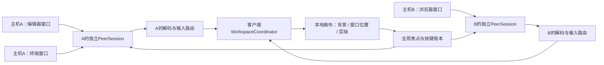

# 多主机窗口汇聚工作区：可行性与架构预留

设计 v0.2，2026-11-12。**当前只做方案，不实现、不启动多主机连接。**

## 1. 可行性结论

你提出的体验在架构上可行：客户端绘制自己的桌面/工作区背景，把来自主机A、B等设备的窗口流放在同一画布中，本地管理位置、尺寸、层级和输入焦点。它复用窗口串流核心，不需要先把各主机整屏视频合并，也不要求主机之间彼此可达。

不能把难度只估为“多开几个视频播放器”。主要工程工作在多路解码预算、全局输入路由、关联弹层、布局恢复和不同主机故障的隔离。界面可以像一个桌面，但应用、文件、登录会话和权限仍分别属于原主机。

## 2. 三个概念分开建模

| 能力 | 在哪里工作 | 远端来源 | 规划 |
|---|---|---|---|
| 传统整屏远程 | 显示一个远端display surface | 一台主机的真实/虚拟显示器 | 后续功能，继续保留 |
| 主机虚拟显示器 | 远端Mac创建/管理显示环境 | 同一个Mac登录会话中的窗口 | 可选后端，涉及兼容性验证 |
| 客户端多主机工作区 | 本地Mac/iPad/iPhone组织多个surface | 多台主机的独立窗口 | 本文预留，未来另行实施 |

后续在客户端工作区中也可以放一块“主机A整屏”surface，和主机B单个窗口并存。统一surface模型允许这种组合，无需另建一套媒体协议。

## 3. 数据模型

| 对象 | 关键字段 | 约束 |
|---|---|---|
| HostProfile | hostID、受信身份、端点列表、设备名称 | 与IP/hostname解耦 |
| PeerSession | hostID、sessionID、transportEpoch、capabilities | 每host隔离认证、网络与恢复 |
| RemoteSurfaceRef | hostID、sessionID、surfaceID、generation | 不允许用裸windowID跨主机查找 |
| Workspace | workspaceID、背景、布局、窗口条目 | 客户端所有，不发给任何单一host作全局真相 |
| WorkspaceItem | itemID、RemoteSurfaceRef、localRect、localZ、viewportTransform | 本地位置与远端位置分开 |
| FocusToken | itemID、hostID、leaseID、focusGeneration | 一次键盘输入只有一个明确目标 |
| ResourceBudget | 总解码像素/秒、内存、总网络、热预算、每item优先级 | 跨所有host分配，而不是每条会话独自抢满 |

本地画布拖动窗口只修改localRect/localZ；不把本地x/y直接发送给远端AXPosition。调整大小先本地预览，只有用户意图为“调整远端布局”时才发送远端逻辑尺寸事务。这样把A的窗口摆到B窗口右边，不会挪乱A的实际桌面。

## 4. 输入与切换

画布先做本地hit test，再查完整RemoteSurfaceRef和版本，最后通过相应PeerSession路由。光标/快捷键绝不广播到所有主机。

从A切到B时：结束/取消A上的拖动与composition、释放已按键，结束A的控制租约或明确保留观察状态，再激活B目标。若A失联，Host租约/超时机制负责释放；客户端不等待A恢复才允许用户看B。相同host不同窗口仍受同一个macOS键盘焦点约束。

系统级快捷键保持客户端控制，如切应用/切工作区；对远端发送的快捷键依据明确映射。远端菜单只作用于当前host和surface，标题/状态中可识别来源设备。

关联弹窗跟随其父窗口的本地布局与缩放，限制在相应窗口组中；A的系统弹窗不能因为本地z-order抢走B的输入。目标不明的弹层先限制交互，避免误点另一个host。

## 5. 呈现、颜色与预算

保留每路独立解码纹理，在客户端合成；不把所有远端画面先重编码成一条大视频再显示，以免增加画质损失和编码延迟。本地画布有一个显示时钟，各流使用自己的最新可用帧，不为同步A/B时间戳把所有窗口一起缓冲。

每路视频有独立色彩描述；合成前统一转换到客户端工作的线性/EDR色彩空间。SDR窗口白色与HDR内容亮度的关系需要一致，不能将所有纹理仅当相同8位RGB混合。普通4:2:0视频不自带窗口透明度：先使用矩形内容加本地圆角/遮罩，异形窗口、阴影和透明弹窗是后续专项。

示例：四个2560×1440@60fps窗口约为8.85亿像素/秒的解码输入，且未计合成、内存带宽与HDR格式开销；它们不应都默认全速。设计上：

- 当前输入窗口优先原生像素与60fps。
- 可见但非活动窗口初始按15–30fps策略，视频播放可显式提高。
- 完全遮挡/最小化窗口暂停媒体，仅保持目录和状态；再次显示请求关键帧。
- 资源不足时先降低后台帧率/暂停，再调整前景质量；不承诺所有设备支持固定窗口数。

以上帧率仅为调度初值。未来验证应先做两台主机、各一个窗口，再测同主机多窗口与移动端热预算。

## 6. 故障、保存与跨主机操作

主机A断连只使A条目离线，B继续工作。保留本地布局和最后帧状态，但明确离线；重连用原身份与当前目录重新绑定，不凭同名窗口自动恢复控制。

保存工作区记录布局、host引用、应用/窗口恢复提示，不保存可永久复用的windowID。初版未来恢复方式可让用户确认重选窗口；自动启动应用和打开文件需要另行定义动作与权限。

剪贴板默认按当前活动host定向发送，不在A/B之间后台广播；跨主机复制是显式动作。将文件从A拖到B不等于本地窗口拖拽，需要文件读取、传输和目标写入流程，不纳入“多主机窗口可行”这一结论。音频先焦点跟随/指定host，后续才考虑多源混音；不因开多个窗口重复播放同一host音频。

## 7. 现在预留什么，未来才做什么

| 当前架构必须预留 | 暂不实施 |
|---|---|
| 所有surface/input/cursor带host/session命名空间 | 多host连接UI与工作区编辑器 |
| PeerSession通过对象引用依赖，不做全局唯一连接单例 | 同时连接多台设备与多路混合解码 |
| 本地布局与远端几何分离 | 保存/恢复多主机工作区 |
| 输入账本/控制租约按host隔离 | 跨主机拖放、自动剪贴板同步 |
| 所有流可报告负载、可见性和暂停需求 | 全局GPU/带宽调度策略实现 |
| 客户端呈现接口可嵌入原生窗口或画布条目 | 自绘桌面、dock、自由叠放、复杂窗口装饰 |

未来开展前的验证出口：两主机同名/同ID窗口不串输入；一台断线不冻结另一台；焦点切换无粘键；局部弹层正确跟随；混合SDR/HDR表现正确；整体资源预算可控。完成这些之后再扩大到“统一桌面”的完整产品体验。
