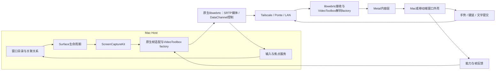

# KKRemote A 路线：窗口优先详细架构

版本：设计 v0.3，2026-11-12。产品范围依据用户已确认的选择；传输建议依据[本轮复核](传输路线复核.md)调整，尚待M0冻结。本轮只产出文档，没有产品实现或运行测试。

## 1. 已确定的产品范围

| 项目 | 本轮确定的方向 |
|---|---|
| 技术路线 | A：Apple原生采集、VideoToolbox编解码与Metal呈现；优先验证原生libwebrtc媒体会话，QUIC为有条件备选 |
| 被控端 | Mac；首轮验证优先 Apple silicon，macOS 15+ 为拟定最低线，具体机型/系统进入验证矩阵 |
| 客户端 | Mac、iPad、iPhone；Mac 先打通，移动端复用媒体与协议核心 |
| 首个交付形态 | 单主机窗口串流，可从一个主窗口扩展到同主机多个窗口及其关联弹层 |
| 首要指标 | 原生像素密度、高质量编码、有界排队和低输入延迟；支持 HDR 的设备有完整 HDR 路径 |
| 网络 | 局域网、Tailscale、Surge Ponte；外部隧道负责可达性，KKRemote 不自建打洞、账号云和公网中继 |
| 移动端 | 先建立内容、边框、视口、输入的正确结构；专项视觉/交互优化排在整体方案和功能闭环之后 |
| 整屏远程 | 保留 display surface 与后续里程碑，首版窗口体验不依赖整屏模式 |
| 多主机虚拟桌面 | 只做架构预留和可行性分析，本轮不实施 |

用户说的“先不考虑公网”，在此解释为**不自建公网连接基础设施**：Tailscale/Ponte 可以跨网络承载连接，但其链路仍需按真实 RTT、带宽与丢包评估。

第一版不要求主机创建私有虚拟显示器。现有窗口捕获作为默认后端；将来如需要脱离本机显示布局，再独立评估主机虚拟画布。客户端多主机工作区是另一个模块，见[可行性设计](多主机工作区.md)。

## 2. 两个应用角色，共享三层核心

Mac 端可把 Host 和 Viewer 放在一个产品安装包中，逻辑上保持独立。Host 工作在已登录用户会话，使用系统屏幕录制/辅助功能授权；不把 root 守护进程、锁屏登录注入作为首版依赖。Viewer 的 UI、解码和窗口管理独立于 Host，可同机安装两个角色。

| 模块 | 职责 | 不负责的内容 |
|---|---|---|
| KKSessionCore | host身份、会话、surface、版本、能力、输入协议、统计结构 | AppKit/UIKit布局和具体网络框架对象 |
| KKMediaCore | 原生source/sink、像素/色彩/格式契约、质量预算和编解码适配 | 主机窗口识别、客户端标题栏 |
| KKMediaSession / RTCBackend | 封装libwebrtc轨道、VideoToolbox factories、媒体恢复、控制消息、统计与连接生命周期；将来可换同级QUIC后端 | Tailscale/Ponte账号或隧道实现；不向业务层暴露PeerConnection对象 |
| HostWindowService | 窗口目录、稳定映射、关联弹层、AX动作、捕获源管理 | 客户端窗口在画布上的位置 |
| HostInputService | 每主机控制权、焦点确认、事件注入、按键释放 | 移动手势识别 |
| MacPresenter | AppKit窗口、Metal视图、键鼠、快捷键、宿主标识 | 远端应用业务逻辑 |
| MobilePresenter | UIKit/SwiftUI外壳、Metal视口、手势、键盘/IME、可见区域 | 重新排版任意Mac应用的内部控件 |
| WorkspaceCoordinator（预留） | 管理多个host连接与客户端窗口布局、全局资源预算 | 在远端主机之间搬移进程或文件 |

UI可用SwiftUI组织，但高频视频与输入路径有明确队列，不通过每帧SwiftUI状态更新驱动。视频由CVPixelBuffer/Metal呈现；控制消息与UI状态才进入UI线程。

## 3. 窗口发现、选择与身份

Host提供窗口目录，记录应用、PID、系统窗口标识、可捕获状态、窗口/内容几何及关联关系。对网络只暴露Host生成的不透明surfaceID。`hostID + sessionID + surfaceID + generation`才唯一定位当前授权对象，不能把系统windowID当全球ID。

用户选择窗口后才建立持续视频流；目录不需要给所有窗口常驻高帧率编码器。订阅关闭只停止远程查看，**不默认关闭远端应用窗口**；后者是单独的CloseRemoteWindow命令。

公开API的SCWindow与AX窗口映射是首个技术关口。PID、角色、位置、尺寸等用于建立匹配；标题仅作辅助。匹配有歧义时禁用resize/close等操作并提示，必要时整个窗口进入只读，不假装已经锁定正确目标。首版没有整屏入口时，不把“退回整屏”作为必须存在的解法。

窗口目录采用通知驱动加低频校准；PID/windowID重用、窗口关闭、应用退出、权限撤回都更新generation或删除对象。最小化/隐藏/离屏能否继续采集以API实际帧状态为准；静态最后一帧应标为暂停，不能冒充实时画面。

## 4. 捕获后端与关联界面

定义三个捕获源适配器，优先次序明确：

1. **IndependentWindow**：默认路径，捕获明确的主窗口，去除系统阴影并保持实际内容几何。
2. **RelatedWindowGroup / AppRegion**：当sheet、popover、右键菜单或浮动工具窗不在主窗口图像内，建立关联surface；必要时使用应用过滤加受控区域捕获。不能为修复菜单直接开放整屏内容。
3. **Display**：保留相同输出契约，后续用于传统整屏远程。当前只定义接口与状态，不做产品入口。

关联界面保留parentSurfaceID、popup角色、hostAnchorRect、z-order约束和可交互区域。先验证公开API及行为规则能覆盖的应用；对无可靠归属的菜单提供明确的不支持状态或受限的应用区域模式。复杂父子关系若最终必须依赖私有API，应经过单独决策，不隐入基础捕获层。

多窗口不必等于每个弹层开一个编码器。第一阶段对主窗口独立编码；高频关联弹层可在同一捕获组或GPU合成后编码，以验证结果决定。稀疏透明弹层若走普通4:2:0视频，不能假定自带alpha；需要已定义的遮罩/几何、主机合成或不透明表面方案，HDR混合也要单独验证。

ScreenCaptureKit可选择窗口/显示器，并交付内容几何；部分窗口状态的表现需要运行验证。[Apple窗口采集](https://developer.apple.com/videos/play/wwdc2022/10155/)

## 5. 窗口外壳与内容分层

移动端“边缘粗、上下空间不协调”的问题在此先转化成结构约束，暂不确定最终视觉风格。

| 几何层 | 所有者 | 用途 |
|---|---|---|
| remoteFrameBounds | Host | 原始窗口外框，包括可能存在的标题栏/工具栏 |
| capturedContentRect | 捕获器 | 当前帧真正有内容的区域，排除编码填充 |
| interactiveRegion | Host | 可投递输入的区域；裁切时必须同步变化 |
| trustedPresentationCrop | Host/验证过的应用适配 | 可选裁切，附来源与置信状态；没有可靠依据就保留原内容 |
| clientChromeInsets | 客户端 | 本地导航、连接状态、标题操作区，不参与视频缩放 |
| visibleViewport | 客户端 | 扣除safe area、键盘、分屏遮挡后的可用区域 |
| displayTransform | 客户端 | 把帧内容映射到视口的缩放/平移，输入用其逆变换 |

原则：阴影、编码黑边、本地safe area和远端标题栏不应被混成同一段“留白”。本地外壳保持终端合适尺寸，内容单独缩放；不把一整圈桌面边框放大后再叠加一圈客户端边框。

**不能统一裁掉顶部固定像素。** 有的Mac应用把标题栏与工具栏融合，裁切会丢掉搜索、标签页或关键按钮；第三方窗口不保证提供可靠contentLayoutRect。默认完整保留可操作内容，优先去阴影；仅在有可靠元数据或经过验证的应用策略时裁切。远端标题栏保留时，客户端避免再叠一条厚常驻标题栏，具体样式后续设计。

Mac端先实现一个远端主窗口对应一个本地呈现窗口；iPad/iPhone先实现一个活动窗口视口和窗口切换入口。iPad多窗口/分屏由系统scene与应用自己的布局共同管理，不要求所有平台一开始具有相同窗口装饰。

resize分两步：手势中只做本地预览；稳定后提交逻辑尺寸请求。Host返回应用真正接受的尺寸和layoutRevision，客户端收到对应首帧后提交映射。键盘动画期间先调整viewport，不连续强迫Mac窗口缩小。最小窗口宽度大于手机可用宽度时允许局部查看，不能承诺任意桌面应用自动成为响应式移动页面。

## 6. 画质策略：保持源精度，给编码足够预算

默认60fps交互档、源端真实1×/2×密度、HEVC硬件编码；H.264为兼容回退。首版不把120fps、AV1或软件4:4:4作为阻塞依赖。静态窗口不填充重复帧来凑60fps；有变化时按目标速率响应。

视频格式由双方实际能力决定：codec/profile、chroma、bitDepth、primaries、transfer、matrix、range、width/height、fps及硬解能力。HDR使用可用的10位格式和Main10等实际匹配的profile，携带颜色信息并验证客户端EDR呈现；源为SDR时不能因为用了10位就标HDR。HDR不支持时有明确tone-map或SDR采集路径。[Apple HDR采集](https://developer.apple.com/videos/play/wwdc2024/10088/)

### 供技术验证的码率起点

下表是**设计初值**，按实际编码像素而不是设备名称分档，后续以质量/延迟实验校准。单位Mbps，均为视频平均目标，允许内容复杂度变化；不是链路带宽保证或恒定填充流量。

| 编码负载，60fps | 起始目标 | 建议试验区间 | 说明 |
|---|---:|---:|---|
| 1920×1080附近 | 25 | 20–40 | 单窗口基本交互与文本 |
| 2560×1440附近 | 45 | 35–70 | Retina窗口/滚动文字 |
| 3840×2160附近 | 80 | 60–120 | 4K级像素负载，先验证解码与散热 |

更小窗口按实际复杂度减少流量；更高分辨率先过能力门槛，不无限外推。120 Mbps只作为初期高码率验证上沿，后续可按实测增加；多窗口需要共享**总预算**，不能每个后台窗口都占满最高档。

例如1440×900 points、2×源窗口是2880×1800像素，像素量比2560×1440高约41%；必须按这一真实负载预算。手机/平板不再按设备类型强制1.5×等固定降采样。若能力不足，展示实际降级原因。

高码率不能恢复采样时丢失的像素，也不能恢复4:2:0丢掉的色度细节。先把高质量硬编做好；静态图块精细层C仅保留接口，是否增加取决于文字对照结果。[既有画质证据](../research/casement.md)

### 编码与内存

捕获帧优先保持IOSurface/CVPixelBuffer，尽量经GPU完成必要的裁切、颜色和像素格式转换，避免CPU读回、每帧PNG或Base64。不得把“零拷贝”当未测量的结论，需记录每个跨层复制。

VideoToolbox设置实时编码、禁用重排，并检查属性支持和返回状态。优先比较普通实时模式与支持的低延迟速率控制模式；不因“低延迟”名称就牺牲过多画质。GOP初值试验1–2秒，启动、resize、丢参考链时请求随机访问帧；不用等待固定GOP才能恢复。[Apple低延迟编码](https://developer.apple.com/videos/play/wwdc2021/10158/)

## 7. 延迟预算与队列约束

初始验收场景：单活动窗口、60fps、约2560×1440编码像素、正常温度、可用带宽有余量。目标是同网RTT≤10ms时输入到画面反馈P95≤80ms；这是验证目标，非已实现指标。覆盖网路径将网络RTT与本地处理分别记录，不能给高RTT链路同一个承诺。

| 环节 | 设计约束/初始预算 | 验证重点 |
|---|---|---|
| 触控/键鼠采样与本地光标 | 本地反馈不等待视频往返 | 移动直操无远程箭头；指针预测与真实点击位置区别明确 |
| Host事件投递到应用响应 | 尽快投递，超时可解释 | 应用绘制本身不可控，单独计时 |
| 捕获交付后处理+编码 | P95≤20ms作为起始预算 | capture callback到encoded callback；不是完整capture age |
| 未编码原始帧 | 每surface一个最新等待帧；编码中数量按实测限制 | 拥塞时替换未编码旧帧 |
| 媒体发送 | 应用层待发送队列目标≤1帧时间，持续超预算触发调节 | 16.7ms@60fps；还要测框架内部排队 |
| 接收重组 | 有界字节/帧数及期限；不得一直等待缺片 | ACK丢失、乱序、巨大关键帧均可恢复 |
| 解码与呈现 | 解码参考链完整；只呈现最新可显示帧 | 待呈现≤1；不能随意扔掉必要的编码参考帧 |

分项P95不可简单相加成为端到端P95。端到端以外部高速拍摄等方法交叉验证，协议时间戳只在校准时钟关系后用于跨机分析。

画质优先的降载顺序：先暂停不可见窗口、降低后台帧率，再适度降活动流码率；持续过载时按交互类别降低帧率，最后才协商降低像素尺寸。拖拽/滚动时可优先保持帧率，静态文字时优先保留原生像素。所有动作受frame age硬预算约束，不以无限排队维持名义高画质。恢复使用滞回，避免清晰/模糊不断振荡。

## 8. 输入、焦点与会话语义

一个Host登录会话同时只有一个明确的KKRemote输入控制租约。用户选中哪个surface，先确认目标存活和焦点，再注入事件。Mac全局键盘焦点不能被多条视频流复制；多主机工作区可以分别持有连接，但客户端一次键盘输入只发往一个host/surface。

可靠有序消息承载点击、按键状态、拖拽开始/结束、文字提交及resize；高频绝对指针位置可合并。相对位移/滚动增量不得直接按“只保留最后一个值”丢弃，使用累计量或可靠的增量序列。

输入包含sessionID、surfaceID、generation、layoutRevision、controlLeaseID和inputSequence。旧布局的点击不重放；旧布局下的up/cancel允许释放此前已持有的按键。断连、切主机、后台、锁屏/权限失效都清理输入状态。

客户端IME保留组合文字，只在提交时发送文本；物理按键与快捷键是另一路径，避免中文重复输入。提供最小可用的直接触控和触控板模式，具体手势、动画和边框视觉等专项优化放在后续阶段。

音频按host/app采集与订阅，多个窗口属于同一应用时去重；应用内不同窗口的声音通常不能自动拆开。第一阶段可先无音频验证视频；窗口功能版补上会话音频与明确静音。多主机混音与焦点跟随为后续策略。

## 9. 会话协议与传输接口

每个host建立一个认证后的PeerSession。建议先验证一个原生PeerConnection承载多个窗口video track、去重后的音频与小型DataChannel控制；启动能力/SDP/ICE交换由Mac Host上的认证TLS信令入口完成，不依赖自建公网服务。信令身份必须绑定会话的DTLS指纹，防止将已配对主机与另一条媒体连接混淆。

媒体会话接口包含native source/sink、surface与轨道绑定、格式/质量预算、控制、统计、生命周期。不能只提供sendDatagram抽象后假定可以无成本替换WebRTC。VideoToolbox在libwebrtc工厂中接入，不在两层重复编码；分包/恢复由后端承担。QUIC候选将来实现同级后端，首版不同时维护两套完整媒体栈。

| 消息族 | 关键字段/语义 |
|---|---|
| Hello / Capabilities | protocolVersion、host identity、支持格式与资源预算 |
| Catalog / Subscribe / Unsubscribe | surfaceID、generation、关联关系、view权限；Unsubscribe不关闭远端窗口 |
| Geometry / ResizeRequest / ResizeResult | requestID、实际逻辑尺寸、content rect、layoutRevision |
| VideoConfig / TrackBinding | streamEpoch、surface/轨道映射、色彩、编码尺寸、layoutRevision；与codec协商一致，新epoch首帧后切换 |
| FrameMetadata | frameID/PTS时钟域与RTP timestamp、epoch的关联；具体映射和扩展在M0验证，不能假定默认SDK均暴露 |
| Feedback | 处理/解码/显示耗时、frame age、资源状态；RTCP网络反馈不等于已显示 |
| QUIC后端内部消息（备选） | MediaFragment与RepairRequest；不是RTP视频上再叠一层自定义分片 |
| Input / Focus / Release | 控制租约、目标版本、幂等动作ID、按键状态 |
| Cursor | 形状ID、hotspot、位置、可见性，按surface/epoch绑定 |
| Health / Reconnect | permission、source状态、transport epoch、最后可恢复状态 |

Wire序列化与最大消息大小在M0冻结；帧缓冲按已协商尺寸和总内存配额分配。视频走媒体轨道，控制走小消息通道；输入与大文件分开。共享连接不保证输入硬优先级，M0在媒体满载时验证尾延迟，再决定是否需要分离控制连接。

RTP与DataChannel之间没有跨通道有序保证；新布局不能直接作用于尚在显示的旧帧。必须验证版本化TrackBinding与首帧屏障，拒绝旧epoch输入。新增/复用轨道及协商串行化，不预分配无限轨道；resize沿用已有轨道也必须验证格式变更与参考链恢复。

媒体分包、选择性补片、参考链恢复和隧道接入见[网络与媒体传输](网络与媒体传输.md)。

## 10. 生命周期与异常行为

连接状态：endpoint准备 → 握手/验证身份 → 已配对 → 目录 → 订阅 → 首帧 → 交互。不要把DNS成功或TCP可达显示成“视频连接正常”。Host身份与端点分离，同一Mac可有LAN、Tailscale、Ponte多个地址；地址变化不能自动更换信任对象。

resize/格式切换状态：继续显示旧帧并限制有歧义操作 → 主机返回实际几何 → 新VideoConfig/streamEpoch确认 → 新首帧 → 原子切换图像与输入映射。可撤销的旧resize请求被最新请求取代，窗口拒绝目标尺寸时返回实际值。

断线只把对应surface标为离线并释放控制，不关闭远端窗口；重连重新枚举，不能靠同标题自动绑定已被替换的窗口。Mac睡眠、iOS后台、VPN更换等恢复时重新核对身份、租约、几何与decoder状态。

## 11. 现阶段决策与待验证项

已定：A、窗口优先、原生像素、高码率有界队列、Mac后移动、Tailscale/Ponte、整屏延后、多主机只预留。

建议调整但未冻结：原生libwebrtc优先，QUIC备选。待验证：Ponte的ICE候选/端口映射与真实媒体路径、Apple HEVC/Main10/HDR适配、RTC队列和高码率控制、公开窗口/AX稳定映射、弹层覆盖、芯片编解码预算、跨屏缩放与连续resize。QUIC若进入对照，再验证其datagram上限、调度与自定义恢复。失败按[实施计划](分阶段实施计划.md)重新决策，不凭静态分析保证结果。
