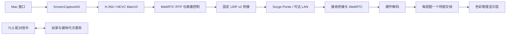
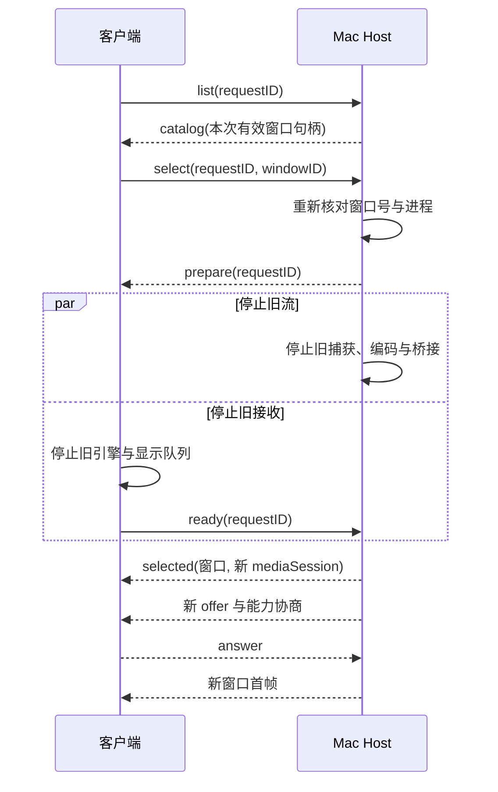

# KKRemote 通信方案 v1

2026-11-14 接入决定：通信 v1 收敛，主动测试及偶发事件专项排查按用户要求暂停，真机由 iOS 研发使用。普通 Host 保持原配置；以下测试方法和失败证据留档，不是当前继续测试的安排。当前操作入口见[真实体验交接](iOS真实体验接入交接.md)。

状态：v1 实现与接入方案已形成，性能验收有条件保留。范围为当前窗口优先的通信主线 T01–T08，及跨端会话 / 输入 / 几何接口设计；保留 Ponte 优先、Tailscale 延后、客户端交互独立研发安排。T03 的 Ponte 零冻结门槛未通过，手机长测及 T06 物理延迟未完成，不能宣布整条主线全部通过。

## 本阶段决定

继续以原生 WebRTC + 自研媒体适配和固定 UDP v2 / Ponte 作为 v1 基线，供窗口产品接入。当前证据显示仍需处理源供帧和偶发间隔尖峰，没有证据表明换成 QUIC 就能解决它们，因此不启动协议重写。机器可读的[配置快照](transport-v1-profile.json)记录了 CLI 参数与回退条件；它是交付清单，不会在运行时自动改 App 设置。

推荐候选为 1440p60 / 20 Mbps 预算、interactive / realtime、Main10 能力协商、10 秒周期关键帧、捕获深度 3。固定 60 Hz 条件的 15mac LAN 15 分钟达到 59.986 fps / 17.726 Mbps、零 SDK 冻结；同条件 Ponte 达到 59.981 fps / 16.604 Mbps，但出现 1 次冻结。因此该候选可用于继续研发，尚不是跨环境的零冻结承诺。当前 Jump 虚拟显示的高复杂度图纸 / 滚动会源端降帧，而视频短测约 60 fps / 5.60 Mbps；低码率视频通过不能代替高负载通过。

## 实现边界

KKRemote 自研的是会话管理、窗口媒体适配、Ponte 固定端点封装、Main10 编解码适配、队列策略和诊断体系。视频拥塞控制、RTP/RTCP、NACK/RTX/PLI、DTLS-SRTP、SCTP 复用固定版本 libwebrtc；硬件编解码使用 VideoToolbox；不把这些依赖称为自研协议栈，也不自行设计密码算法。

当前一个主机信令会话同时服务一个观看者、一个窗口媒体代次。窗口切换采用停止旧媒体、双方确认、建立新媒体的事务。未来多窗口共享资源预算，不复制无上限的 20 Mbps 通道。

## 两条逻辑通道

信令使用原 TCP 端口，Network.framework TLS 1.2 PSK / AES-GCM；4 字节网络序长度后接 UTF-8 JSON。单消息上限 256 KiB、发送待完成字节上限 1 MiB、握手上限 15 秒。它承载 SDP、固定媒体端点协商、会话随机密钥、窗口目录和订阅事务，不承载视频帧。旧客户端忽略新增可选属性；HDR 必须由接收端明确确认，否则使用 H.264 SDR。

媒体使用原 UDP 端口。固定端点模式只把 libwebrtc 的本机 loopback 候选接入桥接，外部网络通过用户指定的主机名和端口到达。观看端先发全尺寸认证探测，主机仅锁定通过认证的来源；不能由新来源抢占现有会话。原生 ICE 保留为 LAN 对照，未配置公网 STUN/TURN 服务。

Ponte 主机名交给系统解析；应用不改 Surge 配置，也不根据 `host/UDP`、本地代理地址或用户填写的网络标签猜测 Ponte 外层路径。当前 socket 实现只支持 IPv4；IPv6-only 场景尚不能宣布通过。Network.framework 路径保留为实现回退，不能在会话中静默切换协议版本。

## 固定 UDP v2 封装

| 字段 | 字节 | 语义 |
|---|---:|---|
| magic | 4 | `KKU2` |
| direction / kind | 1 | 方向位及 media / probe / acknowledgement |
| fragment index | 1 | 当前内层报文的分片编号 |
| total length | 2 | 内层报文总长度，网络序 |
| sequence | 8 | 每方向严格递增的报文序号，网络序 |
| ciphertext | ≤1248 | 内层 ICE / DTLS / SRTP / SCTP 数据 |
| tag | 16 | AES-GCM 认证标签 |

每个外层 UDP 载荷上限 1280 字节；这是应用载荷上限，不是保证物理链路 IP MTU。每方向使用 HKDF-SHA256 派生的独立会话密钥，nonce 为 4 字节零前缀与 64 位序号；序号不回绕，重新连接生成新会话密钥。头部作为 authenticated data。下层 WebRTC 的 DTLS-SRTP 加密仍保留。

内层报文上限 16 KiB，片组以首个 sequence 标识；最多 64 个未完成片组，250 ms 后回收。重放窗口 8192 个序号槽。不能把重排产生的 sequence holes 直接当作永久丢包。正常视频 RTP 适配到单个外层报文，避免丢一个片段损坏一个大包。

## 捕获、编码与呈现

- 产品目录选窗同时校验窗口 ID 与进程；CLI 固定测试源按窗口 ID 选择，长测另加身份校验。窗口失效停止捕获，不自动扩大成整屏。关闭烧入光标、点击效果和窗口阴影。源按显示变化交付，WebRTC 限制输出为 60 fps；静态低更新不算编码丢帧。
- 基准尺寸为 2560×1440，保留纵横比和源逻辑尺寸 / 像素倍率。输出码率 20 Mbps 为配置预算，分别记录实际有效载荷和外层报文字节，不能用填充流量冒充视频负载。
- HEVC Main10 使用 10 位 BT.2020 / PQ；不允许 B 帧重排。周期关键帧最多 600 帧，按需请求不受周期限制。H.264 SDR 作为兼容回退。格式附件不符时停止，不能把 SDR 帧只贴 PQ 标签继续发送。
- libwebrtc 保留拥塞控制、参考关系和丢包恢复；不通过禁用 FrameDropper 或丢弃任意参考帧制造 60 fps 数字。噪声与实际桌面负载分开验收。
- 接收端每个实际显示视图只保留一个尚未提交帧；较新帧替换旧帧，避免主线程恢复后补放过期画面。轨道 / 引擎代次隔离旧回调和旧闭包。AVSampleBufferDisplayLayer enqueue 只代表 API 提交，不代表光子到达屏幕。

## 队列和恢复策略

生产桥接等待区最多 256 个报文，Network.framework 另有最多 32 个 in-flight（合计 pending 上限 288；同步 socket 路径上限 256）；等待超过 25 ms 丢弃并计原因。该期限不包含已交给系统的 in-flight 时间。WebRTC pacer 的 60 ms 是排空目标，不是报文 TTL。诊断故障队列独立限为 256 包，不能混入生产队列延迟统计。

`interactive` 使用已验证的屏幕共享 pacing factor 1.5，`smooth` factor 1.1 仅用于同素材对照。`realtime` 向兼容接收端提示 playout 0–50 ms，`adaptive` 保留自适应回退。该提示既不是端到端 50 ms 保证，也不能保证在任意弱网上继续 60 fps。

当前 ObjC SDK 的这两类 field trial 在进程初始化时固定；切换 pacing / playout 必须用新配置重启 Host，再重建媒体会话。只断开再连接同一 Host 进程不能改变策略。产品若需要同时给不同窗口使用不同策略，先增加可验证的每发送器配置入口或隔离工作进程，不能调用初始化函数覆盖全局状态。

带宽不足时允许拥塞控制降低编码预算并按 `maintainResolution` 降帧，不静默降低空间分辨率；报告实际输出和原因。恢复通过 RTCP NACK、RTX、PLI 进行，必要时按需关键帧重建参考链。媒体探测 1 秒一次，路径 8 秒没有任何认证接收则结束媒体；未完成认证的 15 秒超时。重新连接必须创建新媒体 epoch 和密码会话，不续用旧输入或报文。

信令 / 媒体失败后当前 Lab 结束会话，由客户端明确重连；本阶段不实现无限自动重试。Host 测试进程可重新监听相同端口和本地配对文件。业务端的自动重连需要有限退避、前后台生命周期和权限状态配合，不能仅在网络层重发旧操作。

## iOS / Mac 功能接入契约

已提供的目录与选窗 API 见 `LabModel`。通信侧继续维护媒体、统计和 epoch；iOS 负责视口、手势和 IME，Mac 功能端负责 AX 目标匹配与实际输入执行。当前观看路径只读，配对成功不自动授予控制。

现行窗口协议 v1 的事务如下；所有消息仍走同一条认证信令。`requestID` 关联请求，`windowSession` 限定目录会话，`mediaSession` 限定新媒体。不能用窗口标题作为路由键。

目录请求 10 秒超时，可显式重试；切换事务 20 秒未完成则结束整个连接，避免恢复不确定的旧内容。客户端要区分“selected 已确认”和“首帧已解码”：前者只完成选择事务，后者才进入观看状态。`unavailable` 表示源窗口失效，停止媒体但保留已认证信令以便重新选择。旧媒体回调、候选和异步 UI 提交由代次检查隔离；每一代的统计重新起算，不跨代相减计算帧率。

下一版控制消息至少携带 `hostSession / surfaceHandle / mediaEpoch / geometryVersion / leaseID / sequence`。租约由 Host 产生和过期，时间判断只用 Host 单调时钟；不比较两台设备的裸时间戳。可靠离散事件为按下、抬起、文本提交与释放；连续位置只保留最新，滚动和相对位移在同版本范围内累加。可靠队列到限必须终止控制并请求释放，不能丢掉抬起后继续按下。

文本提交使用独立 commit ID 去重，确认仅由 Host 实际执行后发出；断线不重放。失焦、换窗、几何不确定、租约到期、前后台变化与断线都触发释放。Mac 输入执行与租约尚未接入时，客户端必须继续只读。这个接口设计不等于真实输入已完成验收。

resize 采用 prepare → Host 接受的实际逻辑尺寸 → 新媒体 epoch 首帧 → commit；在首帧前继续显示旧映射但暂停输入，拒绝尺寸返回实际结果。光标形状 / 热点与位置独立于视频；直接触控模式隐藏本地箭头，不能同时显示烧入光标。以上产品事务需要两端功能会话配合，不在通信验收中虚标完成。

## 可维护性与成本边界

当前适配放在 SDK 工厂、标准 RTP hint、公开 VideoToolbox 和端点桥接外层。深度修改 libwebrtc 的 pacer / 解码器依赖解析仍不是本轮必需项；若以后版本升级使已验证的扩展或配置失效，必须重新做同源对照，不能沿用旧数值。

自研外层每报文增加 32 字节（16 字节头和 16 字节认证标签），还应分别计算 SRTP/RTP、RTX、探测、UDP/IP 和 Ponte 的额外流量。当前只能准确统计应用层封装与 SDK 暴露计数，不能把不含 Ponte 的字节数称为完整网络成本。静态图纸实测仍持续提交完整帧但约 0.33 Mbps，说明带宽已明显下降，静态采集 / 编解码省电尚未专门优化。

诊断默认关闭逐帧记录，资源采样每秒一次；统计最多 3600 个样本，帧事件 32768、RTP 分组 4096，保留覆盖数量。完整长测与故障报告在私有目录，公开仓库只保存脱敏摘要。

## 信任与后续能力

现有固定短码仅供用户控制的 Lab 环境，保持不变。正式产品应使用设备身份与持久随机凭据、安全存储、撤销和显式控制授权；短码哈希不增加熵，不以当前方案宣称可安全开放公网。媒体密钥由认证信令下发，日志不保存密钥、输入文本、真实窗口标题、SDP 或媒体载荷。

Tailscale 复用同一上层媒体 / 信令，须分开验证 direct 与 relay；目前按用户安排延后。多窗口必须建立主机级总像素率、解码面和带宽预算，前台优先、遮挡暂停；音频加入后单独验证音画同步，不能直接沿用无音频的低延迟参数。传统整屏与多主机虚拟桌面沿原计划保留后续实施，不混入当前窗口授权。

## 验收方法

完整证据应包含同源真实窗口、实际编码格式、分辨率、帧率和码率、控制 RTT、逐帧 / 区间延迟口径、冻结与丢弃原因、资源与热状态。T01 满载素材校准、T02 关联诊断、T03 15 分钟跨设备对照、T04 参数收益与代价、T05 受控弱网、T07 30 分钟稳定性、T08 推荐配置逐项记录。T06 必须采用独立光学 / 高速拍摄条件，缺少条件时保持未验收。

测量工具也属于负载：本机已观测到可见 USB 投屏窗口使原始捕获降帧，重复启动窗口目录查询也会降低帧率。长测使用常驻元数据检测，手机连接后关闭 Mac 投屏预览；先确认源供帧，再评价协议。源供帧不足时如实呈现低帧率，不复制帧制造 60 fps。

源、编码、桥接、接收、解码、应用显示均使用各自可验证的关联键。跨机器未校准时只比较局部间隔；用屏幕投屏预览测得的延迟包含额外投屏路径，不能当成 iPhone 物理显示延迟。缺失阶段输出 unknown，不填 0。

复测入口、故障处理与回退操作见[运行手册](通信方案v1运行手册.md)，连续验收见[测试报告](../testing/通信方案v1验收.md)。
