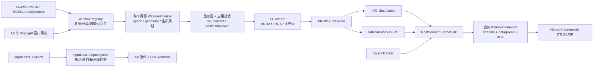

# Casement Home 1.0.4：本机交付物分析

> 本报告引用的原始证据保留在本地分析工作区，不随仓库提供。文件路径用于定位本地材料，详见 [研究资料说明](../../research/README.md)。

日期：2026-11-12。目标是理解行为与工程取舍，为 KKRemote 提供独立设计依据。本报告仅覆盖已安装的 macOS 服务端；未运行目标应用、未建立远程连接、未分析 iOS/Android 客户端。**静态路径能证明程序怎样构造调用，不能证明某次连接实际执行了哪条路径，或某项 VideoToolbox 设置被硬件接受。**

## 目标与证据

- `/Applications/Casement Home.app/Contents/MacOS/CasementHome`
- Bundle ID：`win.casement.home`；版本：`1.0.4`，build `1783`。
- ARM64 Mach-O，11,356,320 bytes；最低系统版本 macOS 26.0。
- SHA-256：`86b42172f53573f688021365b8917e27e54641c33ccea6a60d8ec1c5f3c7e313`。
- REA CLI 6.5.0，native-macos 检查与 Hopper 静态分析；Apple LLVM objdump、nm、swift-demangle 辅助。没有注册/修改 MCP，没有修改被分析应用。

|编号|证据文件 / REA Evidence ID|用途|
|---|---|---|
|C-M|`research/casement/rea-macho.json` · `ev_cfbacb5eeb88d1c1b7a00ee9f69efc6e7c0894391bdc7deb223188cab69570f0`|交付物身份、链接依赖、导入与导出|
|C-O|`research/casement/rea-overview.json` · `ev_6f89697ed67c982cf45c3f97b76fb63479ece8c8926d0ae7d252229eab44cb9c`|Hopper 识别 29,666 个 procedure；这是分析引擎的划分，不是原始源码函数总数|
|C-C|`research/casement/rea-base-stream-config.json` · `ev_626b2f0d9368d23b43f3a74c94aec8374013f4be8a19561190de13587de13834`|采集参数、调用者、伪代码和汇编|
|C-E|`research/casement/rea-encoder-init.json` · `ev_c3f9fbd65e040b7d05915714fe7fc209bad2a6c694b6776e621af78f01a708aa`|HEVC 初始化参数与低延迟 fallback|
|C-F|`research/casement/rea-make-filter.json` · `ev_443a42fda5543e828b29fa0511fd2030590148a8af1d37636d0cf9d02fb2538e`|显示器/应用过滤器两分支的完整函数 dossier|
|C-P|`research/casement/rea-stream-policy.json` · `ev_ab2ddd614f9ab51181868af6eeabaccccccab06fd06e9b76ffeb85a12979804a`|移动端尺寸/码率策略；浮点返回值以汇编交叉核对|
|C-S|`research/casement/symbols-demangled.txt`|完整可读符号索引；名称只用于定位，不单独证明行为|
|C-A|`research/casement/disassembly.asm`|同一 SHA-256 的完整 LLVM ARM64 反汇编；下面各 `.asm` 是其地址切片|

REA 伪代码是恢复结果，不是源码。Hopper 有 Swift ABI 参数识别失真，例如把 NSNumber 桥接前的寄存器解释成错误变量；本报告涉及布尔值、整数、浮点常量时以 ARM64 参数寄存器与真实调用为准。Hopper 不提供完整 function body ranges，间接调用和全量数据流恢复也存在限制。

## 核心结构

这是基于多处静态控制流的重建图。调用链的整体组合是归纳；每个重要边界均有下面的直接调用证据。

## 窗口不是一个 ID 加一段视频

**窗口注册表。** `WindowRegistry.enumerateWindows`，地址 `0x100125f18`，调用 `CGWindowListCopyWindowInfo` 两次，读取 window number、owner PID、layer、bounds、alpha、name/owner name，将记录构造成 `WindowObservation`；随后调用 `fillServerParents` 与 `fillHostApps`。返回值区分 `onScreen` 与 `offScreen`。见 `research/casement/enumerate-windows.asm`。

`WindowObservation`、`WindowKind.classify`、`WindowPlan.diff/follow` 与 `WindowPresence` 的符号说明它还维护主窗口/附属窗口、隐藏/最小化/其他 Space、应用归属、关闭与重新出现等状态。分类器全部规则尚未逐分支证明，不能声称对所有应用的弹窗归属都正确。

**AX 与 CGWindowID 对齐。** `AXWindow.lookup` 的特化体 `0x100212720` 从指定 PID 的 AX 应用读取窗口列表，遍历 AX 窗口，通过 `_AXUIElementGetWindow` 取 window ID，与目标 ID 比较。随后 `WindowActions` 在按 PID 建立的队列上执行 raise、setPosition、setSize、close、restoreVisible 等动作。见 `research/casement/ax-lookup.asm`、`research/casement/ax-set-size.asm`。这是 macOS 上单窗口远程操作的重要映射层，不是视频 API 自动附带的功能。

**父子窗口事实。** `SkyLightWindowTree` 的加载路径 `0x1000dcbb8` 明确 `dlopen` 私有路径 `/System/Library/PrivateFrameworks/SkyLight.framework/SkyLight`，再 `dlsym` 查询 `SLSWindowQueryWindows`、`SLSWindowIteratorGetParentID`、window ID、level、tags、attributes 等。见 `research/casement/skylight-load.asm`、`research/casement/skylight-nodes.asm`。因此“把菜单、popover、sheet 纳入哪个远程窗口”并非只靠标题或矩形猜测，至少存在 WindowServer 父子关系的辅助路径；其可用性与 fallback 仍需运行验证。

## 当前窗口采集路径是“应用过滤 + 区域裁剪”

`WindowPipeline.makeFilter`，地址 `0x1000f8ad4`，有两条明确调用：

- 桌面分支：`SCContentFilter.initWithDisplay:excludingWindows:`，排除列表为空。
- cell 分支：`SCContentFilter.initWithDisplay:includingApplications:exceptingWindows:`，应用与窗口例外列表来自 `CellTarget`。

见 `research/casement/make-filter.asm`。这里**没有把单窗口模式简单实现为 `desktopIndependentWindow` 过滤器**。

`WindowRegistry.prepareCell`（`0x10012d36c`）读取目标窗口 frame，挑选显示器，取 owningApplication/processID，并将已观察窗口、child 记录、可用 apps/windows 交给 `CellFilterPlan.plan`，生成应用 inclusion 与窗口 exception 集合。见 `research/casement/prepare-cell.asm`。

`WindowPipeline.start` 的异步体 `0x1000fac54` 和 `pumpCellOps`（`0x1000f45b0`）随后设置 `sourceRect`、`destinationRect`，并设置 `ignoreShadowsDisplay`，再创建/更新 SCStream 配置与过滤器。见 `research/casement/pipeline-start.asm`、`research/casement/pipeline-pump-cell.asm`。`CellGeometry.plan` 负责把窗口矩形、显示器矩形、目标像素尺寸和有效 scale 组合为采集几何，见 `research/casement/cell-geometry.asm`。

**推断与意义：** cell 是一个包含相关应用内容的采集区域，可以把主窗口附近的附属 UI 纳入同一远程视图。这能解释它为什么需要持续追踪窗口位置、父子关系和过滤器版本。只做“截一个 CGWindowID”将遗漏这一层复杂性。这个推断并不证明每一种菜单和弹窗都能正确纳入。

**虚拟显示。** `VirtualCanvas.makeDisplay`（`0x1000ea570`）实际实例化 `CGVirtualDisplayDescriptor`、`CGVirtualDisplay`、`CGVirtualDisplaySettings` 与 modes，写入配置中的 HiDPI 字段，再 `applySettings`。同一交付物还有 `HeadlessCanvas`、`MirrorCanvas`、`MirrorKeeper`。见 `research/casement/virtual-display.asm`。这证明虚拟画布/镜像能力存在，**不证明每个窗口都被移入虚拟屏，也不证明当前用户会话启用了虚拟屏**。当前 `prepareCell` 会选择已有显示器，不能把虚拟屏说成单窗口模式唯一基础。

## HDR、Retina 和画质的真实边界

### 采集与编码为 SDR 的直接证据

C-C 的 `baseStreamConfiguration(width:height:)`（`0x1000fa830`）实际设置：

|配置|实际参数|
|---|---|
|width / height|调用者传入的像素尺寸|
|pixelFormat|`0x42475241`，32BGRA，即每颜色分量 8-bit|
|colorSpaceName|`kCGColorSpaceSRGB`|
|showsCursor|`false`|
|captureResolution|枚举值 `1`，本机 SDK 中为 `.best`|
|minimumFrameInterval|`CMTime(value:1, timescale:config.fps)`|
|queueDepth|来自 config，不能从此函数推定具体值|
|capturesAudio|`false`；仅说明此视频采集流，不能推定整个应用无音频|

C-E 的 `HEVCEncoder.init`（`0x10002f644`）继续设置：

- `HEVC_Main_AutoLevel`，而非 Main10。
- ColorPrimaries、TransferFunction、YCbCrMatrix 均为 ITU-R 709。
- `RealTime = true`；`AllowFrameReordering = false`；`MaxFrameDelayCount = 0`。
- `PrioritizeEncodingSpeedOverQuality = true`；`ExpectedFrameRate = fps`。
- `MaxKeyFrameInterval = 600`，还存在按需强制关键帧的调用路径。
- 先要求 low-latency rate control；创建失败时再尝试不带此特性的创建，仍请求硬件编码。创建辅助体见 `research/casement/encoder-init.asm`。

因此已检查的主采集/HEVC路径是 **8-bit SDR + sRGB/709**。HDR 用户体验缺失有明确实现依据。仍不能仅因一次静态负搜索就排除所有未检查的条件路径。设置函数的返回值/硬件能力是否接受也未实测。

### HiDPI 支持存在，移动策略会限制 scale

`requestScale`（`0x10010fd9c`）对窗口路径结合配置 cap、`FrameSink.streamPolicy` 返回 cap 与 display backing scale 取较小值。`backingScale`（`0x10011ada0`）存在读取 `CGDisplayModeGetPixelWidth / CGDisplayModeGetWidth` 的明确计算，以及 `NSScreen` 快照路径。见 `research/casement/request-scale.asm`、`research/casement/backing-scale.asm`。

C-P 的 `StreamPolicy.decide` 特化体（`0x100325e74`）按设备能力、屏幕/容器短边和 point scale 分档。通过 Swift 返回布局、float 指令与 tier 字符串交叉解释，touch 分支为：

|touch 设备有效短边|tier|scale cap|HEVC bitrate cap|
|---|---|---|---|
|1–499 pt|`handheld`|2.0|4 Mbps|
|500 pt 及以上|`tablet`|1.5|6 Mbps|

0 尺寸落在非小屏分支，不应拿它推断实际设备默认状态。tier 的字符串返回也已独立检查，见 `research/casement/policy-decide.asm`、`research/casement/policy-tier-names.asm`。最终 scale 还会受宿主 cap、backing scale、`maxLongSide` 像素计划约束；最终码率会被路径状态调整。这不是抓包测得码率。

**结论：** “完全没有 Retina 机制”与交付物不符。更具体的候选问题是 tablet 路径可能将原生 2x 的桌面 UI 降到 1.5x，再被客户端放大；手持端也不一定按 3x 物理像素采集。需记录当前会话的 negotiated scale、实际 SCStream 尺寸和客户端 drawable 尺寸才能证明用户遇到的模糊来自哪里。

### 动态视频与无损恢复并存

`WindowPipeline.processFrame`（`0x1001051bc`）直接调用 `TileDiff.ingestAndDiff`，把 dirty tiles 交给 `Classifier.route`，再使用 `LosslessLedger.plan`，分支到 `sendPlainTiles` 或 HEVC encoder；安静后的 `leaveHEVCIfQuiet`、`beginSettleIfOwed`、`pumpSettle` 等路径负责恢复。见 `research/casement/process-frame.asm`。

协议存在 `TileFrame`、`VideoConfig`、`VideoFragment`、`FrameAck`、`TileDigest`，包含 windowID、epoch、seq、ptsNs、scalePercent、HEVC cutoff 与 dirty bitmap。Tile 层有 XOR/carry 与 QOI64 编解码符号。由此可确定它并非全程只发有损视频；具体 tile codec 的每条选择条件尚未全部追踪。

所以“文字模糊”也可能来自持续滚动时的有损模式、无损 settle 未及时完成、尺寸降采样或客户端二次缩放，不能仅根据存在 HEVC 就断言根因。

## 传输不是仅凭一个 QUIC 字符串定性

`HostServer.makeDTLSListener`（`0x100097998`）调用 `LegacyDTLS.listenerParameters`（`0x100255c80`）。后者构造 `NWProtocolTLS.Options` 和 `NWProtocolUDP.Options`，再明确调用 **`NWParameters(dtls:udp:)`**。见 `research/casement/host-listener.asm`、`research/casement/dtls-listener.asm`。

其上有自有 `CasementSessionCore.ReliableTransport` 与 `CasementTransport.TransportDriver`：具名方法包括 stream offset 写入、datagram deadline/priority、ACK ranges、RTT readout、detectLoss、requeue、poll/buildPacket、拥塞/排队 gauges。实际网络 wire format、完整拥塞算法、重传阈值、公网发现/NAT 穿透尚未完整重建；这些应列为后续研究项。现有证据足以指出 **应用自有可靠/实时传输层覆盖于 DTLS/UDP**，不能把零散 `QUIC` 文本当成使用 QUIC 的证据。

## 光标与触控

**光标是独立对象。** 采集配置明确 `showsCursor=false`。`CursorTracker.tick`（`0x1000188c0`）读取当前位置，`CursorHit.pick` 选目标窗口，获取 `NSCursor.currentSystemCursor`（失败可回退 arrow），渲染形状，并借助 `CursorShapeMemo` 判断是否重发；`CursorUpdate` 带 windowID、epoch、归一化坐标、visible/imageIncluded 标志、hotspot、图像尺寸和 PNG。见 `research/casement/cursor-tick.asm`。因此用户看到的鼠标，更合理的待验证解释是客户端独立光标显示策略；静态证据不支持说它必然已经烧进视频。

**输入不是只有 mouseDown。** `InputEvent` 有 scroll phase、momentum phase、gesture、pen pressure/tilt；`InputInjector.handle`（`0x1000b1718`）实际创建 keyboard、Unicode、mouse、scroll CGEvent 并投递。`InputDesk`/`InputHold`/`InputPacer`/`PressLedger`/`InputGeoTable` 分别包含排队、焦点/遮挡门控、时间节奏、按压释放一致性、epoch 几何有效性等逻辑。见 `research/casement/input-handle.asm` 与符号索引。

**这并不等于移动体验已优化。** 服务端具备输入事件类型，不代表客户端具有合适的手势仲裁、局部预测、惯性滚动、文字编辑/IME、触控隐藏光标策略。焦点切换、旧 epoch 拒绝、top-window gate、输入排队也可能造成用户感知的“第一下没反应”。当前尚不能在几个候选原因之间定责。

## 对 KKRemote 的可执行设计启示

1. 把 capture target 抽象为 desktop、window、application region，复用后面的媒体管线。窗口路径应提供主窗口与关联 UI 的模型；单窗口 public API 可作为简单路径，应用过滤+裁剪作为有弹窗的路径。
2. 建立 `window identity / owner PID / geometry generation / content rect / scale / input transform` 的统一契约。resize 请求、实际 AX 尺寸、采集尺寸、客户端已显示 generation 必须相互确认，不能只发送一个新 width/height。
3. 先做到端到端像素密度透明。用户能查看目标 point size、host backing scale、编码 pixel size、客户端 drawable pixel size；“Retina”开关要控制整个链路，避免固定 tablet 1.5x 这样的隐式降采样。
4. HDR 是独立协商能力：捕获动态范围、10-bit 像素格式、HEVC Main10、色彩元数据、客户端 EDR/HDR呈现与 SDR fallback 一起实现；不能只提高 bitrate。
5. 光标作为控制通道对象：触控直操默认隐藏，触控板/鼠标模式本地绘制，远端旁观策略另定。Casement 已有独立光标这一机制，改善点主要在客户端策略与时序。
6. 移动输入需要单独状态机和实机验证：tap/drag/long-press、双指滚动、pinch视图缩放、键盘、IME、pointer lock、手写笔。保持每次按压都可释放，并对geometry变化处理取消/重映射。
7. 可借鉴动态视频+安静无损恢复的思想，但先量化其收益与复杂度。无损层、视频层、epoch/PTS互相覆盖极易出错，不能认为叠加tile必然更清晰。
8. 公共 API 与非公开依赖隔离：SCStream/SCContentFilter、VideoToolbox、AX大部分操作、CGWindowList与CGEvent是系统常规框架入口；CGVirtualDisplay、`_AXUIElementGetWindow`、显式 PrivateFrameworks/SkyLight 路径是需单独评估的依赖。KKRemote 基础路径不应把后者变成无法替换的前提。

## 问题清单与剩余验证

|问题|状态|下一步最小验证|
|---|---|---|
|如何枚举、识别、控制窗口|已回答核心路径；复杂分类部分回答|用测试窗口记录PID/ID、AX映射、popup归属与生命周期|
|单窗口到底怎样采集|已回答当前主要cell/desktop构造路径|连接一次窗口模式，核对filter、source/destination rect与实际分辨率|
|有没有HDR与Retina|SDR路径已证实；HiDPI机制/策略已证实；端到端体验未实测|读取会话协商和实际像素格式，比较2x/1.5x与HDR测试图|
|鼠标为什么出现|已证实独立光标，不是此采集路径烧录；客户端策略未知|在触控/鼠标模式分别记录cursor channel与呈现开关|
|触控为何不流畅|部分回答：服务端输入机制；根因未知|同步输入发送/到达/注入/画面反馈时间，测P50/P95及首击丢弃|
|如何传输数据|已回答DTLS/UDP + 自有可靠层边界；完整协议未重建|同意的两端连接上采集脱敏性能统计/包时序|
|虚拟屏是否必要|已证实存在，是否是当前模式必需未知|比较现有屏/无屏/镜像模式的目标选择与窗口位置|
|iOS/Android客户端如何渲染与仲裁手势|未回答，当前未提供该交付物|分析对应安装包或使用实际客户端做受控体验测试|

本轮没有运行时画质、延迟或带宽对照数据，因此没有宣称已证明 Jump 优于 Casement 的具体原因，也没有给出未测量的提升比例。
