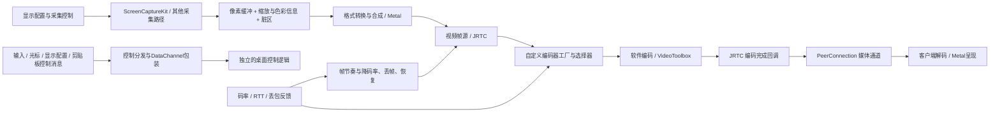

# Jump Desktop：媒体、传输与输入的本地静态分析

> 本报告引用的原始证据保留在本地分析工作区，不随仓库提供。文件路径用于定位本地材料，详见 [研究资料说明](../../research/README.md)。

分析日期：2026-11-12。范围：本机 macOS 客户端与 Connect 服务端的 arm64 切片。**没有运行远程连接、抓包、注入进程或测量画质/延迟；没有恢复完整 Fluid 协议。** 以下“观察”是对安装包字节与指令的观察，不代表这些分支在用户当前连接中已执行。

## 1. 目标身份与方法

| 目标 | 版本 / 构建 | 主程序 SHA-256 |
|---|---|---|
| `/Applications/Jump Desktop.app` | 10.15.46.0 / 1001604 | `1419490a14baa430e359c1c5397dbf27ad9fe7f7fedf15968574ae0f1af19a50` |
| `/Applications/Jump Desktop Connect.app` | 10.15.51.0 / 168768256 | `d1ebff866e4707ee6798faaf711c9f095ffb6fc54cd87e1828365148ca8d49fd` |

两者为 x86_64 + arm64 universal Mach-O；本次深入指令分析选择 arm64。客户端 arm64 容器偏移 `31342592`，服务端 `22413312`。下文地址是未加 ASLR slide 的虚拟地址，不是文件偏移。

使用 REA 6.5.0 的 `inspect-macho`、系统 `nm` / `otool` / `llvm-objdump`。通过 `LC_FUNCTION_STARTS` 划定函数，通过 `__objc_stubs` 的 selector 引用解析 Objective-C 调用，在重点汇编片段中以 `RESOLVED_OBJC_STUB` 标记这一可复查映射。没有把字符串命中直接当作已执行的行为。

| 证据代号 | 文件 | REA Evidence ID / 来源 |
|---|---|---|
| J-MACHO-H | `research/jump/host-macho.json` | `ev_1beb1dc6e7c71cb6ab87d4228ff44db2a7a24ecc66be076eeb1cd91afcd91a14` |
| J-MACHO-C | `research/jump/client-macho.json` | `ev_a01935216e6c17615c8d747b53eaaa17accc8805674e0085d05453a7fad9467c` |
| J-ASM | `research/jump/host-disassembly.txt.gz` | `xcrun llvm-objdump --macho --arch=arm64 --disassemble` 的完整输出压缩件 |
| J-STUB | `research/jump/host-objc-stubs.txt`、`objc-stub-map.json` | Objective-C selector stub 指令；后者为派生索引 |
| J-ABI | `research/jump/host-objc.txt` | `otool -arch arm64 -ov` 的 Objective-C 元数据 |
| J-TEXT | `research/jump/{host,client}-media-context.txt` | 安装包字符串的选定上下文，行前数字是 Python `splitlines()` 序号，不等同于原始 `strings.txt` 的 POSIX 行号 |

完整命令与产物摘要见 `research/jump/manifest.json`。非 REA 工具的结果采用上述本地证据代号，不伪造 REA Evidence ID。

### 反编译工具限制

REA 的 Hopper 搜索在等待 bridge readiness 时超时，错误包含 `provider_timeout` 和 `cleanup_incomplete`，保存在 `research/jump/host-capture-procedures.json`。没有取得 Jump 的 Hopper 伪代码。REA 报告过私有目录 `/tmp/rea-NHoQch`；之后只读检查发现该目录已不存在，没有手动删除或强杀共享 Hopper。其 GUI 文档关闭状态未验证。因此本文关键结论来自成功的 REA Mach-O 清单与实际 ARM64 指令，不声称来自成功的 Hopper 反编译。

## 2. 可以建立的核心结构

该图整合了已观察到的模块边界。中间有虚函数、回调和消息封装，**不是已经恢复的完整逐函数调用图**。同一应用还含 RDP、VNC、旧版 WebRTC 与其他功能；不能把任意网络库符号都归到当前 Fluid 会话。

### 2.1 采集不是持续截图再无差别压缩

**观察：** 服务端函数 `0x1006f2b58` 内创建 `SCStreamConfiguration`。其已解读的调用：

| 地址 | 实际指令所支持的行为 |
|---|---|
| `0x1006f5410` | 取得 `SCStreamConfiguration` 类并分配对象 |
| `0x1006f5428` → `0x1006f542c` | 参数 3 → `setQueueDepth:` |
| `0x1006f5450`、`0x1006f545c` | 从配置数据取得宽高，分别设置 width / height |
| `0x1006f5468` | 设置像素格式，参数来自配置而非单个固定常量 |
| `0x1006f5474`、`0x1006f5480` | 设置 color matrix / color space name |
| `0x1006f5488` → `0x1006f548c` | `capturesAudio = false` |
| `0x1006f5494` → `0x1006f5498` | **`showsCursor = false`** |
| `0x1006f54bc` | 设置 `minimumFrameInterval`，此处输入来自 `kCMTimeZero` |

证据：`sck-configuration.asm` + J-STUB。不能把 `minimumFrameInterval = 0` 理解为整个应用不限制帧率；后续另有帧节奏控制。

`ScreenCaptureDelegate` 元数据将 `stream:didOutputSampleBuffer:ofType:` 映射到 `0x1006f0b98`。回调向已注册观察者分发 buffer；间接调用目标没有全量解析。另一函数 `0x1006fbe08` 内，`0x1006fbea0` 取得 sample attachments，`0x1006fbf04` 读取 `SCStreamFrameInfoDirtyRects`，随后迭代并调用 `CGRectMakeWithDictionaryRepresentation`，把矩形坐标转为整数数组。另有以当前帧完整宽高构造矩形的分支。

证据：`sck-callback.asm`、`sck-dirtyrects.asm`、J-ABI。

**推断：** 采集层保留变化区域，供后面的工作量与编码优化使用；不是所有画面变化都只能按整帧重新分析。仍需追踪各编码器是否都消费同一脏区列表。

### 2.2 脏区进入 16×16 活动图；不能等同于“网络只发脏矩形”

函数 `0x1005ffdc4` 将输入宽高加 15 后右移 4，为活动图计算网格尺寸；对矩形坐标和边界做相应的 16 像素分块转换，边界检查后按行 `memset(..., 1, ...)` 标记网格。它调用的日志辅助函数含 `Dirty Rect: {} -> activemap: {}`。网格尺寸变化时重新分配并标记整个活动图。

证据：`encoder-activemap.asm`，关键区间 `0x1005ffde8`–`0x1005ffe04`、`0x1005ffe50`–`0x1005ffeb8`、`0x1005fff68`–`0x1005fff84`。

**观察可支持：** 该路径把脏区转成 16×16 的活动网格。

**尚不能支持：** 全部 Fluid 编码器都采用此网格；网络载荷是独立图片 tile；无变化区域是数学意义无损；画质优势完全来自活动图。视频编解码器内部的 skip / reference frame 与应用层 tile 传输是不同概念。

### 2.3 有自定义媒体层，同时实际使用 WebRTC 的连接与媒体接口

主程序实际指令调用下列 API，超出了“目录里碰巧带 WebRTC.framework”的证据强度：

| 调用地址 | API / 作用边界 |
|---|---|
| `0x100669120` | `JRTC_PeerConnectionFactory_CreatePeerConnection` |
| `0x10065d174`、`0x100660210` | SetRemoteDescription / SetLocalDescription |
| `0x100658254`、`0x10065d970` | AddIceCandidate |
| `0x10064c6cc` | CreateDataChannel |
| `0x100659db0` | DataChannel_SendAsync |
| `0x100655b70` | VideoTrackSource_DeliverFrame |
| `0x1006048f8` | JumpVideoEncoder_OnEncodedImage |
| `0x10064ec00`、`0x10064f66c` | 创建自定义编码器选择器并装到 RtpSender |

证据：J-ASM、`media-deliver-frame.asm`、`media-encoded-callback.asm`、`datachannel-send.asm`、`transport-calls.txt`。

DataChannel 包装函数 `0x100659cd4` 会检查通道存在、累计/缓冲容量与分块上限，再建立 DataBuffer、复制相应长度并 `SendAsync`；通道不存在、容量受限和成功是不同返回分支。**观察：** 存在主动背压/分块，而不是无限塞入发送队列。

**推断：** Jump 在 WebRTC 连接、协商、媒体输送接口上叠加自己的桌面协议、捕获、编码工厂与调优。直接采用标准 WebRTC 只能覆盖一部分能力，不能自动得到相同体验。

J-TEXT 中有 host-only / relay-only / all transport、ICE server、候选更新、SDP offer 等日志。**未知：** 用户当前会话走 UDP 直连、TURN、TCP/TLS、隧道中的哪一条；丢包恢复/FEC/NACK的实际启用值；精确报文格式、拥塞参数及控制消息的 DataChannel ordering/reliability。没有抓包，不能给出具体链路比例或重传时延。

### 2.4 编码有多条路线，硬件 H.264/HEVC 只是其中一条

函数 `0x1004d13cc` 的指令显示：

- 根据内部编码类型分支准备 `avc1` / `hvc1`，在 `0x1004d1910` 调 `VTCompressionSessionCreate`。
- H.264 路径可选 Constrained Baseline / Main；HEVC 路径按格式分支选 Main / Main10，随后 `VTSessionSetProperty(ProfileLevel, ...)`。
- 处理色彩 primaries / transfer / matrix，而非只设置宽高与码率。
- `0x1004d2010` 将 `RealTime` 设为 `kCFBooleanTrue`；`0x1004d2048` 将 `AllowFrameReordering` 设为 `kCFBooleanFalse`。前者参数来自 `0x1004d1f6c` 对 `kCFBooleanTrue` 的解引用；后者来自 `kCFBooleanFalse`。
- 部分属性受版本/能力检查约束，不能认定所有系统均成功应用。

证据：`encoder-configuration.asm`。这是低延迟硬件编码配置的直接静态证据；不代表其实际延迟已经测得。

服务端还链接 `libaom.dylib` 并导入 `aom_codec_encode`；客户端导入 dav1d 解码接口与 `VTDecompressionSessionCreate` / `DecodeFrameWithOutputHandler`。客户端字符串明确含 AV1 sequence header 解析、bitDepth/chromaFormat 检查、VideoToolbox 格式探测和 decoder fallback 日志，及本地 `Fluid 2.0` 名称。

客户端内置质量说明区分 4:2:0 8-bit、4:4:4 8-bit、4:2:0 10-bit、4:4:4 10-bit。**这证明本地版本已含这些配置与实现线索，不能仅凭文本断定当前连接实际协商的是哪一个档位，更不能断言所有平台硬件都支持 4:4:4。** 官方文档与本机证据需分开标注。

### 2.5 自适应不仅是换一个码率数字

实际指令注册 `SetRates`、`PacketLossRateUpdate`、`RttUpdate` 回调，地址分别为 `0x1004a6680`、`0x1004a68ec`、`0x1004a6b58`。`0x10064e160` 调用 PeerConnection SetBitrate。

帧处理函数 `0x100601b88` 中可见：

- 目标码率和当前受限码率分别存储，降低码率时做浮点运算和边界选择后回写。
- 如果需要进一步限流，递增独立 drop-level 字段，并走带 actual / target 参数的日志分支。
- 有降低 drop level、恢复码率与重置状态的反向路径。
- 同一函数里出现 duplicate frame、Encode Done、时间比较与计数相关操作。

证据：`frame-adaptation.asm`；降码率区间 `0x100602e50`–`0x100602ec0`，drop-level 区间 `0x100602f10`–`0x100602f4c`，恢复码率区间 `0x100603010`–`0x10060305c`。**可以确认“反馈 → 降码率/丢帧 → 恢复”的多层调节结构，尚未完整还原每一阈值与时间窗口的语义。**

存在 ZeroPlayoutDelay、pacer queue drain、fast retransmission、BWE probing 等 field-trial 字符串，说明这些是调查入口；没有全部追到初始化拼接与启用条件，不能直接宣布所有开关均开启。

### 2.6 光标与输入不是视频中的一个像素区域

这里有三类相互支持的证据：

1. 上述 SCK 路径明确 `showsCursor = false`。
2. 控制分发函数 `0x100553814` 区分 Desktop Input、Desktop Pointer updates request、Server Pointer update；内置 protobuf 类型含 `PointerUpdatesRequest`、`PointerUpdateMesg.Changed`、`PointerUpdateMesg.PointerImage`、`InputEvent`，与视频编码器控制消息分开。
3. 客户端含 `cursorImageFromBitmapBuffer:hotSpotOffsetAdjustment:`、mouseCursorUpdates 等方法与属性。服务端通过 `CGEventCreateMouseEvent`（`0x100614204`）、滚轮事件（例如 `0x100614490`）、键盘事件（`0x100617b54`），以及 `CGEventPost`（`0x100616170`）接入 OS 输入路径。

证据：`control-message-dispatch.asm`、`mouse-scroll-create.asm`、`event-post.asm`、J-TEXT、`client-strings.txt`。

**强推断：** Jump 的该远程显示路径将视频、指针状态/图像和输入控制分开，允许接收端单独呈现指针。这是低感知延迟与触控模式控制的重要结构前提。

**未知：** iOS 的手势分类、输入采样频率、预测算法、触摸与滚轮相位的完整映射。本次安装的 macOS 程序不足以恢复 iOS 客户端。也不能仅凭独立指针路径断定它用了何种“本地光标预测”。

### 2.7 Retina 和 HDR 是数据模型中的信息，不只是码率开关

客户端保留的 Objective-C 类型编码暴露 `BitmapBuffer` 的字段结构：`mScaleFactor`、可选 `ColorSpaceInfo`、`mBitmapStorage`、`mDimensions`。色彩信息包含 primaries、transfer、matrix、range、chroma siting、hasHDR、mastering primaries/white point/luminance，以及 max content / frame-average light level。

服务端控制消息日志独立记录 RetinaCapture、FullRangeColor、ColorPassthrough、EncodingFormat；采集配置日志有 LocalRect、CapRect、Num Pixels、ScaleFactor。客户端还有“显示尺寸匹配 + Retina”相关选项文本。

证据：`client-abi-color.txt`、J-TEXT。硬件编码路径另有 HEVC Main10 和色彩配置的实际调用。客户端导入 PQ / HLG / extended linear 相关色彩常量，含 `setWantsExtendedDynamicRangeContent:` selector；这些支持 HDR 管线存在的判断，**没有证明本机当前远程会话已成功端到端 HDR 呈现**。

对 KKRemote 的直接启发是分别定义逻辑坐标、实际像素尺寸、backing scale、色域、传递函数、位深和色度采样。Retina、HDR 与 4:4:4 解决不同问题；10-bit 也不自动等于 HDR。

## 3. 对重建方案的具体约束

以下为设计建议，不是对 Jump 私有实现的断言：

| 目标 | 需要借鉴的结构 | 不能偷换成的简化 |
|---|---|---|
| 清晰文字 | 原生像素密度、缩放管理、4:4:4/细节路线与静态画面策略 | 单纯把 H.264 码率提高 |
| 低延迟 | 有界采集/发送队列、禁重排、旧帧丢弃、输入与指针分离 | 无限制排队以保证每帧送达 |
| HDR | 能力协商、全链路10-bit/色彩元数据、接收端正确呈现/回退 | 在 UI 放一个 HDR 开关 |
| 移动触控 | 在客户端建立触控语义层，服务器负责受控的坐标/事件注入 | 每个 touchmove 都变成一个远程 mousemove |
| 桌面与单窗口统一 | 共享 frame/source contract、编码/传输与反馈模块；不同 source adapter | 两套彼此独立的远程软件拼到一个菜单 |
| 弱网 | 反馈驱动的码率、帧率、分辨率/画质策略和恢复滞回 | 只做带宽测速后固定参数 |

不建议以“兼容 Fluid 私有协议”作为第一期目标。本次已经足以提取模块边界与优化方向，但没有覆盖协议重实现所需的消息语义、连接状态机、认证、错误恢复与各平台行为。自建公开可审查的协议更容易验证。

## 4. 原始问题的完成状态

| 问题 | 状态 | 本次可回答的范围 / 缺口 |
|---|---|---|
| Jump 如何采集与处理变化区域 | 部分回答，关键指令已验证 | SCK配置、dirty rect解析、16×16活动图；多采集后端的选择条件未全恢复 |
| Jump 如何处理媒体流 | 部分回答，模块边界可靠 | 自定义工厂/选择器、VT编码、JRTC帧与编码回调、解码器路线；精确码流封装未恢复 |
| UDP/ICE/中继如何选择 | 部分回答 | PeerConnection/SDP/ICE真实调用与模式线索；实际会话路径未知 |
| 为何清晰/流畅 | 可形成机制解释，未作因果定量验证 | 像素密度/色彩配置、独立光标、脏区、低延迟编码和自适应；无A/B画质/延迟数据 |
| HDR/Retina | 部分回答 | 数据模型和代码路径存在；真实端到端模式与硬件边界待测 |
| 移动端触控 | 未恢复客户端算法 | macOS输入注入路径可见；需要合法获取的iOS客户端或受控行为测试 |
| 可否据此启动 KKRemote 架构设计 | 可以 | 足够确定模块与技术验证顺序；不足以承诺达到Jump性能或协议互通 |

建议下一轮运行验证用同一主机/客户端、显示密度、内容、局域网与网络整形条件，分别测静态文字、滚动文字、窗口拖动、高运动视频、HDR测试图、触摸拖拽与滚轮。记录协商模式、编码耗时、发送队列长度、frame age、端到端输入响应和重连恢复。这样才能把本次结构推断变成体验上的可验证结论。
