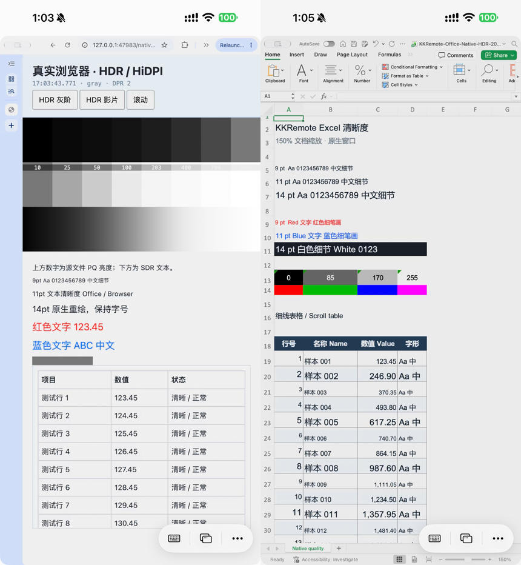

# HDR + HiDPI 工作区真实应用验证

> 构建 41 历史记录。最新构建 42 已消除最后一次适配缩放、修复窗口恢复，并将虚拟工作区放在内屏右侧以避免左侧 Dock 迁移，见 [精确像素与窗口恢复验证](精确像素与窗口恢复验证.md)。

2026-11-15，USB 构建 41，iPhone 15 Pro Max。**真实 Chrome 和 Excel 已同时验证原生源像素、可读字号和现有 Main10/Ponte 链路；HDR 工作区也保留了超过 SDR 白色的实际高光值。** 这是一轮可行性和画质验证，不是无损显示或零冻结验收。

原 Host、45990 / 45991 端口和私有配对文件未改变。没有发布新的 TestFlight。没有改变物理内屏的分辨率、刷新率或颜色配置。

## 已实现

- `Tests/NativeWorkspace.m --hdr` 在独立实验 helper 中启用 HDR 虚拟显示模式，探测运行时 selector，要求实际显示具备 EDR 能力。当前 macOS 27.2.1 报告 1280×1440 点、2560×2880 backing、2×、60 Hz、EDR 5。未传 `--hdr` 的旧 SDR 路径保留。
- 使用 P3 原色 / D65 描述工作区。运行时确认 `initWithWidth:height:refreshRate:transferFunction:` 的最后参数为 unsigned int；本机 mode 1 提供 HDR。没有修改系统私有库，也没有复制其他项目实现。
- 复用严格原生采集路径：真实窗口为 645×1310 点，原生采集、编码和手机解码均为 **1290×2620**；`pointPixelScale=2`、`scalesToFit=false`，不经过旧的 860×1746 插值路径。
- 传输画布 3,379,800 像素，小于 2560×1440 的 3,686,400 像素预算。虚拟桌面较大只是为了容纳窗口，不对整个桌面编码。保持 60 fps 上限、20 Mbps 预算、QP 上限 16、原 Ponte UDP v2/socket 策略。
- 修复真实 Chrome 的标题匹配：SCK 标题不带 ` - Google Chrome`，AX 标题带后缀。仅接受已观察到的精确 Chrome 后缀，仍要求 PID、CG 窗口、几何和唯一 AX 对象匹配；拒绝任意子串、其他应用和含糊匹配。窗口布局和既有控制授权共用同一规则。

参考的是 BetterDisplay 官方的 [HDR 虚拟屏能力说明](https://github.com/waydabber/BetterDisplay/issues/5257) 和 [虚拟屏配置文档](https://betterdisplay.pro/guide/interface-reference/settings/displays/virtual-screen/)。本机没有安装 BetterDisplay，本轮不宣称测试了它的二进制。REA 服务未连接，证据来自本地 Objective-C 运行时探针、公开参考和实际采集，不冒称 REA Evidence 记录。

## 字号与实际应用

Mac 仍以 2× 绘制，增加真实窗口点尺寸来覆盖 iPhone 3× 视频区域；正文在栅格化之前放大 150%，抵消手机端显示成原来逻辑宽度时的字号缩小。

| 实际应用 | 内容缩放 | 验证内容 |
|---|---|---|
| Google Chrome 独立原生窗口 | 自有页面 CSS layout zoom 1.5 | 9 / 11 / 14 px 正文、红蓝文字、1 像素黑白条带、HDR 灰阶、HDR 影片和滚动表格 |
| Microsoft Excel | 工作簿视图 zoom 150% | 9 / 11 / 14 pt 字体、白底/深底文字、SDR 灰阶、细线表格和翻页 |

浏览器的 px 与 Excel 的 pt 是各自排版单位，不能当作所有应用字体实际物理大小一致的证明。150% 对应的是同一应用前后字号补偿。Excel 单元格是 SDR，本轮验证它在 HDR 传输中的文字和白色，HDR 高光验证由浏览器完成。

普通应用的菜单和标题栏仍为系统 2× UI。没有实现跨应用自动缩放，也没有宣称任意应用都能适配手机竖屏；应用最小宽度、弹窗、工具栏密度继续属于产品适配范围。Ego 自动化空间未作为最终采集对象，最终选中的是普通 Chrome 原生窗口。

## HDR 的实际证据

独立 `HDRWorkspaceCaptureProbe` 仅捕获自有夹具中 PID、window ID 和标题完全一致的窗口，导出原生 P010 luma，而非用 PNG 判断 HDR。

| 源素材标称 PQ 亮度（nit） | 10 | 25 | 50 | 100 | 203 | 400 | 700 | 1000 |
|---|---:|---:|---:|---:|---:|---:|---:|---:|
| 虚拟工作区采集的 10 位 PQ 中位码值 | 365 | 431 | 487 | 544 | 602 | 655 | 697 | 724 |

同帧 SDR 文档白色为码值 572。高光仍递增且超过 SDR 白色，说明虚拟显示器没有把它们全部截为 SDR 白色。手机灰阶阶段解码样本最高值为 724，仍是 P010 / BT.2020 / PQ，包含非 8 位对齐的值；手机报告 EDR 8，实际呈现选择 HDR（`desktopColors=false`），显示队列无失败。

这些数值**经过主机合成器的色调映射，不等于逐码原样透传**。没有色度计测量手机物理亮度；PNG 截图只能检查布局和空间细节，不能证明实际 nit 值或代替 HDR 色彩标定。

## 真机短测结果

每个有效会话约 51 秒统计，下面排除前 5 秒；没有用长测取代产品体验工作。

| 项目 | Chrome 灰阶 → 影片/滚动 | Excel 静态 → 翻页 |
|---|---:|---:|
| 接收 fps，中位 / 范围 | 60 / 55–64 | 60 / 56–64 |
| 解码耗时中位 | 3.81 ms | 3.79 ms |
| 实际视频 Mbps，中位 / 最大 | 0.66 / 7.11 | 0.24 / 1.98 |
| 解码丢帧计数 | 0 | 0 |
| 显示失败 / 背压丢帧 | 0 / 0 | 0 / 0 |
| SDK 冻结计数 | 4 | 2 |

影片与表格同时运动的选定 15 秒区间为接收 60 fps 中位、实际 3.79 Mbps 中位。20 Mbps 是预算，不强制静态文字耗尽带宽。灰阶文件是静态图封装在 60 fps 视频中；真实 HDR 影片源为 23.976 fps，浏览器还有 60 fps 页面更新，因此不能把传输 60 fps 称为影片有 60 个独立原始画面。解码耗时不是端到端延迟，本轮没有光学端到端时延测量。

SDK 冻结计数保留，不声称零卡顿，也未继续追查。手机截图显示 Wi‑Fi，本轮不能标为蜂窝 5G 验收；Ponte 外层路径未观测。

同一 300 列、每列 1 源像素的条带，测量中央 290 列的奇偶列灰度差：源 PNG 为 254/255，手机 PNG 为 178.06/255。手机仍能区分原生单像素交替，明显不同于旧插值路径约 1/255 的结果；数值受 PQ 截图转换、有损编码和呈现缩放共同影响，不能解释为标准画质评分或单独的编码损失。

[浏览器原图](data/hdr-hidpi-browser-phase1.png)、[HDR 影片与滚动原图](data/hdr-hidpi-browser-phase2.png)、[Excel 原图](data/hdr-hidpi-office-phase1.png)、[Excel 翻页原图](data/hdr-hidpi-office-phase2.png)、[结构化结果](data/2026-11-15-hdr-hidpi-workspace.json)。

## 仍需收敛的边界

1. 虚拟屏使用私有 CoreGraphics 运行时，仅验证本机系统；独立 helper 与 iOS App 分离，未作为正式发布依赖。低版本系统、重启恢复、多显示器和无头环境尚未验证。
2. 编码尺寸 1290×2620，实际视频视口约 1290×2619。客户端整窗 fit 会产生极小的非整数缩放；需要以后以有效内容矩形 / 偶数编码 padding 协调到最终像素边界。此轮没有擅改 iOS 布局。
3. HEVC 4:2:0 和量化仍会损失彩色细字，原生源充足不等于无损 RGB 桌面。
4. 断开后两扇测试窗均回到物理屏，但最终为 645×1084，**原始宽窗口尺寸没有完全恢复**。现有恢复过程受跨屏尺寸钳制/动画影响，需后续双阶段 move / resize 事务；不能沿用自建 AppKit 夹具成功的结果宣称普通应用已全部通过恢复。
5. 跨应用缩放适配、窗口修饰和移动布局由后续产品/iOS 任务处理；偶发冻结继续留档。

## 复测与交接

- `Tests/NativeWorkspace.m`：编译后以绝对状态文件路径加 `--hdr` 启动。实际 display ID 从状态文件读取，不能写死 12。
- `Tests/Fixtures/window-capture/native-hdr-workspace.html`：由 `scripts/serve-capture-fixture.py` 在 loopback 提供既有 HDR / 灰阶素材，用普通独立浏览器窗口打开。
- `Tests/Fixtures/window-capture/create-office-native-fixture.py --output-dir <临时目录>`：需要 openpyxl，生成自有工作簿；不包含外部链接、宏和用户文档。
- `Tests/HDRWorkspaceCaptureProbe.swift`：记录原生源点/像素和 P010，仅用于自有夹具。采集输出目录传应用可写的绝对路径。
- `Tests/HDRWorkspaceDeviceTests.swift`：独立 USB XCTest target，使用已有连接偏好，断开后导出报告。浏览器和 Excel 测试均通过；另已通过重启 App 后 HDR 模式保留测试。
- `bash scripts/test-window-quality.sh`、`bash scripts/test-signaling.sh` 通过；Chrome 标题规则包括拒绝其他应用、不同窗口和伪后缀的回归。
- 本轮结束已停止诊断 / XCTest，手机普通启动为 USB 构建 41；已保存 HDR 显示选项，保留原连接参数。Mac 继续监听，独立 HDR helper 继续存在，自有浏览器灰阶与 Excel 工作簿可直接选取。

当前运行指针为忽略的 `.build/iphone-resume-20261114/ready-host.json`，详细状态为 `.build/hdr-workspace/host-state.json`、`workspace.json`。物理内屏最终仍为 3456×2234 / 1728×1117 / 60 Hz。不能用这些本机临时路径、显示 ID 或测试窗口 ID 作为正式 SDK 契约。
