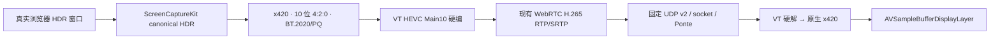

# HEVC Main10 / HDR 真实窗口验证

2026-11-13。目标为 **2560×1440、60 fps、20 Mbps 视频预算上限**。本轮实现保留 WebRTC M157、固定 UDP v2、socket 桥接和原有配对方式。异地客户端需要新的内部 TestFlight 构建；构建 5 仍可接收 H.264 SDR 回退。

## 实现



- `HEVCCodec.swift` 通过公开 RTC 编解码工厂接入 VideoToolbox，要求硬件会话、Main10、10 位输出、实时模式及关闭帧重排。码率随 WebRTC 分配变化；一秒 DataRateLimits 限制累计输出，不增加填充数据。
- VT 长度前缀 NAL 转为 Annex B，关键帧带 VPS/SPS/PPS；接收端重建格式和硬解会话。保留 WebRTC 的分包、重组、NACK/RTX、PLI 和拥塞控制。只支持本次固定尺寸单层路径，不声称 I420 转换、动态缩放或多层编码已经兼容。
- **没有替换 SDK 或使用私有 ABI。** 已固定的 stasel/WebRTC 157.0.0 底层包含 H.265 RTP；公开默认工厂未列出 HEVC，并不等于底层不可用。真实 RTP 回环确认自定义工厂能贯通这份二进制，原生 CVPixelBuffer 未经过 8 位 I420 转换。
- ScreenCaptureKit 使用 canonical HDR 预设并明确要求 x420、BT.2020/PQ、2020 矩阵。每帧核验实际附件；本机能直接输出，因而没有添加 GPU 转换。最低系统/其他硬件若输出不符会报错，不会改标签伪装 HDR。
- 接收端用系统色彩管理的 `AVSampleBufferDisplayLayer`，保留解码色彩附件。应用只保留一个最新待提交帧，使用立即显示，避免另加时间戳播放队列；显示层忙时丢弃待显示帧。显示层内部及物理屏幕延迟仍须真机测量。
- 接收能力通过随包附带的自生成 1440p Main10 关键帧实际硬解检测。协商只增加可选 `videoFormat` 字段；旧客户端选择 H.264 时先确定 SDR，再启动 SDR 捕获。HDR/SDR 改变需重连。
- JSON schema 6 增加捕获/解码实际像素格式、色彩标签、10 位亮度样本和屏幕当前/潜在 headroom。回调帧率不等于物理显示帧率；headroom 也不是实测峰值亮度。

## 本地结果

主机为 Apple Silicon、macOS 27.2.1，显示器继续使用已确认的 60 Hz。窗口 1280×720 点、2×，传输 2560×1440；视频处于窗口内容区，不能把整个传输帧都算作全屏影片。以下均为同机两端，不代表 15mac LAN 或异地 Ponte。

| 测试 | 结果 | 解释 |
|---|---|---|
| 原生 Main10 直接编解码，12 秒 | 718 提交 / 编码 / 解码，错误 0；首行 1,928 个样本低两位非零 | 实际 10 位梯度；简单图案码率很低，不是 20 Mbps 压测 |
| HEVC 位流核验 | ffprobe：Main10、yuv420p10le、BT.2020、PQ、2020 non-constant matrix、video range | 不只检查设置参数成功 |
| 合成梯度经 RTP，35 秒 | 预热后编码 60.00 / 解码 60.04 fps，0.272 Mbps，SDK 冻结 0 | 验证 packetizer/depacketizer 与原生帧链路 |
| 真实 Chrome 窗口 + PQ 60 fps 参考片，120 秒 | 预热后编码 **59.919** / 解码 **59.928 fps**，接收 **13.399 Mbps**；秒级最低 59 fps | 上限 20 Mbps；内容未填满码率是正常现象 |
| 上述 120 秒无损回环 | SDK 丢帧 / 冻结 / NACK / PLI / RTP 丢包均为 0 | SDK RTX 统计包含探测/填充，不能把非零 RTX 接收数直接当作实际丢包重传 |
| 显示层实际窗口探针 | 180 帧接收 / 入队，readyForDisplay=true，替换/背压丢弃/显示错误均为 0，主屏 headroom=16 | 验证系统层能呈现，不是光学亮度/色准认证 |
| 1% 周期丢包 + 200 ms 连续中断，45 秒 | 人为丢弃 427 外层包，154 NACK，427 RTX 发送；一次 SDK 冻结，随后恢复 | 25 秒后平均解码 **59.901 fps**，最大回调间隔 **26.44 ms**，无继续累积冻结 |
| H.264-only 接收端 / 无 HDR 字段，25 秒 | 回退 H.264 SDR，解码 **59.926 fps**、17.949 Mbps，SDK 冻结 0 | 兼容行为模拟；不冒充旧构建 5 的新一轮真机实测 |
| 真实 Apple HDR 影片窗口，45 秒 | 捕获/解码均为 10 位 BT.2020/PQ；窗口回调 59.943 fps、3.718 Mbps、SDK 冻结 0 | 影片本身 23.976 fps；浏览器时钟让窗口按 60 Hz 更新 |
| HDR 常驻主机重连 | 两次有效视频会话、错码拒绝、同一主机 PID/密钥、10 位 PQ 解码通过 | 使用隔离测试端口与测试码，未修改用户原配对文件 |

稳态统计通常排除前 10 秒；恢复测试排除前 25 秒。平均 fps 由累计帧数差除以相对时间差得到，Mbps 为秒级样本均值。恢复测试末段与 SDR 回退测试曾短时重叠约 10 秒，故其性能数值仅用于恢复和兼容验证，正式无损基线使用独立 120 秒运行。

丢包恢复测试捕获 / 解码的 2,048 个抽样中，分别有 589 / 816 个样本低两位非零，最大 PQ code value 744 / 746；附件均为 x420 / BT.2020 / PQ / 2020 matrix。该证据确认数字链路没有截成 8 位，但不单凭码值估算屏幕实际 nits。

120 秒基线末次窗口的平均编码约 9.83 ms、解码约 1.45 ms、抖动缓冲约 16.29 ms。它们来自不同统计区间，**不能简单相加作为端到端延迟，也不是每帧 P95**；控制 RTT 单独记录。

脱敏汇总与原始报告 SHA-256 见 [本地统计 JSON](data/hdr-main10-local-20261113.json)。原始报告留在本机私有测试目录。

## 素材与复现

60 fps 参考片由 `scripts/generate-hdr-fixture.sh` 生成，明确标注为 10 位 PQ code-value 测试图，不冒充真实摄影 HDR 素材。另用 [Apple Advanced Stream](https://developer.apple.com/streaming/examples/advanced-stream-dv-atmos.html) 的 hvc1/PQ 4K 影片验证真实 HDR 内容；该片原生 **23.976 fps**，浏览器 60 Hz 更新不代表影片有 60 个不同帧。下载的影片与捕获内容均留在忽略的本地目录，未提交到仓库。

```bash
bash scripts/build-lab.sh mac-release
bash scripts/test-main10.sh
bash scripts/test-hdr-renderer.sh
bash scripts/test-signaling.sh
bash scripts/test-media.sh
python3 scripts/test-persistent-host.py --hdr --window-id WINDOW_ID
```

真实窗口回环使用 Release 可执行文件，参数：

```text
--self-test --hdr --window-id WINDOW_ID
--resolution 2560x1440 --fps 60 --mbps 20
--route fixed-udp-v2 --bridge-transport socket --pacing interactive
--duration 120 --report PRIVATE_VIEWER_JSON --host-report PRIVATE_HOST_JSON
```

`--simulate-loss` 仅允许与 `--self-test` 一起使用：第 5–15 秒每 100 个 RTP 包丢 1 个，第 15–15.2 秒丢全部 RTP；正常主机不会启用。`--sdr-receiver` 在测试接收端只注册 H.264 并省略 HDR 能力字段。

## 交付与未完成项

代码已通过 Mac Release、iOS Simulator 构建及 iOS build 6 签名归档。**0.1.0（6）于 08:22（本机时区）上传成功**；Apple 返回 processing。App Store Connect 浏览器登录过期，已交给用户重新登录，处理完成、合规状态及 Development 内部组关联尚待确认，不能宣称手机已可安装。上传有现有 WebRTC 二进制缺少 dSYM 的非阻断警告，影响 SDK 崩溃符号化，不影响本次上传成功。

Mac 已切换为常驻 HDR 优先主机，原 Ponte 地址、TCP/UDP 端口与配对文件保持不变。当前显式窗口播放真实浏览器中的 60 fps PQ 参考片；旧接收端选择 H.264 时采集 SDR，新接收端确认 Main10/PQ 后才启动 HDR 捕获。

尚未完成异地 iPhone 的新构建安装、真实屏幕 HDR 亮度/白点/色偏对照、10–30 分钟热稳定性与网络退化测试。系统版本矩阵、15mac HDR 能力、iPad、Tailscale、输入、移动布局、音频均不在本轮已通过范围。当前称为 **Main10 PQ HDR 路径**，未实现 Dolby Vision、HLG、HDR10+ 动态元数据，也不伪造整个合成窗口的 mastering/MaxCLL 元数据。
