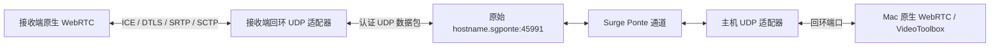

# Ponte 固定 UDP 媒体实验

> 本文记录 `fixed-udp-v1` 的历史实验。当前 v2 封装、发送节奏与双机高码率复测见 [高码率排队优化](高码率排队优化.md)。

更新：2026-11-12。当前实现是 M0 实验适配器。**已通过两台 Mac 经 Ponte 的视频与控制测试，Surge 确认使用 LAN 通道；尚未验证异地公网通道或远程 iPad。** Tailscale 按当前优先级延后。

## 1. 实现与数据路径



- `45990/TCP`：原有 TLS 1.2 PSK 信令；主机每次启动生成新的 256 位配对密钥。端口可改。
- `45991/UDP`：实验媒体入口，主机可改；通过认证信令告知接收端。接收端主动建立 UDP 路径，主机只响应通过本次认证的接收端。
- 媒体仍由 WebRTC 编解码、拥塞控制、pacing、RTCP/NACK/恢复与 DTLS-SRTP/SCTP 保护。适配器不解密或重新编码媒体，不增加外层重传，也不把视频放进 TCP/DataChannel。
- 新模式剔除信令 SDP 内的网络候选，不交换原生网络候选；每端仅向 ICE 注入自己的回环适配端口。适配器只接收本端实际收集到的 WebRTC 回环端口。它不是把 SDP 的 LAN 地址替换成 `.sgponte`。
- 外层通过 `Network.framework` 直接连接原始主机名，交给当前系统/Surge 路由。不改 Surge 全局策略，不新增公网服务，不自动切换到直接 LAN ICE 或 TCP 视频。
- `direct-ice` 兼容模式保留，允许使用旧客户端；该模式不约束实际物理接口。

选用这条路径是为了验证现成 libwebrtc 与 Ponte 能否组合工作。它增加了一次本机 UDP 转发、分片和包认证开销，仍需与后续源码级 socket 适配对照，不能据此宣称已经得到最终传输架构。

## 2. 包格式与资源限制

`fixed-udp-v1` 的外层头为 32 字节：magic/version、方向、类型、序列号、包 ID、分片序号/数目、原包长度；末尾为 32 字节 HMAC-SHA256。每个会话通过 TLS 发送新随机媒体密钥，HKDF-SHA256 用会话 ID 与方向派生收发认证密钥。内层仍使用标准 WebRTC 加密，外层认证只保护适配器入口。

| 限制 | 当前值与行为 |
|---|---|
| 外层 UDP payload | 最大 1232 字节；含适配器头和认证标签，不含 IP/UDP/Surge 开销 |
| 单分片内容 | 最大 1168 字节 |
| 单个内层 UDP 包 | 最大 16384 字节；不是视频帧上限，视频帧已由 WebRTC 分包 |
| 未完成重组 | 最多 64 个，每个 250 ms 到期；先验 HMAC、结构与重放再分配 |
| 重放保护 | 8192 个序列槽，每方向 64 KiB；允许有界乱序，拒绝重复/过旧包 |
| 应用发送队列 | 最多 256 个待发外层包、32 个 in-flight；等待超过 25 ms 丢弃 |
| 本机读取批量 | 每次最多 16 个内层包，给网络完成回调与定时器让出执行机会 |
| 未认证 UDP 连接 | 最多 4 个，2 秒清理；认证后固定为一个接收端 |
| 连接超时 | UDP 认证 15 秒；已认证后 8 秒无数据；媒体协商后 30 秒无首帧报错 |

这些是适配器边界，**不是对 WebRTC pacer、内核或 Ponte 内部队列的总时延保证**。大 RTP 包会拆成两个外层包，增加包率；MTU 与重组参数仍需异地/移动网络测试。

## 3. H.264 与测量修正

本次定位了 Mac 默认 H.264 工厂只声明 Level 3.1 的问题：720p 自检通过不能证明 1080p/1440p 能编码。新工厂先要求 VideoToolbox 接受 1440p60、High 5.1 硬件会话配置，再在工厂能力中声明 High 5.1，保留原有能力作为兼容项；iOS 沿用 SDK 的设备能力。通过正常协商选择等级，不直接改 SDP profile。配置接受不等于持续帧率或所有设备解码能力已通过验收。

新增指标包括实际 `codecParameters`、源帧/编码帧、编码/解码耗时、jitter buffer、发送延迟、首次解码回调时间、丢帧/冻结、控制探测计数，以及适配器队列/分片/认证统计。`sendDelayMilliseconds` 来自 WebRTC `totalPacketSendDelay` 的相邻差值除以同期发送包数；不能用适配器队列很短代替这个指标。

`endpointScope` 只描述 socket 地址：Ponte 的远程连接在主机侧也可能呈现为本地 Surge 代理的回环地址。**回环地址不等于单机测试，虚拟地址也不证明异地路径。** 需结合两端进程所在设备与 Surge 诊断。单机自检的报告 `mode=local-loopback` 始终表示单设备。

## 4. 本轮实测

发送端为 Apple Silicon Mac，macOS 27.2.1；接收端为 Intel MacBookPro11,4、macOS 15.8.1。使用 Release、真实 VideoToolbox H.264、固定 UDP 适配；前 10 秒不计入稳态统计。每组仅 30–40 秒，属于连通性与瓶颈定位，不是长期稳定性或严格 A/B 排名。

| 双机测试 | 实际视频均值 | 接收帧率均值 | 控制 RTT P95 | jitter buffer 秒级均值的 P95 | 结论 |
|---|---:|---:|---:|---:|---|
| LAN 地址，1080p60 网格，25 Mbps 上限 | 5.13 Mbps | 60.05 fps | 9.68 ms | 17.54 ms | 视频与控制通过 |
| `.sgponte`，1080p60 网格，25 Mbps 上限 | 5.24 Mbps | 59.90 fps | 13.64 ms | 18.84 ms | Ponte 媒体通过，外层为 LAN |
| `.sgponte`，1080p60 噪声，80 Mbps 上限 | 44.08 Mbps | 38.65 fps | 422.16 ms | 909.71 ms | 压力测试未达到低延迟目标 |

两个网格测试均未报告丢帧、冻结、RTP 丢包或适配器队列丢弃。80 Mbps 压力测试出现 3293 个累计 RTP 丢包、26 个丢帧、1 次冻结；主机发送延迟秒级均值的 P95 约 1992 ms。不能把“仍有画面”记为高码率验收通过。

单机经自身 `.sgponte` 的 1440p60 噪声测试覆盖了 20/45/80/120 Mbps 阶梯，实际 payload 约为 18.8/42.6/75.9/113.7 Mbps。发现一次读取 128 个内层包会压住发送完成回调，造成应用队列按数量溢出；改成 16 个、保留 25 ms 时限并扩大有界突发容量后，120 Mbps 重测约 **114.7 Mbps、53 fps 中位数、控制 RTT P95 4.06 ms，主机适配器队列丢弃为 0**。

这仍没有达到低延迟目标：同一重测的主机 WebRTC 发送延迟秒级均值 P95 约 586 ms、接收 jitter buffer 秒级均值 P95 约 251 ms。噪声是刻意制造的极端内容，不是桌面画质得分；实际源帧为 60 fps，并不保证编码/接收 60 fps。控制 RTT 也不是输入到显示延迟。

本轮没有修改 Surge/Tailscale 全局配置。Surge 的独立 Ponte 诊断确认双机通道通过 LAN 建立；没有测试公网直连、NAT 穿透或中继。原始报告、地址、诊断与配对文件不提交仓库。

## 5. 复现与远程测试

单元/集成与兼容检查：

```bash
scripts/test-signaling.sh
scripts/test-media.sh
scripts/build-lab.sh mac-release
scripts/build-lab.sh simulator
.build/DerivedData/Build/Products/Release/KKRemoteLabMac.app/Contents/MacOS/KKRemoteLabMac --self-test
.build/DerivedData/Build/Products/Release/KKRemoteLabMac.app/Contents/MacOS/KKRemoteLabMac --self-test --route direct-ice
python3 scripts/benchmark-media.py --rates 20,45,80,120 --duration 40
```

Release 保持 sandbox 与 hardened runtime，应用和嵌入框架使用同一开发签名；需要本机开发身份和 `Config/Signing.local.xcconfig`。可用 `MAC_SIGN_IDENTITY` 指定身份。`mac` 仍是可用 ad-hoc 签名的 Debug 构建。没有关闭 library validation 来绕过框架签名。

在另一台已允许 SSH 的 Mac 安装同版本 Release 包后：

```bash
python3 scripts/benchmark-remote.py \
  --ssh viewer-mac \
  --remote-app /Users/your-user/KKRemoteLabTesting/KKRemoteLabMac.app \
  --host sender-name.sgponte --network 'Surge Ponte' \
  --resolution 1920x1080 --fps 60 --mbps 25 --pattern grid --duration 40
```

脚本只使用已有 SSH 访问；配对码经 SSH stdin 传输，存放在两端 App sandbox 内的私有临时测试目录，结束后清理配对文件。报告复制到 `.build/remote-bench/`。接收端到时导出并退出，主机随后收到连接结束，可能以诊断退出码 1 退出；脚本保留两端报告，以接收端成功状态和持续视频/回声为连通性条件。性能验收要另看报告，不能只看脚本返回码。

手工 App 流程：两端选择“固定 UDP（Ponte）”；主机启动，接收端填主机 `.sgponte`、信令端口和本次配对码。媒体端口以主机协商值为准。与待审核的 TestFlight **0.1.0（2）** 连接时只能选旧的原生 ICE；该构建不包含固定 UDP 适配器，iPad 的新模式需发布新版后测试。

## 6. 接下来的技术关口

1. 先约束编码输出与 WebRTC pacer 的帧龄，核实高复杂度内容下的码率突发、帧率适配与发送队列；应用层 25 ms 队列不能解决内层已经排队的包。避免用强制最低码率压满链路。
2. 对照相同内容/设备的原生 ICE、固定 UDP + LAN、固定 UDP + Ponte，区分编解码、适配器、物理链路和覆盖网代价。需要长时测试与丢包/切网/后台恢复。
3. 发布包含新模式的 iOS 测试构建，验证远程 iPad 真机的 UDP、解码、前台生命周期和端到端呈现；再考虑 iPhone。
4. 之后恢复 Tailscale 验证，并推进 HEVC/HDR、自建 libwebrtc socket 适配或 QUIC 对照。窗口捕获与移动布局继续排在传输关口之后。

依据：[Surge Ponte 官方说明](https://manual.nssurge.com/features/ponte.html)、[上游 H.264 能力声明](https://webrtc.googlesource.com/src/+/refs/heads/main/sdk/objc/components/video_codec/RTCH264ProfileLevelId.mm)、[上游 H.264 工厂](https://webrtc.googlesource.com/src/+/refs/heads/main/sdk/objc/components/video_codec/RTCVideoEncoderFactoryH264.m)、[WebRTC pacing controller](https://webrtc.googlesource.com/src/+/refs/heads/main/modules/pacing/pacing_controller.cc)。上游 main 用于解释机制，实际包仍固定为 M157 社区二进制，具体行为以本次实测为准。
