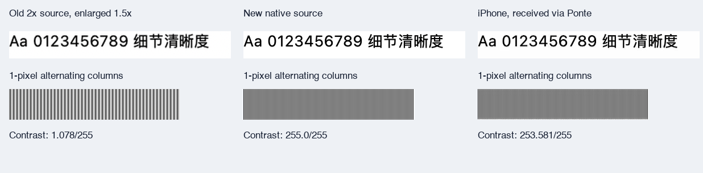

# 原生源像素工作区验证

后续进展：构建 41 已完成 HDR 工作区和真实 Chrome / Excel 测试，见 [HDR + HiDPI 真实应用验证](HDR-HiDPI工作区真实应用验证.md)。本文构建 40 的 SDR 限制和自建夹具恢复结果为历史记录，不覆盖新测试结果。

2026-11-15，USB 构建 40，自建 AppKit 实窗 → 原 Ponte 链路 → iPhone 15 Pro Max。

**已打通真正的 1290×2620 源端采集和真机接收。** 旧源为 860×1746；本次增加的是应用重新绘制的像素，不是在编码前或手机上放大旧画面。原连接地址、端口和配对文件均未改变；未上传 TestFlight。

## 原因和实现

Mac 内屏为 3456×2234 像素、1728×1117 点、60 Hz。窗口按手机的 430×873 点布局，在 Mac 原生 2× backing 下只有 860×1746 像素；手机视频区域需要 1290×2619 像素。整块 Mac 屏幕的像素数不能自动变成一个小窗口的像素数。

本次采用独立的临时 HiDPI 工作区，逻辑尺寸 1280×1440 点、物理尺寸 2560×2880、60 Hz。它容纳 645×1310 点的实窗，AppKit 以原生 2× 重新绘制，得到 1290×2620。物理内屏的模式没有改变。只在原物理屏上增大窗口会被 AppKit 钳制到 1084 点高，因此并不足以完成竖屏目标。

- `MobileWindowSizing.nativeSourcePoints` 根据客户端点尺寸、`displayScale`、工作区 backingScale 和既有像素预算计算源窗口尺寸。
- Host 显式参数 `--native-workspace-display-id <id>` 启用这条实验路径。它与 `--window-text-quality` 插值路径互斥。
- 已认证选窗事务先停止旧媒体，再把同一 PID / window ID / AX 对象对应的窗口移到指定工作区并调整尺寸；采集确认实际原生像素满足目标后才启动。
- 原生路径设置 `captureResolution = .best`、`scalesToFit = false`，不启用 RGB Lanczos 转换。工作区、预算或应用最小尺寸不满足时明确失败，不悄悄放大低分辨率源。
- 切换或断开时尝试恢复所移动窗口的原位置和尺寸；对象必须仍属于原进程，且未被本地用户另行移动。异步事务取消后不再继续调整窗口。硬崩溃后的持久恢复尚未实现。
- 保持 Main10/PQ 编解码、20 Mbps 预算、60 fps 上限、QP 上限 16 及原 Ponte 策略。

为了维持原来手机上的字号，自建夹具在**字体和矢量栅格化之前**采用 150% 内容绘制比例；字体实际写入更大的 backing store。这不是将已有图片放大。普通应用同样能获得更大的原生窗口，但还需要该应用的内容缩放（例如 150% 页面缩放）才能保留同样的字号和布局密度；系统标题栏不会因此自动变成 3×。

## 真机证据

| 项目 | 源窗口点尺寸 | 原生采集 / 手机解码像素 |
|---|---:|---:|
| 原竖屏源 | 430×873 | 860×1746 |
| 新竖屏源 | 645×1310 | 1290×2620 |
| 新横屏源 | 1221×645 | 2442×1290 |
| 切回竖屏 | 645×1310 | 1290×2620 |

竖屏源像素增加约 2.25 倍，面积仍低于 2560×1440 的既定预算。手机全屏为 1290×2796，扣除状态区域后的视频区域为 1290×2619；编码为满足偶数尺寸多出一行。因此这不是把整台手机的全部像素都称作视频区域，也不承诺最后呈现完全没有亚像素适配。

测试夹具绘制 300 列黑白交替细线：在新的内容绘制比例下每列恰好占一个源像素。测量同一静态条带的偶数列和奇数列平均亮度之差（8 位截图值，非标准画质评分）：

| 路径 | 交替列差值，最大 255 |
|---|---:|
| 旧 2× 源以 Lanczos 放大 1.5× | 1.078 |
| 新原生源 | 255.000 |
| 新路径的 iPhone 实际截图 | 253.581 |

旧源无法分辨该频率，出现的是较粗的混叠条纹；新的手机截图仍保留逐列交替。这个证据区分了“增加编码尺寸”和“真的增加源端细节”，但不能代表所有彩色文字、运动画面的画质。



完整真机图：[竖屏原图](data/native-source-pixels-phone.png)。结构化数据：[测试记录](data/2026-11-15-native-source-pixels.json)。

两轮有效真机测试完成选窗 → 竖屏 → 横屏 → 竖屏 → 断开，解码和显示 API 未报错。最终恢复的 AX frame 与初始值一致：`(20, 43, 430, 873)`。最新媒体代次的 9 秒报告中，去掉前 3 秒后接收 fps 中位数为 60，解码耗时中位约 3.31 ms；实际码率约 0.224 Mbps，因为画面主要静止、仅页脚运动。这**不是**持续 20 Mbps 或高负载 60 fps 验收，亦不构成冻结问题已解决。

手机截图显示 Wi-Fi，本轮不能标为蜂窝 5G 验收。Ponte 外层路径仍未观测。

## 实验边界与 HDR

1. `Tests/NativeWorkspace.m` 通过私有 CoreGraphics 运行时创建显示器，独立于 iOS App 和默认 Host。它是本地可行性验证，不是可直接发布的正式实现，也没有 Mac App Store 兼容保证。
2. 跨应用 AX 窗口控制不能放在 App Sandbox 中运行。本轮用独立 entitlement 覆盖构建本地控制 Host；默认沙盒配置、iOS 签名不改，仍检查系统辅助功能和屏幕录制授权。依据：[Apple Accessibility Programming Guidelines](https://developer.apple.com/library/archive/documentation/Cocoa/Conceptual/Accessibility/cocoaAXIntro/cocoaAXintro.html)。
3. **该虚拟工作区只报告 EDR 余量 1.0。** Main10/PQ 链路不等于源端 HDR 高光得到保留。当前客户端的桌面色彩显示模式也转为 SDR UI；本轮验证原生空间细节，不能宣称虚拟工作区 HDR 验收通过。真实 HDR 内容应继续使用已验证的物理 HDR 显示路径，或后续接入可验证的 HDR 工作区。
4. HEVC 4:2:0 和量化仍有损；原生源像素充足不等于无损桌面。应用字号缩放、标题栏与移动布局由后续应用适配和 iOS 体验阶段处理。
5. 原生模式默认关闭。旧客户端未提供 `displayScale` 时不能启用这个严格模式；普通 Host 的兼容路径保持不变。

Apple 的 [backingScaleFactor](https://developer.apple.com/documentation/appkit/nswindow/backingscalefactor) 和 ScreenCaptureKit 的 [pointPixelScale](https://developer.apple.com/documentation/screencapturekit/sccontentfilter/pointpixelscale) 是两个应实际读取的尺度，不能用手机的 3× 数值覆盖 Mac 的实际 backing。实验运行时接口参考了 [Chromium 的 macOS 虚拟显示测试实现](https://chromium.googlesource.com/chromium/src/+/HEAD/ui/display/mac/test/virtual_display_util_mac.mm)。

## 重现与当前运行状态

- `bash scripts/test-window-quality.sh`：原生源尺寸、工作区高度不足、横屏尺寸、预算越界与既有质量转换回归。
- `bash scripts/test-signaling.sh`：密度字段兼容、窗口协议和 TLS 配对回归。
- `Tests/WindowQualityFixture.swift --native-drawing`：初始小窗，选窗后由 Host 移动并调整；`--native-client-pixels --display-id <id>` 用于独立原生采集探针。
- `Tests/NativeDensityCaptureProbe.swift`：只采集夹具元数据中 PID、ID、标题均匹配的窗口；输出目录应传绝对路径。
- `Tests/NativePixelDeviceTests.swift`：复用已保存端点，验证实际视频尺寸、方向切换及断开。用于独立 UI 测试 target，不包含连接秘密。

本地控制 Host 构建覆盖：

```sh
xcodebuild -project KKRemote.xcodeproj -scheme KKRemoteLabMac \
  -configuration Release -destination 'platform=macOS' \
  -derivedDataPath .build/native-density/Host \
  CURRENT_PROJECT_VERSION=40 ENABLE_APP_SANDBOX=NO \
  CODE_SIGN_ENTITLEMENTS=Config/TransportLabMac-NativeWorkspace.entitlements build

xcrun clang -fobjc-arc -fblocks -framework AppKit -framework CoreGraphics \
  Tests/NativeWorkspace.m -o .build/native-density/NativeWorkspace
```

工作区进程状态在忽略的 `.build/native-density/workspace.json`；Display ID 必须从本次状态读取，不能跨重启写死。Host 启动参数在同目录 `host-state.json`，原端点的 ready-host 指针已同步。私有日志与采集图保留在 `.build/native-density/` 及 Mac App 原有本地容器，配对秘密不写入文档或仓库。

当前留下临时工作区和原端点的实验 Host 供继续体验；iPhone 为 USB 构建 40，普通启动、不带自动测试倒计时。使用“KKRemote Native Quality Fixture”可重现本轮效果。

停用时先从客户端断开，让选中窗口恢复；再停止实验 Host、恢复之前的普通 Host 参数，最后终止 workspace 状态文件记录的专用 helper。不要在有活动窗口租约时先移除显示器。临时 helper 未设置登录启动。
