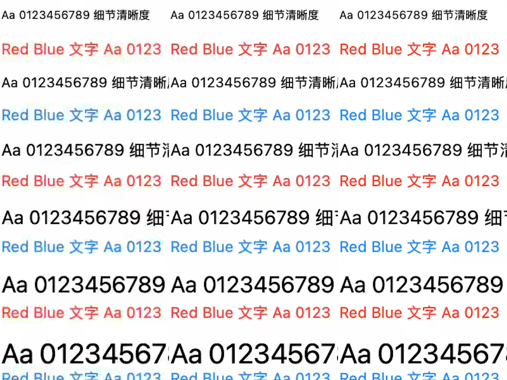

# 真实窗口文字画质改进

2026-11-14。通信侧接回 iPhone 后的专项验证；不替代 iOS 交互验收。

后续进展（2026-11-15）：[原生源像素工作区验证](原生源像素工作区验证.md) 已用更大的真实 backing store 打通 1290×2620 源采集和 USB 构建 40。下文保留构建 39 的历史对照，不能将 RGB 插值实验与新的原生重绘混为一谈。

**当前保留配置：USB 构建 39，原生窗口采集 + HEVC QP 上限 16。** RGB 高分辨率路径已实现并验证画质收益，保留为显式实验选项，当前测试 Host 未启用它。原 Ponte 地址、端口和配对信息未变。

## 根因与本轮范围

Mac 内屏实际为 3456×2234 像素，逻辑工作区为 1728×1117 点、60 Hz。屏幕并不低清。
手机自适应窗口为 430×873 点，Mac 的原生 2× 窗口采集只有 860×1746 像素；iPhone 的显示区域为 1290×2619 像素。
原链路在较小画面上先完成 P010 / 4:2:0 转换和编码，再在手机放大。文字边缘同时受到源采样、色度采样和编码量化影响。

本轮使用自建 AppKit 窗口，内容为中英文 9–22 点文字、彩色笔画、单像素线条和表格。没有编辑用户文档。
截取同一静态文字区域，并用真实滚动窗口检验持续更新。源窗口是实窗捕获，不是直接向编码器喂测试图。

## 实现

- `WindowViewport.displayScale` 为可选字段。客户端传入屏幕密度；逻辑宽高、AX 窗口尺寸和输入坐标保持原定义。旧客户端缺省时仍走原生像素路径，旧服务端忽略新字段。
- Host 显式启用 `--window-text-quality` 时，使用 ScreenCaptureKit 的原生 RGBA half-float 捕获，先以 Lanczos 完成一次 RGB 缩放，再转为 BT.2020 / PQ P010。保留 10 位编码和 HDR 数值范围。
- 手机竖屏的编码尺寸为 **1290×2618**，属于原有 2560×1440 像素预算之内；原生采集仍为 **860×1746**，日志与遥测分别记录这两种尺寸。这不是原生 3× 渲染。
- 新增 Host 参数 `--hevc-max-qp 16`，限制过度量化。保留 20 Mbps 码率预算、无 B 帧、原关键帧与 Ponte 队列策略。配置值和实际 QP 观测分开；不能把配置上限当成已经测得的逐帧 QP。
- 转换输出池最多保留 8 个缓冲，编码尺寸和像素面积有上限。耗尽时记录 `text_pixel_conversion_failed`，不无限分配。捕获遥测增加原生尺寸与转换耗时。

质量选项保持显式启用。高熵视频在严格量化上限与码率上限同时作用时可能丢帧；本轮验证对象是桌面文字和滚动内容，不将该档位宣称为所有视频的最优默认值。

## 对照证据

本机离线测试使用相同 P010 采集帧，经生产 HEVC 编解码重复 180 帧。20 Mbps 是预算，不能要求静止画面持续填满码率。

| 原生 860×1746 文字区域 | 原配置 | QP 上限 16 |
|---|---:|---:|
| 首个解码帧 PSNR | 22.56 dB | 35.92 dB |
| 第 120 帧 PSNR | 35.20 dB | 36.17 dB |
| 解码成功帧 | 180 / 180 | 180 / 180 |

这些数值只描述该夹具与测量区域，不代表所有窗口的画质分数。

手机进行了三组相同实窗对照：原配置、仅限制量化、限制量化并在 RGB 阶段缩放。原始截图的固定区域经 ICC 色彩转换后，与未压缩 RGB 采集图的同尺寸 Core Image Lanczos 参考比较：

| ROI 平均绝对误差（8 位 RGB，越低越好） | 原配置 | 仅 QP 16 | RGB 缩放 + QP 16 |
|---|---:|---:|---:|
| 9 点黑字 | 10.40 | 3.59 | 6.03 |
| 12 点红字 | 32.17 | 25.90 | 18.47 |
| 12 点蓝字 | 36.18 | 23.20 | 15.95 |
| 22 点黑字 | 5.79 | 2.17 | 4.74 |

新路径明显减少彩色笔画周围杂色。黑字与彩字的最优设置并不完全相同；RGB 路径的偶数编码高度与手机奇数显示高度会带来额外的亚像素重采样差异。此处没有将所有 ROI 都宣称为更优。
该参考只衡量对已有原生采样的保真度，不是字体在原生 3× 渲染时的真值。

对照截图（左：原配置；中：仅 QP 16；右：RGB 缩放 + QP 16）：

## 验证与使用

两轮均为同一真实滚动夹具，连接后持续约 126 秒，iPhone 15 Pro Max，测试结束时热状态均为 `fair`：

| 指标 | 原生采集 + QP 16（当前保留） | RGB 缩放 + QP 16（实验） |
|---|---:|---:|
| 手机接收 fps 中位数 | 59 | 60 |
| 每秒统计 fps 最小 / 最大 | 33 / 69 | 49 / 76 |
| 手机接收视频码率中位数 | 2.52 Mbps | 1.98 Mbps |
| WebRTC `freezeCount` | 9 | 9 |
| WebRTC `framesDropped` | 0 | 0 |
| 解码 / 显示 API 失败 | 0 / 0 | 0 / 0 |
| 显示队列替换旧帧 | 187 | 238 |
| 显示背压丢弃 | 5 | 2 |
| 手机末次 physical footprint | 274 MiB | 339 MiB |

两条路径都记录到冻结，**不能据此将冻结归因于新增 RGB 转换，也不能宣称稳定 60 fps 已通过**。
当前优先保留黑字误差更低、解码与内存成本更低的原生质量档。RGB 档可在色彩细节优先的场景继续评估。
高分辨率档增加的发送端 RGB 转换 P95 约 3–4 ms，编码回调 P95 约 15 ms；原生档编码回调 P95 约 9 ms。这些都不是输入到屏幕的端到端延迟。
本轮按用户已有收敛要求记录偶发冻结，不恢复冻结根因长测。两分钟 footprint 观测也不构成内存泄漏结论。

- `bash scripts/test-window-quality.sh`：像素预算、应用最小窗口尺寸、异常密度、HDR 灰阶锚点、缓冲池上限与回收。
- `bash scripts/test-signaling.sh`：新旧视口兼容，原 TLS 配对和分帧回归。
- `Tests/WindowQualityFixture.swift`：自有 AppKit 窗口；`--capture-probe` 只采集自身窗口。输出目录中的 `scroll.flag` 控制真实滚动。
- `Tests/WindowQualityCodecProbe.swift`：离线生产编解码对照；通过 `scripts/test-window-quality.sh <采集目录> [QP 上限]` 执行。
- 真机通过 USB 安装，使用原 Ponte 主机名、端口和配对信息。本轮截图显示 Wi-Fi，不能标注为蜂窝 5G 验收。外层 Ponte 直连/中继路径仍不可从 RTP 候选类型判断。

完整数值与构建记录见 [验证数据](data/2026-11-14-window-quality.json)。本轮不上传 TestFlight，不改 iOS 手势、键盘或布局。

## 保留边界

1. 增大输出尺寸不能补出 Mac 2× 源端没有画出的细节。若要达到原生 iPhone 3× 文字效果，需要更大的源端渲染窗口配合应用缩放，或专用远程工作区方案；不能只改编码宽高。
2. 两端现有桌面呈现模式仍会将 PQ 画面转换为 SDR UI。本轮校验了传输转换的 HDR 数值保留，不替代真实 HDR 影片的屏幕亮度验收。
3. 自建夹具的输入控制未列为验收项；帧率和图像对照不证明触控、AX 或中文输入质量。
4. 本轮是画质专项，未重启冻结与内存增长长测，也没有覆盖全部窗口应用、弱网与蜂窝组合。
