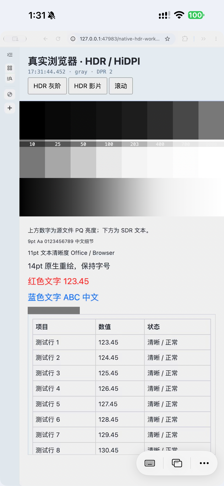
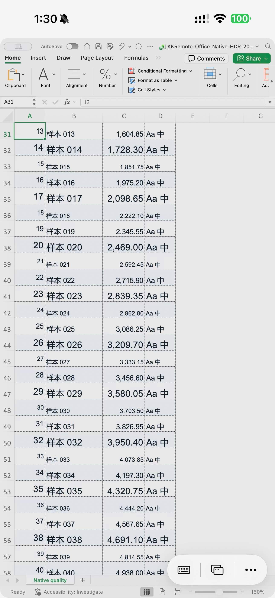

# 精确像素与窗口恢复验证

2026-11-15，USB 构建 42，iPhone 15 Pro Max。原 Ponte 地址、端口和配对保持不变；HEVC Main10 / PQ、60 fps、20 Mbps 预算，最大编码面积 3,686,400 像素。本轮为短时画质与生命周期回归，不替代蜂窝长测或冻结验收。

## 消除最后一次适配缩放

手机竖屏视频区域为 430×873 点、3×，即 1290×2619 像素。上一版将 1290×2620 的编码帧适配到该区域，产生非整数缩放。现在源端向下对齐到偶数像素，窗口为 645×1309 点，2× 原生采集得到 1290×2618；底部剩余一行不拉伸、不参与输入命中。

客户端几何和实际 AVSampleBufferDisplayLayer 分别记录，避免只凭布局计算宣称成功。两种真实应用均验证：

| 项目 | 实测 |
|---|---|
| SCK 源像素 / 编解码 / 显示层像素 | 1290×2618 / 1290×2618 / 1290×2618 |
| 显示层屏幕位置 | (0,177) 像素，整数位置 |
| 源端 `scalesToFit` | false |
| 客户端 `pixelExact` / 显示层 `pixelOneToOne` | true / true |
| 横屏目标 | 2442×1290，源窗口 1221×645 点 |

实际解码尺寸、源点尺寸与视口不匹配时，客户端沿用普通适配；不会把旧帧标成精确像素。输入和显示使用同一几何，余量不命中远端。客户端实现及 2,403 项几何断言、33 项原生组件验证见 [iOS 精确像素几何](iOS精确像素几何.md)。

## 源应用、细线与 HDR

浏览器使用自建真实 Chrome 页面，文档 CSS zoom 为 150%；Excel 使用专用工作簿、文档缩放 150%。这些设置让文字在源端重新绘制，以补偿 Mac 2× 与手机 3× 的密度差；没有实现任意应用的自动内容缩放。

同一条一像素黑白竖线的 8 位截图亮度差：源图 254/255，构建 41 手机 178.059/255，构建 42 手机 239.187/255。源图 ROI 为 (165,1600,290,10)，手机为 (165,1777,290,10)。这是细线保真对照，不是 HDR 绝对亮度、PSNR 或无损声明；HEVC、4:2:0 色度和系统颜色转换仍可能损失细节。

独立 SCK P010 源帧为 BT.2020 / PQ，八级灰阶码值依次为 365、431、487、544、602、655、697、724，与上一版一致。手机显示余量实测 8，虚拟工作区 EDR 5。浏览器的真实 HDR 影片和滚动表格用于动态检查；影片素材本身约 23.976 fps，不把 60 fps 串流当作影片原生 60 fps。

## 窗口进入与恢复

旧恢复顺序在窄虚拟屏上先要求原宽度，会被系统限制；异步调整又可能让 AX 与窗口服务器暂时同时报告旧尺寸。现在进入和退出都按“缩小到两屏均可容纳的尺寸 → 移动 → 调整到最终尺寸”执行，等待 AX 与实际窗口几何均达到每一步的目标。

恢复租约保留精确窗口身份、连接前位置和尺寸、最后一次由本会话施加的几何。切窗先等前一窗口恢复，重选同窗先等其恢复任务结束。窗口消失、原屏不可用或本地用户已改变位置时停止恢复；不会仅凭标题找一个替代窗口。原生目标未达到时报告失败，不把中间尺寸当作成功。

初轮回归还发现了进入工作区的同类问题：Excel 在切窗时被旧最小尺寸推断放大到 1012×1402 点。该失败留在 `.build/pixel-exact/motion.xcresult`；随后将原生入口改为上述精确三阶段流程。

最终 `.build/pixel-exact/motion-final.xcresult` 全部通过：HDR 影片和滚动、竖转横（2442×1290）再转竖（1290×2618）、Chrome → Excel → Chrome、断开并重新连接。六个检查点的 `pixelExact`、实际图层 `displayOneToOne` 均为 true，显示失败均为 0。浏览器操作通过客户端现有输入通道执行，收到 3 次输入确认；没有借此重写客户端交互。

已实测断开后的原窗口恢复：Chrome 回到 (148,33)、645×1084 点；Excel 回到 (40,33)、1688×1084 点。后者特意比虚拟工作区宽，覆盖之前的宽度被截断问题。成功日志要求实际几何验证通过，不以 AX 设置返回成功替代。

## 工作区位置与 Dock

此前 helper 创建的虚拟屏被系统排在内屏左侧，导致左侧 Dock 转移；这是实验工作区的副作用。现在先记录现有屏幕位置与模式，再将新工作区排在现有屏幕最右侧，并核验原屏未改变。当前虚拟屏原点 (1728,0)，内屏仍为原点 (0,0)、1728×1117 点 / 3456×2234 像素、60 Hz，Dock 仍在内屏左侧。

只提交当前进程有效的屏幕排列，不修改 Dock 偏好、不修改内屏模式。镜像显示或不能保持原显示状态时拒绝继续。该 helper 仍使用实验私有 CoreGraphics API，仅验证当前 macOS 27.2.1；签名、发布兼容、睡眠唤醒、多屏与崩溃恢复尚未完成。

## 短测数据与证据

两轮各约 52 秒，排除前 10 秒初始化后统计如下。20 Mbps 是预算，静态与轻量滚动不需要持续消耗该码率；本轮截图显示 Wi-Fi，不归类为蜂窝 5G 验收。

| 内容 | 接收 fps 中位 / 范围 | 实际 Mbps 中位 / 峰值 | 解码中位 | 解码丢帧 / 显示失败 / SDK 冻结 |
|---|---|---|---|---|
| Chrome 灰阶、文字、细线 | 60 / 57–63 | 0.371 / 1.371 | 3.89 ms | 0 / 0 / 0 |
| Excel 静态及翻页 | 60 / 57–64 | 0.271 / 2.586 | 3.83 ms | 0 / 0 / 0 |

显示队列最新帧替换分别为 10 和 9，不能混同于显示失败或宣称零掉帧。以上解码耗时不等于物理端到端延迟。偶发冻结调查继续后置，短测的零计数不证明历史问题已经解决。

验证入口：`Tests/HDRWorkspaceDeviceTests.swift`、`Tests/HDRWorkspaceCaptureProbe.swift`、`Tests/NativeWorkspace.m`。本机证据在 `.build/pixel-exact/`；汇总见 [机器可读数据](data/2026-11-15-pixel-exact-workspace.json)。Mac 与 iOS Release 构建、源像素 / 信令测试通过；180 帧 Main10 硬件渲染回归通过。未提交新的 TestFlight 构建。

真机现已恢复普通启动，主动测试结束。原地址和配对继续使用，Host 保持监听；当前 helper / Host 指针分别为 `.build/pixel-exact/workspace.json`、`.build/iphone-resume-20261114/ready-host.json`。若收回实验工作区，应先断开并确认窗口恢复，再停止这两个指针所对应的自有进程，不要停止其他显示服务。
