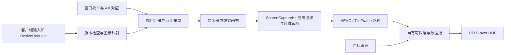
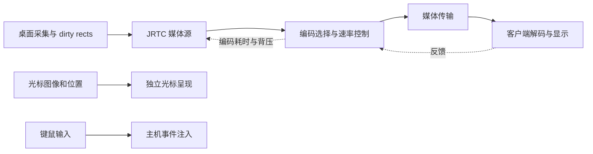
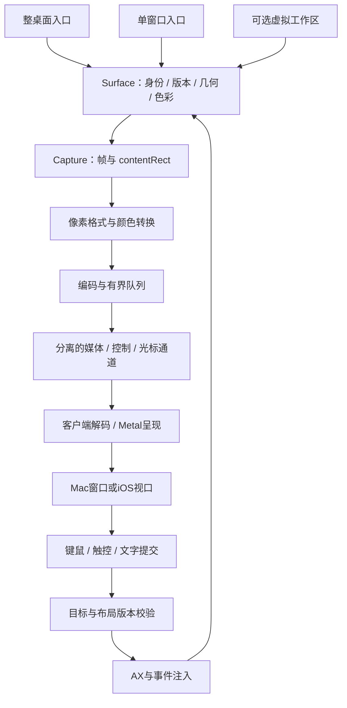

# KKRemote 方案评审

日期：2026-11-12。状态：**历史评审材料，A路线已选定；未开始产品实现。**

用户随后明确窗口优先、Tailscale/Surge Ponte、高码率低延迟；整屏远程延后，多主机窗口工作区只预留。当前执行依据为[窗口优先架构](design/窗口优先架构.md)与[分阶段实施计划](design/分阶段实施计划.md)。下文路线比较和旧阶段表保留为研究背景，不再作为待选范围或当前排期。

## 建议选择

建议选择 **A：Apple 原生媒体链路**，先实现桌面与现有窗口两种入口，优先打通 Mac → Mac，再交付同一协议的 iPad/iPhone 客户端。第一版明确以局域网或已有 VPN 为连接条件。窗口工作区先用公开 API；Casement 式虚拟画布作为单独的技术验证项。文字清晰层作为后续升级，而不是第一版同时自研整个媒体系统。

这个建议基于你的优先级：Apple 平台、Retina/HDR、窗口体验和触控。**如果“无需 VPN、从任意网络直接连接”是首发硬要求，应改选 B。** 如果“彩色小字接近本机、对标 Jump 的高质量模式”高于首版交付速度，应选择 C 或给 A 增加 C 的第二阶段。

## 本次分析改变了什么判断

| 原始问题 | 当前证据支持的解释 | 对 KKRemote 的影响 |
|---|---|---|
| Casement 画面不清晰 | 已检查的路径为 BGRA/sRGB 采集、HEVC Main/Rec.709 编码，且设置编码速度优先；touch 平板档 scale cap=1.5、码率 cap=6 Mbps，手机档为2.0/4 Mbps。最终还有宿主/显示器限制，尚未测出你实际连接用了哪一档 | 先把采集像素密度、编码格式和带宽限制分别显示/记录，避免只加一个“高清”开关 |
| Casement 没有 Retina 体验 | 存在 backing scale、HiDPI 虚拟显示和缩放协商；“完全没有 HiDPI 能力”不成立 | 检查是否真实以 2× 渲染/采集，不能把 1× 视频放大称为 Retina |
| Casement 没有 HDR 体验 | 被检查的基础采集与 HEVC 初始化路径是 8 位 SDR；不是对所有未执行路径的穷尽证明 | HDR 要从采集到显示全程协商，不能仅换 HEVC 编码器 |
| 画面出现鼠标 | Casement 和 Jump 已检查的采集路径都设置 showsCursor=false；Casement 有独立 CursorUpdate | 直接触控默认不显示远程光标；鼠标/触控板才显示客户端光标。仍需客户端证据才能诊断现有问题 |
| 窗口对手机适配不好 | Casement 有虚拟画布、cell、窗口 resize 与布局版本机制，远超截图缩放 | 布局适配、视频尺寸和输入坐标必须作为同一事务同步 |
| Jump 为什么更流畅 | 已确认脏区读取、媒体轨道、编码反馈、背压节流和独立光标路径 | 借鉴分层、反馈和队列控制；不能仅选相同 codec 就预期相同体验 |

本表的本地证据、地址和限制见 [Casement 研究](research/casement.md) 与 [Jump 研究](research/jump.md)。未采集移动客户端、真实连接码流或用户手势时间线，因此没有声称已定位全部体验问题。

## 两款软件的核心结构

### Casement：远程窗口工作区

本次静态分析显示，它不仅枚举窗口并编码，还管理窗口的摆放、大小、焦点和对应画布。已观察到 WindowRegistry、WindowPipeline、VirtualCanvas/HeadlessCanvas/MirrorCanvas、CellGeometry，以及窗口布局版本和帧确认相关结构。

关键区别是：已检查的 cell 路径使用 **显示器上的应用过滤，再按区域裁剪**，并非所有情况都调用独立单窗口捕获 API。这种组织方式为菜单、弹层及应用关联窗口提供了处理空间，也把虚拟显示、坐标换算、窗口迁移和恢复变成了产品核心。具体哪些关联窗口被包含，仍需要逐场景验证。

`processFrame` 的实际调用证明了 TileDiff、Classifier、LosslessLedger 以及无损图块/HEVC 分支，另有安静后的 settle 恢复。因此 Casement 已有兼顾运动与静态细节的机制；本轮没有穷尽分类阈值、恢复时限和每一种 tile codec。当前网络构造链明确为 DTLS + UDP，上面有自己的可靠传输层，不能因二进制里出现 QUIC 字样就认定它使用 QUIC。官网也描述设备间直连与外网使用 Tailscale 的方式。[Casement 网络说明](https://casement.win/en/security)

### Jump：带实时反馈的桌面媒体系统

本机 JumpConnect 的 ScreenCaptureKit 回调读取帧与 dirty rects，并交给 JRTC 媒体源；还有将区域转换为16×16活动格的路径。编码路径具有 H.264/HEVC 分支、Main10 配置与编码完成回调，另有节流/恢复路径。客户端具有解码及渲染组件，光标与控制输入独立于视频。WebRTC.framework/JRTC 的存在与这些调用共同支持“使用 WebRTC 相关基础设施并有自身媒体层”的判断，但不能据此认为 Fluid 是可直接兼容的标准 WebRTC 协议。

官方把 Fluid 2.0 软件编码和 Hardware 编码分开，并提供 4:2:0/4:4:4、8/10 位等档位；Mac 硬件编码的能力表不包含 4:4:4。**10 位、HDR、广色域和颜色直通是不同能力。** 本轮没有证明你当前 Jump 连接的具体组合。[Jump 编码说明](https://docs.jumpdesktop.com/viewer/performance/codecs/)

## 三条可选路线

以下投入是方案估算，不是实测结论或交付承诺。假设两名熟悉 Apple 图形/音视频的工程师，完成可测试内测版，含三个客户端形态的必要交互；对应下面的 P 窗口范围，不含 V 虚拟画布、Windows、浏览器、商业后台和大规模发行。阶段0结束后重新估算。工程周表示总投入，不能机械地除以人数得到日历工期。A/B是底座选择，C是在其上追加的画质路线。

| | A：Apple 原生链路，推荐 | B：WebRTC 公网优先 | C：桌面文字画质优先 |
|---|---|---|---|
| 媒体基础 | SCK → VideoToolbox → 原生传输 → VT/Metal | SCK → 适配 libwebrtc 编码/媒体轨道 → 原生接收器 | A 或 B 加静态区域精细更新层 |
| 首版网络 | 局域网/已有 VPN；QUIC streams + datagrams 为候选 | 信令 + ICE/STUN/TURN；必须实测中继回退 | 继承 A/B，另有图块调度与版本同步 |
| 最强项 | Apple 像素/色彩路径可控、依赖较少 | 公网连通性、现成媒体反馈机制 | 彩色小字、细线和静态 UI 的还原 |
| Retina | 显式处理源 backing scale 和客户端像素，三种路线都必须做 | 同左，WebRTC 不替你解决窗口尺寸 | 同左，精细层不能补回源本就没有的像素 |
| HDR | Main10 + 色彩元数据 + EDR 显示，先做端到端验证 | 固定 libwebrtc 版本验证 HEVC/10bit/metadata，不能承诺默认支持 | 视频层支持 HDR；精细层也要保持相同色彩空间 |
| 文本质量 | 4:2:0 硬编起步，不能承诺等同 Jump High | 同样取决于实际 encoder 和色度格式 | 无损/近无损 RGB 图块或可用软件 4:4:4 路径 |
| 首要风险 | 应用层码率/优先级要配合QUIC拥塞控制，帧截止与丢包恢复仍需设计 | 构建维护、扩展编码器与色彩路径；TURN 带宽成本 | 缓存一致性、滚动撕裂、HDR 混合、移动端功耗 |
| 粗略投入 | 16–24 工程周 | 20–32 工程周 | 以 A/B 为基础另加 12–20 工程周 |
| 适用条件 | 先把 Apple 平台体验做好，接受先用 VPN | 公网随处连是首发要求 | 愿意投入更久追求接近本机的桌面细节 |

QUIC DATAGRAM 提供不可靠数据报，但仍受拥塞控制约束；关键帧请求、图块版本、帧超时和输入状态恢复仍要设计。[RFC 9221](https://www.rfc-editor.org/rfc/rfc9221.html) Apple Network 提供 QUIC 选项及 datagram 接口，但接口存在不代表已验证目标系统上的媒体表现。[Apple QUIC](https://developer.apple.com/documentation/network/nwprotocolquic/options)

WebRTC 可以使用 TURN 解决无法直连的场景；要把服务器部署和回退测试计入方案。[WebRTC TURN](https://webrtc.org/getting-started/turn-server)

## 独立于传输路线的窗口决策

### P：先串流现有窗口，作为基础能力

桌面入口用 display filter；窗口入口先用 desktop-independent window filter。窗口使用 AX 管理可调整的尺寸和焦点；弹窗、菜单、sheet 作为关联 surface 或受控区域补充，不能假定单窗口捕获会自动包括所有界面。公开API下的SCWindow与AX窗口对应必须单独验证；同进程窗口有相同标题或几何时，不可凭标题猜测。匹配不唯一则拒绝窗口级操作或退回桌面模式，不能悄悄引入私有桥接。

优点是依赖明确、适合验证清晰度与交互。代价是远端窗口仍属于同一个 macOS 登录会话，调整大小/焦点可能影响本机使用。不承诺两个人在同一账号中完全独立操作。

### V：增加 Casement 式虚拟工作区

将远程应用窗口安排到可控画布，按终端尺寸生成布局，再输出每个 surface。适合 iPhone/iPad 的独立工作台与多窗口组合，但需额外处理窗口迁移、关联弹层、显示器重建、断连恢复和 HiDPI/HDR 模式。

本机 Casement 使用了 CGVirtualDisplay 与 AX 窗口 ID 桥接相关能力。当前检查的公开 SDK 头文件未声明 CGVirtualDisplay / _AXUIElementGetWindow；应按非公开依赖处理并隔离在可替换后端。**虚拟显示器并不等于独立登录会话，也不自动得到独立键盘焦点。** 是否采用这条路线，先用验证结果决定，不能作为无风险基础设施。

建议组合：**A + P 为首版范围；V 先验证再决定是否纳入；C 作为画质升级。** 如果你需要的“窗口串流”必须像 Casement 一样替你管理独立远程工作台，则选 **A + V**，并接受额外的兼容性验证和维护投入。

## 共用架构：两种入口，一套会话

Surface 的标识至少包含会话、资源 ID 和 generation；帧/输入另带 layoutRevision，媒体帧包含streamEpoch与frameSequence。编码器重建、格式或分辨率切换时更新streamEpoch并丢弃旧帧。关闭后重建的窗口不能沿用旧授权和旧坐标。窗口 resize 确认必须返回实际尺寸，等待新布局首帧后再切换输入映射。[详细契约](design/contracts.md)

### 清晰度与 HDR

Retina 的根本是应用实际渲染的像素密度：例如 1000×700 points 的 2×窗口应有约 2000×1400 源像素，再依据设备能力决定是否降采样。统一记录 sourcePoints、sourceBackingScale、capturePixels、encodedPixels、clientViewport 和显示缩放。不能只提高码率。

HDR 链路需要：HDR 源采集 → 保留足够精度的像素格式 → 明确 primaries/transfer/matrix/range → 支持的编码/解码 profile → 客户端 EDR/HDR 呈现。普通 10 位 SDR 仍然是 SDR。接收端不具备能力时做可验证的 tone mapping；不能简单丢弃高位。ScreenCaptureKit 有 HDR 配置与 preset，可作为实现起点。[Apple HDR 捕获](https://developer.apple.com/videos/play/wwdc2024/10088/)

文字与运动分开验收。4:2:0 即使高码率也不能保证彩色细字与 4:4:4 一致；第一版先评估高质量硬编能否满足你，只有不足时再承担 C 的复杂性。

### 触控和光标

移动端提供直接触控与触控板两种明确模式。直接触控隐藏远程指针并提供本地触点反馈；触控板/硬件鼠标显示独立低延迟指针。手势的点击、拖拽、滚动与本地缩放各有状态机；不要让同一次拖动同时平移视口和拖动远端对象。

手指触点最终通常需要翻译成 macOS 鼠标/滚轮事件，不应承诺把所有 Mac 应用变成原生多点触控应用。缩放和窗口重排也不能让桌面软件获得原本没有的响应式布局。对最小窗口宽度过大的应用，退回可平移视口和精确指针。

中文输入以客户端组合输入和提交文字为单独路径，物理快捷键为另一条路径。软键盘弹出先调整可见视口，避免每个键盘动画帧都触发远端 resize。Mac 客户端需明确本地与远端快捷键归属、多窗口焦点和剪贴板方向。

### 队列、网络和恢复

捕获、编码、发送和显示都有有界队列。丢帧优先在编码前丢弃过期原始帧；已编码的参考帧不能随意删除，否则需要恢复/关键帧机制。光标位置可覆盖过期状态；按键和按钮的 down/up 必须可靠、去重，并在重连/失焦时恢复，防止粘键。

同一连接承载三个逻辑域：可靠控制（配对、surface、resize、按键状态）、有截止时间的媒体（帧/分片/恢复）、可覆盖状态（指针位置、最新测量）。控制消息不排在大块视频后面。媒体反馈跟踪 frame age、编码耗时、排队长度、丢包和 RTT，不能只根据带宽设置固定码率。

音频以会话/应用为单位，避免每开一个窗口重复采集同一进程音频。交互模式限制视频等待；观看模式允许以音频为时钟增加少量缓冲。[Apple 采集语义](https://developer.apple.com/videos/play/wwdc2022/10155/)

## 实施顺序与停止条件

| 阶段 | 将来要做的工作 | 进入下一阶段的条件 |
|---|---|---|
| 0 技术验证 | 固定设备，检查源像素密度、HDR采集/解码/显示、窗口弹层、最小化、焦点；如选 V，单独验证虚拟画布 | 关键能力有实测记录；失败则缩小范围或换路线，不直接铺产品 UI |
| 1 Mac → Mac 闭环 | 桌面/窗口共用surface，SDR Retina，配对和控制，独立光标，重连 | 桌面和窗口切换无错位；连续输入无粘键；队列不无限增长 |
| 2 移动体验 | iPad/iPhone布局、直接触控/触控板、IME、旋转、软键盘、窗口尺寸事务 | 不误点、不把本地缩放发成远端拖拽；小屏仍可完成目标工作 |
| 3 画质与弱网 | HDR全链路、质量策略、延迟反馈、带宽/丢包场景；按路线增加公网能力 | 达到双方选定的清晰度和交互预算，降级行为明确 |
| 4 可选升级 | V虚拟工作区或C精细文字层、多窗口资源调度 | 用基准证明收益大于复杂度，再进入正式功能 |

详细设备矩阵、对照方法和建议验收阈值见 [验证计划](design/验证计划.md)。所有阈值均为建议目标，本轮未执行运行时性能测试。

## 当时的决策项（已更新）

1. **A / B**：已选择A；通过Tailscale/Ponte接入，不自建公网连接体系。
2. **C**：保持可选，先完成高质量硬编与低延迟，再根据文字测试决定。
3. **P / V**：当前架构从现有窗口开始；私有虚拟显示后端单独验证。新增的客户端多主机工作区独立于此选项。

当前范围以v0.2架构为准：窗口先交付，整屏后续支持，移动窗口视觉稍后专项优化，多主机只预留。
