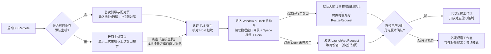
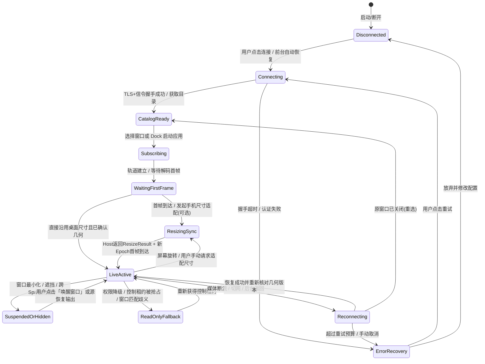

# 01 信息架构、核心用户流转与全生命周期状态机

> 本章定义 KKRemote 移动客户端（iPhone / iPad）的整体信息架构、连接入口、**Window & Dock 启动台**（对齐并超越 Casement 窗口目录体验），以及串联前后台、选窗、几何事务与异常恢复的统一状态机。

---

## 一、信息架构总览（IA）

客户端摒弃“仪表盘首页 + 底部常驻 Tab 栏 + 独立全屏按钮”的实验工具结构，收敛为 **「沉浸式工作区为主舞台，连接与目录为轻量抽屉/启动台，诊断与工程设置退居二级入口」** 的三层结构：

```
KKRemote Mobile App
├── Layer 1：启动与主机入口（未连接 / 多主机卡片）
│   ├── 快速重连主卡片（上次/默认 Mac 主机 + 网络标签 + 一键直连）
│   ├── 已保存主机列表（LAN / Surge Ponte / Tailscale；保留多主机扩展槽位）
│   ├── 添加 / 配对新主机（扫码或 6 位配对码 + TLS 指纹核验引导）
│   └── 高级连接与实验室入口（齿轮图标 → 原「设置与工具」Sheet）
│
├── Layer 2：Window & Dock 启动台（连接成功后自动/随时呼出）
│   ├── 顶栏：当前主机状态胶囊（主机名 · 链路 · RTT · 一键断开）+ 全局搜索框
│   ├── 区块 A：当前可操控窗口（按 App 分组，含实时/最近缩略图、状态徽章、尺寸标签）
│   ├── 区块 B：Mac Dock 与已安装应用（对齐 Casement：点击直接远程启动或唤起窗口）
│   └── 区块 C：进阶模式入口（如「查看完整桌面显示器」作为兜底模式，明确标识作用域）
│
└── Layer 3：全屏无界窗口工作区（主舞台）
    ├── 底层画布：ColorManagedVideo（Main10 PQ HDR / SDR）+ 边缘原生色彩融合安全区
    ├── 交互层：Direct Touch / Thumb Trackpad / Precision Loupe / Independent Cursor
    ├── 悬浮中枢：可吸附、半透明灵动控制胶囊（48pt 高度）
    │   ├── 主动作：快速换窗 / 键鼠切换 / 展开扇形快控盘
    │   └── 扩展面板（Sheet / Popover，不中断视频解码器生命周期）：
    │       ├── Mac 原生 MenuBar 投影 + 命令速搜
    │       ├── 画质与视口控制（Retina 倍率 / HDR 开关 / 锚点预设 / 概览快窥）
    │       ├── 剪贴板桥接 & 应用音频开关
    │       └── 实时诊断详情（复用 U01 详细数据 Sheet 与 JSON 报告导出）
    └── 输入浮层：原位 UITextView 覆盖 / 灵动 IME 输入条 + 情景快捷键条 + 60% Mac 软键盘
```

---

## 二、核心用户流转（User Flows）

### 2.1 冷启动到操作桌面窗口（理想路径 ≤ 2 步）



**体验关键细节**：
1. **视频容器零重建**：从“启动台”切到“工作区”，以及在工作区打开“MenuBar / 诊断 / 连接设置” Sheet 时，`HDRVideoView` / `ColorManagedVideo` 必须保持挂载在固定视图树层级，绝不因弹层造成解码器销毁或缓冲飙升（符合 [iOS测试界面改版草案.md](../docs/design/iOS测试界面改版草案.md) 的架构铁律）。
2. **后台回前台智能恢复（延续构建 16 逻辑并强化反馈）**：
   - 进入后台：主动清理未确认的中文 `markedTextRange`，发送全量按键/鼠标释放，停止媒体连接并记住 `hostID + windowIdentity (number + pid + title + appBundleID)`。
   - 返回前台：延时避让 Host 1 秒监听重建窗口（约 1.2–1.5s），自动重连并重新拉取目录；若**精确匹配**原窗口身份（非仅靠标题），自动无缝续播；若原窗口已关闭/身份模糊，自动弹出启动台并在顶部柔和提示“原窗口已关闭，请选择其他窗口”，**绝不盲目控制同名新窗口**。

---

### 2.2 Window & Dock 启动台设计（对标 Casement + 信息降噪）

Casement 的核心魅力之一是“像打开 iOS 原生 App 一样打开 Mac 应用”。单纯的文本列表（如现行 `RemoteWindowsView`）在打开 15 个 Mac 窗口时检索效率较低。设计升级如下：

#### 结构分区（由上至下）
1. **顶部连接状态栏（52pt）**：
   - 左侧：Mac 设备图标 + 主机名称（如 `MBP-HOME`）+ 绿色实时链路点 + 网络与延迟摘要（`LAN · 8 ms` 或 `Ponte · 38 ms`）。
   - 右侧：刷新按钮、连接设置齿轮、红色/中性断开按钮。
2. **智能搜索栏**：支持同时搜索 **应用名、窗口标题、Bundle ID 拼音/缩写**，输入即过滤窗口与 Dock 应用。
3. **当前活动窗口网格 / 分组列表（Open Windows）**：
   - **当前正在观看的窗口**置顶高亮，附带绿色“当前连接”边框与快速返回画布按钮。
   - 其余窗口按应用聚合（如 `WPS Office (2)`、`Google Chrome (3)`、`Terminal (1)`），每张卡片展示：
     - **应用图标**（Host 缓存下发的原生 Mac `.icns` 缩略图，无图标时退回 SF Symbols）+ **窗口快照缩略图**（低频静态预览或最近缓存帧，占位以 16:10 骨架框）。
     - **窗口标题**（最多 2 行）+ **逻辑尺寸与状态标签**：如 `1280×800 · 2× Retina`、`最小化（点击唤醒）`、`位于其他桌面空间`。
     - **快捷左滑操作（Swipe Actions）**：`隐藏窗口` / `关闭远端窗口`（需二次确认，防止误关 Mac 文档）。
4. **Mac Dock 常驻应用条（Pinned Dock Apps — Casement 对齐项）**：
   - 横向滚动胶囊条，展示 Mac Dock 图标及运行指示小圆点（Running dot）。
   - 点击未运行应用 → Host 触发 `LaunchApp` 并自动等待主窗口就绪后直入工作区；点击已运行但无当前窗口的应用 → 触发激活/新建窗口。
5. **底部折叠区 — 完整桌面视图（Fallback）**：
   - 明确收起为低优先级入口「以整屏显示器模式查看」（对应 `D01/D02` 预留，避免误以为桌面模式是主流程）。

---

## 三、全生命周期与异常状态机（State Machine）

为保证任何网络抖动、权限缺失、尺寸谈判或后台切换都不产生“假死画面”、“幽灵输入”或“粘滞按键”，UI 严格绑定以下 8 个显式状态：



### 各状态的界面视觉与交互防呆约定

| 状态 | 画面表现 | 交互权限 | 界面提示策略（最小化打扰） |
|---|---|---|---|
| **Connecting** | 主页按钮变为加载态，允许随时「取消连接」 | 禁止选窗 | 简洁单行状态：`正在通过 Surge Ponte 握手…` |
| **WaitingFirstFrame** | 隐藏未就绪旧纹理（防止闪烁旧窗口残影），背景采用安全底色 | 仅允许返回启动台/断开，**禁止发输入** | 居中轻量毛玻璃指示器：`正在同步窗口画面…`（20s 超时自动提示切换窗口） |
| **ResizingSync** | 继续保留上一有效帧（可叠加 0.15s 轻微模糊或保留静态），**冻结输入发送** | 本地仅允许取消/切窗；手势输入排队丢弃不补发 | 顶部微胶囊提示：`正在适配手机窗口尺寸…`，收到新 `epoch` 首帧瞬间原子切换 |
| **LiveActive（完整控制）** | 100% 清晰实时帧（Main10 PQ HDR / SDR）+ 边缘融合 | 开放直触 / 触控板 / 键盘 / 菜单 | 所有提示退隐，仅保留半透明灵动胶囊 |
| **ReadOnlyFallback（只读观看）** | 画面正常流畅播放 | **允许本地捏合缩放、双指/单指平移**；禁用远程键鼠与菜单触发 | 胶囊旁出现 2 秒自动收起的琥珀色小锁徽章：`当前为只读观看（原因：未授予控制权/目标不唯一）` |
| **SuspendedOrHidden（暂停/最小化）** | **必须停止标为实时**，对最后帧施加静态暗化蒙版（40% 黑） | 禁止盲目点击旧画面 | 居中毛玻璃动作卡：`窗口在 Mac 上已最小化或隐藏` + 主按钮「在 Mac 上唤醒」+ 次按钮「切换其他窗口」 |
| **Reconnecting（断流恢复）** | 最后一帧灰度微暗蒙版 + **立即触发本地按键/鼠标抬起保护** | 禁用输入 | 顶部紧凑条：`网络波动，正在重新同步会话…`（带「断开」按钮） |
| **Closed（远端窗口关闭）** | 平滑退场，不保留死画面 | 自动释放租约 | 弹出非阻塞卡片：`「XXX」已在 Mac 上关闭` + 「选择其他窗口」/「从 Dock 重新打开」 |

---

## 四、研发测试页（Lab Mode）与产品模式的共存边界

根据 [iOS测试界面改版草案.md](../docs/design/iOS测试界面改版草案.md) 与任务 `U01` 的严格约束，产品界面不能丢掉通信验收能力：

1. **平时零污染**：默认进入产品级沉浸工作区（不展示 fps / Mbps / RTT / 丢包四宫格在主屏下方）。
2. **一键直达诊断面板**：
   - 在 **主机连接首页** 右上角菜单、**启动台** 顶栏、以及 **工作区悬浮胶囊的 `···` 菜单** 中，均提供「实时性能与链路诊断」入口。
   - 打开后以原生 iOS Sheet 展示全部核心指标（接收 fps、视频 Mbps、控制 RTT & P95、接收缓冲 ms、解码耗时、帧间隔 P95/最大、实际像素尺寸、编码与 PQ/SDR 色彩附件、屏幕 EDR 余量、Bridge 队列丢弃）与「生成/分享 JSON 报告」。
3. **可选紧凑悬浮遥测条（HUD Telemetry Chip）**：
   - 供研发/发烧友在诊断面板中打开开关「工作区显示微型状态条」：在灵动岛下方或安全区边角显示极细半透明单行：`59.9 fps · 12.4 Mbps · 38 ms · 10-bit PQ`（`allowsHitTesting(false)` 不拦截任何画面点击）。
